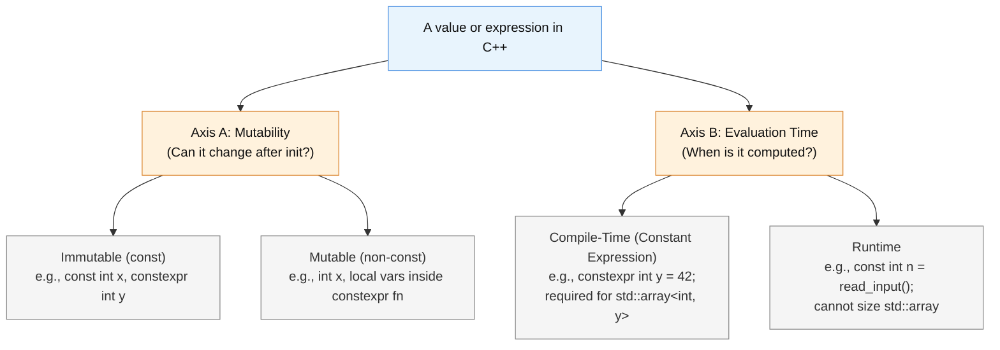
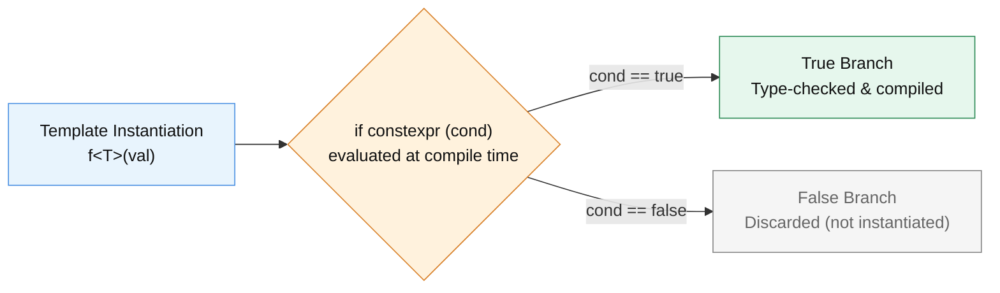

# `constexpr`: Compile-Time vs. Runtime Evaluation

::: tip What you'll learn
- Separate **mutability** (`const`) from **evaluation time** (`constexpr`) as two independent dimensions
- Master the initialization rules for `constexpr` variables, top-level `const` semantics on `constexpr` pointers, and static storage address restrictions
- Understand the dual-mode evaluation model of `constexpr` functions (compile-time vs. runtime) and how their capabilities evolved from C++11 to C++20
- Define custom user-defined types that can be constructed and manipulated at compile time (**literal types** and `constexpr` constructors)
- Use `if constexpr` (C++17) for compile-time branch discarding in templates, replacing verbose template specializations
:::

## Motivation

As we saw earlier, `const` prevents a variable from being modified after initialization, yet `const` does **not** guarantee that its value is known before the program runs:

```cpp
#include <array>

int get_runtime_value();

int main() {
    const int n = get_runtime_value();  // Valid const: initialized at runtime

    std::array<int, n> arr{};           // Error: 'n' is not a constant expression
    int raw_arr[n];                     // Error in standard C++: array bound must be constant
    static_assert(n > 0, "positive");   // Error: static_assert requires a constant expression

    switch (1) {
        case n:                         // Error: case label does not reduce to an integer constant
            break;
    }
}
```

Even though `n` is `const`, the compiler cannot know the return value of `get_runtime_value()` while translating your source code into machine instructions. Meanwhile, template arguments (`std::array<int, N>`), array bounds, `case` labels, and `static_assert` conditions must all be resolved **before the executable is ever launched**.

Before modern C++, programmers reached for two painful workarounds to compute values at compile time:

1. **Preprocessor macros (`#define`):** Text substitution before compilation. Macros ignore C++ scopes, bypass type checking completely, evaluate arguments multiple times unexpectedly, and produce cryptic error messages.
2. **Template metaprogramming (TMP):** Encoding arithmetic and loops as recursive class template instantiations. While genuinely computed at compile time, TMP forces you to write logic in a completely different, functional-style dialect that is hard to read, difficult to debug, and slow to compile.

`constexpr` solves both problems cleanly: it lets you write **normal, type-safe C++ variables, functions, and classes** that the compiler can evaluate at compile time.

::: tip When this matters most
Sizing fixed-capacity containers (`std::array`), validating invariants at compile time (`static_assert`), building lookup tables without startup overhead, writing generic template utilities (`if constexpr`), and eliminating runtime computation for known inputs.
:::

::: info When you can ignore it
When values fundamentally depend on runtime input (network packets, user keyboard input, files read from disk) or when your code performs side effects like I/O that cannot exist during compilation.
:::

::: danger First, separate mutability from evaluation time
`const` answers: *"Can this object be modified after initialization?"* `constexpr` answers: *"Can (or must) this expression be evaluated during compilation?"* Treating `constexpr` as merely "stronger `const`" hides how dual-mode `constexpr` functions and `constexpr` pointers actually work.
:::

## Core Idea & Intuition

### The two-axis mental model

When looking at any variable or expression in C++, evaluate it along two orthogonal axes:

1. **Axis A — Mutability:** Can the object's value be changed after initialization? (`const` vs. non-`const`)
2. **Axis B — Evaluation Time:** Is the value computed by the compiler during translation, or by the CPU while the program executes? (`compile-time` vs. `runtime`)



Because these two axes are independent:

- A `const` variable initialized from a runtime function sits in **(Immutable, Runtime)**.
- A `constexpr` variable sits in **(Immutable, Compile-Time)** — every `constexpr` object automatically carries top-level `const`.
- A local variable *inside* a `constexpr` function (since C++14) can be **(Mutable, Compile-Time)**: the compiler mutates it inside its own compile-time interpreter while computing the final result!

### The intuition, in one sentence

> A **`constexpr` variable** is a value guaranteed to be computed at compile time (and therefore implicitly top-level `const`), whereas a **`constexpr` function** is a **dual-mode function** ("write once, run at compile time or runtime") that executes during compilation when given constant arguments in a compile-time context, and falls back to a normal runtime function otherwise.

### Analogy — and where it breaks

::: tip Factory-etched chip ID vs. sealed field nameplate
Think of building hardware devices:
- A **`constexpr` variable** is like a serial number **laser-etched into the silicon at the factory** before the device ever ships. Before power is ever turned on, the value is already fixed and permanently baked into the hardware.
- A **`const` variable initialized at runtime** is like a **blank nameplate filled out on site** when the machine boots up and immediately covered with a tamper-evident seal. Once written, nobody can alter it (`const`), yet the factory had no idea what number would be written there until deployment.
:::

::: warning Where the analogy breaks
Calling a `constexpr` function does **not** mean "force this call to run at the factory (compile time)." A `constexpr` function is only *capable* of running at compile time. If you pass it a runtime variable (like `std::cin` input) or store its result in a plain `int` without a compile-time requirement, the compiler may execute it at runtime just like any ordinary function.
:::

## Formal Definition / Mechanism

### 1. `constexpr` variables and pointer semantics

A `constexpr` variable declaration obeys three strict rules:

1. **Mandatory initialization at definition:** You cannot default-initialize a `constexpr` variable without a value (`constexpr int x;` is ill-formed).
2. **Constant expression initializer:** The initializer must be a **core constant expression** — every value and operation used to compute it must be known and valid at compile time.
3. **Implicit top-level `const`:** Declaring a variable `constexpr` automatically adds top-level `const` to its type.

That third rule creates a classic surprise with pointers. Recall that top-level `const` applies to the **pointer object itself**, not the pointee:

* `constexpr int* p = &global_x;` is equivalent to **`int* const p = &global_x;`** — the pointer `p` cannot be aimed at another address, **but `*p` can still be modified** if `global_x` is non-`const`.
* `constexpr const int* p = &global_x;` is equivalent to **`const int* const p = &global_x;`** — neither the pointer `p` nor the pointed-to integer `*p` can be modified through `p`.

**Address constant expression restriction:** When a `constexpr` pointer (or reference) binds to an address, that address must remain constant across the lifetime of the program. Therefore, a `constexpr` pointer may only be initialized with:

- `nullptr` (or `0`), or
- The address of an object with **static storage duration** (a global/namespace-scope variable, a `static` local variable, or a `static` class data member), or a function.

Binding a `constexpr` pointer to an automatic (stack-allocated) local variable is forbidden because stack frame addresses do not exist at compile time.

| Declaration | Equivalent Type | Can reassign `p`? | Can modify `*p`? | Valid Target Address |
| --- | --- | --- | --- | --- |
| `constexpr int x = 10;` | `const int` | N/A | N/A | N/A (value, not pointer) |
| `constexpr int* p = &g;` | `int* const` | No (top-level `const`) | Yes (if `g` is non-`const`) | `nullptr` or static storage object |
| `constexpr const int* p = &g;` | `const int* const` | No (top-level `const`) | No (low-level `const`) | `nullptr` or static storage object |

### 2. Dual-mode `constexpr` functions and standard evolution

A `constexpr` function is a single definition that can be invoked in two modes:

- **Compile-time evaluation:** Guaranteed when the function is called inside a context that *requires* a constant expression (such as initializing a `constexpr` variable, `static_assert`, template non-type argument, or `case` label) **and** all arguments are constant expressions.
- **Runtime evaluation:** Occurs when arguments are only known at runtime, or when the compiler chooses not to evaluate at compile time in a non-constant context (such as assigning to a plain `int x = f(5);`).

C++ has steadily expanded what is legal inside a `constexpr` function body:

| Standard | Key Additions to `constexpr` Functions |
| --- | --- |
| **C++11** | Very restrictive: body could essentially contain only a single `return` statement (plus `static_assert`, `typedef`/`using`). Iteration required recursion; branching required the ternary operator `?:`. |
| **C++14** | Major ergonomic leap: local variables (not `static` or `thread_local`), `if`/`switch` statements, `for`/`while`/`do-while` loops, and mutating local objects inside the function. |
| **C++17** | `constexpr` lambdas (`[]() constexpr { ... }`, and lambdas are implicitly `constexpr` whenever eligible); `constexpr` algorithms/utilities expanded across the standard library. |
| **C++20** | `virtual` function calls at compile time, `try`-`catch` blocks (provided no exception is actually thrown during evaluation), `asm` declarations (if not reached), and **transient dynamic memory allocation** (`new`/`delete`, `std::vector`, `std::string`) as long as all allocated memory is freed before compile-time evaluation finishes. |

**Compile-time evaluation is a strict Undefined Behavior (UB) detector:** At runtime, undefined behavior (like signed integer overflow, out-of-bounds array indexing, dereferencing `nullptr`, or reading an uninitialized variable) might silently corrupt memory or appear to "work." During `constexpr` evaluation, the C++ standard **forbids** undefined behavior — if any execution path taken at compile time triggers UB, the compiler **must reject the program with a compile error**.

**Implicit `inline` rule:**

- Every `constexpr` function (and C++17 `constexpr` static data member) is **implicitly `inline**`, meaning you can define it in a header file included by multiple `.cpp` translation units without violating the One Definition Rule (ODR).
- By contrast, namespace-scope `constexpr` variables are **not** implicitly `inline` (they have internal linkage by default, like `const` globals). If you want a single shared address across translation units in C++17+, write `inline constexpr`.

### 3. Literal types and `constexpr` constructors

`constexpr` works with user-defined `struct` and `class` types, provided the type qualifies as a **literal type**:

1. All non-static data members and base classes are themselves literal types (such as built-in arithmetic types, pointers, references, or other literal structs).
2. The class has at least one `constexpr` constructor (or is an aggregate, like a simple `struct` with public members and no user-provided constructors) that initializes every member.
3. Prior to C++20, the class had to have a trivial destructor (C++20 lifted this restriction, allowing `constexpr` destructors).

**Subtle C++11 vs. C++14 member function difference:**

- In **C++11**, marking a member function `constexpr` implicitly made it a `const` member function (`constexpr int get() const`), preventing it from mutating member variables.
- In **C++14 and later**, `constexpr` no longer implies `const` on member functions. You can write mutating `constexpr` member functions (such as `constexpr void scale(int factor)`) and call them on local objects inside other `constexpr` functions!

### 4. Compile-time branching with `if constexpr` (C++17)

Normal `if (cond)` evaluates its condition at runtime — which means **both** the `if` branch and the `else` branch must be syntactically and semantically valid for the types involved, even if one branch never executes.

`if constexpr (cond)` evaluates `cond` at compile time (so `cond` must be a constant expression convertible to `bool`):

- When used inside a **template instantiation**, the branch not taken becomes a **discarded statement**: the compiler skips type-checking and code generation for template-dependent expressions inside the discarded branch.
- Outside templates, both branches must still be valid C++ (though only the selected branch executes).



## Step-by-Step Example

Let's build a small, self-contained program demonstrating `constexpr` variables, pointers, dual-mode functions, custom literal types, and `if constexpr`.

### Step 1 — `constexpr` variables, `static_assert`, and pointer top-level `const`

```cpp
#include <array>
#include <iostream>

int global_counter = 10;

int main() {
    constexpr int rows = 3;
    constexpr int cols = 4;
    constexpr int total_cells = rows * cols;  // Computed at compile time

    static_assert(total_cells == 12, "Grid must have 12 cells");
    std::array<int, total_cells> grid{};  // Valid array size

    // Top-level const on constexpr pointer:
    constexpr int* p_mut = &global_counter;  // Equivalent to: int* const p_mut
    *p_mut = 25;                             // OK: global_counter is non-const
    // p_mut = nullptr;                      // Error: p_mut itself is const

    constexpr const int* p_ro = &global_counter;  // Equivalent to: const int* const p_ro
    // *p_ro = 30;                                // Error: pointee is const via p_ro

    int stack_var = 5;
    // constexpr int* bad_ptr = &stack_var;  // Error: stack_var does not have static storage duration

    std::cout << "grid.size() = " << grid.size()
              << ", *p_ro = " << *p_ro << "\n";
}
```

**What happens here:**

- `total_cells` is computed during compilation, verified by `static_assert`, and used as a non-type template argument for `std::array`.
- `p_mut` has type `int* const`: its stored address cannot change, yet mutating `*p_mut` updates `global_counter`.
- `bad_ptr` fails to compile because `stack_var` lives on the runtime stack and has no fixed compile-time address.

### Step 2 — Write a dual-mode `constexpr` function

```cpp
#include <iostream>

// Uses C++14 local variables and loops inside a constexpr function
constexpr unsigned long long factorial(unsigned int n) {
    unsigned long long result = 1;
    for (unsigned int i = 2; i <= n; ++i) {
        result *= i;
    }
    return result;
}

int main() {
    // 1. Compile-time mode: constant argument + constant expression context
    constexpr auto fact_5 = factorial(5);
    static_assert(fact_5 == 120, "5! must be 120");

    // 2. Runtime mode: runtime argument from user input
    unsigned int input = 0;
    std::cout << "Enter a small non-negative integer: ";
    if (std::cin >> input) {
        std::cout << input << "! = " << factorial(input) << "\n";
    }
}
```

**What happens here:**

- `factorial(5)` runs inside the compiler when initializing `constexpr auto fact_5` — zero CPU cycles are spent computing `120` when the executable runs.
- `factorial(input)` uses the **exact same function definition** at runtime when `input` comes from `std::cin`.

### Step 3 — Create a custom literal type with mutating `constexpr` methods

```cpp
#include <iostream>

struct Vec2D {
    int x = 0;
    int y = 0;

    constexpr Vec2D(int x_val, int y_val) : x(x_val), y(y_val) {}

    // C++14+: non-const constexpr member function can mutate *this at compile time
    constexpr Vec2D& translate(int dx, int dy) {
        x += dx;
        y += dy;
        return *this;
    }

    constexpr int dot(const Vec2D& other) const {
        return x * other.x + y * other.y;
    }
};

constexpr int compute_shifted_dot() {
    Vec2D a{2, 3};
    a.translate(4, -1);  // Mutates local literal object 'a' at compile time -> (6, 2)
    constexpr Vec2D b{10, 5};
    return a.dot(b);  // 6*10 + 2*5 = 70
}

int main() {
    constexpr int result = compute_shifted_dot();
    static_assert(result == 70, "Expected dot product of 70");
    std::cout << "Compile-time dot product: " << result << "\n";
}
```

**What happens here:**

- `Vec2D` is a literal type because its members (`int x, y`) are literal types and its constructor is `constexpr`.
- Inside `compute_shifted_dot()`, `a` is a mutable local `Vec2D` object modified by `translate(4, -1)` during compile-time evaluation.

### Step 4 — Discard invalid branches cleanly with `if constexpr`

```cpp
#include <iostream>
#include <string>
#include <type_traits>

template <typename T>
std::string stringify(const T& val) {
    if constexpr (std::is_same_v<T, std::string>) {
        return val;  // Only compiled when T is std::string
    } else if constexpr (std::is_arithmetic_v<T>) {
        return std::to_string(val);  // Only compiled for numbers (int, double, etc.)
    } else if constexpr (std::is_pointer_v<T>) {
        if (val == nullptr) {
            return "null";
        }
        return stringify(*val);  // Only compiled when T is a pointer
    } else {
        return "<unprintable>";
    }
}

int main() {
    int num = 42;
    std::string text = "hello";
    int* ptr = &num;
    int* null_ptr = nullptr;

    std::cout << stringify(num) << "\n";       // 42
    std::cout << stringify(text) << "\n";      // hello
    std::cout << stringify(ptr) << "\n";       // 42
    std::cout << stringify(null_ptr) << "\n";  // null
}
```

**What happens here:**

- When `stringify(text)` is instantiated with `T = std::string`, `std::to_string(val)` and `*val` would both fail to compile if type-checked. Because `if constexpr` discards the untaken branches during template instantiation, `stringify` compiles cleanly for every type.

## Common Misunderstandings & Pitfalls

### Pitfall 1 — Assuming calling a `constexpr` function guarantees compile-time execution

::: danger False
```cpp
constexpr int square(int x) { return x * x; }

int main() {
    int a = square(10);            // NOT guaranteed to run at compile time!
    constexpr int b = square(10);  // Guaranteed to run at compile time
}
```

Storing the result in a non-`constexpr` variable (`int a`) does not require a constant expression. While an optimizer *might* fold `square(10)` into `100`, the language only guarantees compile-time evaluation when the result is used in a constant-expression context (or with C++20 `consteval`).
:::

### Pitfall 2 — Thinking `constexpr int* p` makes `*p` read-only

::: danger False
`constexpr` applies top-level `const` to the declared entity `p`, turning `constexpr int* p` into `int* const p`. The pointer cannot be reassigned, but `*p` can still be modified unless you explicitly add low-level `const`: `constexpr const int* p`.
:::

### Pitfall 3 — Binding a `constexpr` pointer to a local stack variable

::: warning Static storage duration required
```cpp
void demo() {
    int local = 7;
    // constexpr int* p = &local;  // Error: '&local' is not a constant expression
    static int persistent = 7;
    constexpr int* ok = &persistent;  // Valid: static storage duration
}
```

Automatic local variables are created on the call stack at runtime, so their addresses cannot be constant expressions.
:::

### Pitfall 4 — Triggering undefined behavior inside a `constexpr` function

::: warning Compile-time UB is a hard compiler error
```cpp
#include <climits>

constexpr int overflow(int x) {
    return x + 1;
}

// constexpr int bad = overflow(INT_MAX);  // Error: signed integer overflow in constant expression
```

A `constexpr` function definition can be completely valid yet fail to compile for specific inputs if evaluating those inputs causes signed overflow, division by zero, null dereference, or out-of-bounds access.
:::

### Pitfall 5 — Assuming namespace-scope `constexpr` variables are implicitly `inline`

::: warning Functions vs. variables
`constexpr` functions are implicitly `inline`, so putting them in a header file is safe. Namespace-scope `constexpr` variables are **not** implicitly `inline` (they have internal linkage by default). In C++17 and later, if you define a `constexpr` constant in a header and want a single entity shared across all translation units (important if you take its address `&kConst`), declare it `inline constexpr`.
:::

### Pitfall 6 — Expecting `if constexpr` to ignore syntax errors or work outside templates

::: danger False
First, discarded statements must still be **syntactically valid C++** (balanced braces, valid grammar).
Second, the statement-discarding rule only suppresses semantic errors for dependent expressions **inside a template instantiation**.
Using `if constexpr (false)` in an ordinary non-template function still type-checks both branches.
:::

## Practice Check

**Exercise 1.** For each line in `main()`, determine whether it is **guaranteed to evaluate at compile time**, **evaluates at runtime** (or is not guaranteed compile-time), or **fails to compile**:

```cpp
constexpr int add(int a, int b) {
    return a + b;
}

int main() {
    int runtime_val = 5;

    constexpr int r1 = add(2, 3);            // (1)
    int r2 = add(2, 3);                      // (2)
    constexpr int r3 = add(runtime_val, 3);  // (3)
    int r4 = add(runtime_val, 3);            // (4)
}
```

**Exercise 2.** Identify and fix the two compilation errors in the snippet below, while keeping `ptr` unable to modify the pointed-to integer:

```cpp
int g_value = 100;

void inspect() {
    int local_value = 200;
    constexpr int* ptr = &local_value;
    *ptr = 300;
}
```

**Exercise 3.** Rewrite `element_or_byte_count` using `if constexpr` so that it returns `sizeof(val)` when `T` is an arithmetic type (`std::is_arithmetic_v<T>`) and `val.size()` otherwise, without failing to compile when passed an `int`:

```cpp
#include <cstddef>
#include <type_traits>
#include <vector>

template <typename T>
std::size_t element_or_byte_count(const T& val) {
    if (std::is_arithmetic_v<T>) {
        return sizeof(val);
    } else {
        return val.size();  // Fails to compile when T is int!
    }
}
```

### Solutions

::: details Exercise 1 — evaluation timing and compilation
- **(1) Guaranteed compile-time:** Both arguments (`2`, `3`) are constant expressions, and `r1` is declared `constexpr` (requiring a constant expression initializer).
- **(2) Not guaranteed compile-time (runtime context):** Even though the arguments are literals, `r2` is a plain `int`, so the language does not require compile-time evaluation.
- **(3) Fails to compile:** `r3` is `constexpr`, so its initializer *must* be a constant expression, but `runtime_val` is not a constant expression.
- **(4) Evaluates at runtime:** `runtime_val` is a runtime variable and `r4` is a plain `int`, so `add` runs at runtime as a normal function.
:::

::: details Exercise 2 — fixing storage duration and low-level const
The two errors are:

1. `&local_value` is the address of an automatic stack variable, which is not an address constant expression. `ptr` must point to `nullptr` or a static storage object like `&g_value`.
2. `constexpr int*` is `int* const`, which still allows `*ptr = 300;`. Changing it to `constexpr const int*` makes both the pointer and the pointee `const` (and you must remove the mutation `*ptr = 300;`).

Fixed version:

```cpp
int g_value = 100;

void inspect() {
    constexpr const int* ptr = &g_value;  // const int* const pointing to static storage
    // *ptr = 300;  // Now properly prevented by the compiler
    (void)ptr;
}
```
:::

::: details Exercise 3 — refactoring with `if constexpr`
```cpp
#include <cstddef>
#include <type_traits>
#include <vector>

template <typename T>
std::size_t element_or_byte_count(const T& val) {
    if constexpr (std::is_arithmetic_v<T>) {
        return sizeof(val);
    } else {
        return val.size();  // Discarded when T is an arithmetic type like int
    }
}
```

With `if constexpr`, when `T` is `int`, `std::is_arithmetic_v<int>` is `true`, so the `else` branch containing `val.size()` is discarded during template instantiation and never type-checked against `int`.
:::

## Summary

- **`const` vs. `constexpr`:** `const` restricts mutability; `constexpr` enables and enforces compile-time evaluation (and implicitly adds top-level `const` to variables).
- **Pointers & addresses:** `constexpr int* p` means `int* const p` (pointer is fixed, pointee is mutable), and `constexpr` pointers may only hold `nullptr` or addresses of objects with static storage duration.
- **Dual-mode functions:** `constexpr` functions work at both compile time and runtime; C++14 added local variables and loops, and C++20 added virtual calls, `try-catch`, and transient dynamic allocation.
- **Strict safety:** Undefined behavior is strictly illegal during `constexpr` evaluation and triggers a compile-time error.
- **Custom types & branching:** Literal types with `constexpr` constructors can be manipulated at compile time, and `if constexpr` discards untaken branches during template instantiation.

## Quick Reference

| Construct | Meaning & Key Rule | Primary Use Case |
| --- | --- | --- |
| `const int x = f();` | Immutable after init; value may be runtime or compile-time | Protecting runtime values from accidental mutation |
| `constexpr int x = 10;` | Evaluated at compile time; implicitly `const int` | Array bounds, `std::array<T, x>`, `static_assert`, `case` labels |
| `constexpr int* p = &g;` | Equivalent to `int* const p`; `g` must have static storage | Compile-time pointer to a mutable global/static object |
| `constexpr const int* p = &g;` | Equivalent to `const int* const p`; `g` must have static storage | Read-only compile-time pointer to a global/static object |
| `constexpr auto fn(T x)` | Dual-mode function (implicitly `inline`); compile-time if args & context allow | Reusable logic without macros or template metaprogramming |
| `constexpr Type(...)` | Constructor enabling a literal type to be created at compile time | Compile-time structs/classes (e.g., math vectors, lookup entries) |
| `if constexpr (cond)` | Compile-time branch; untaken branch discarded in template instantiations | Type-dependent branching in templates without SFINAE/specialization |
