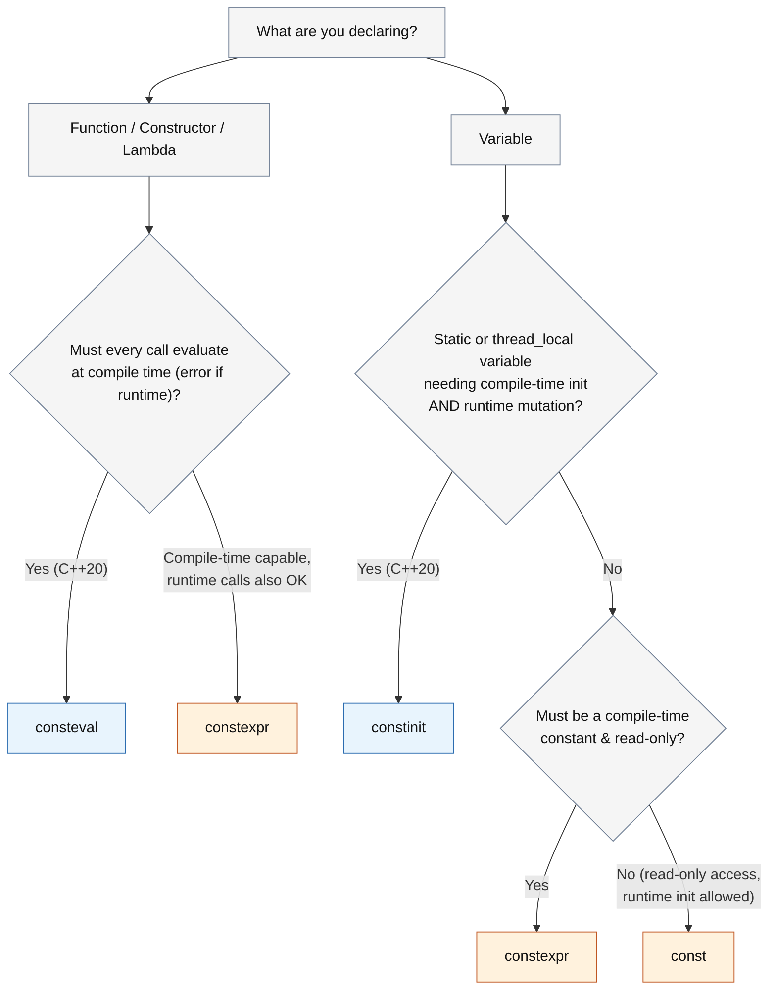

# Enforcing Compile-Time Execution & Constant Init: `consteval` and `constinit`

::: tip What you'll learn
- Understand why `constexpr`'s "dual-mode" behavior creates hazards for strict compile-time checks and predictable initialization
- Use `consteval` (C++20) to define **immediate functions** whose every potentially-evaluated call must evaluate at compile time
- Use `constinit` (C++20) to guarantee **constant initialization** for static or `thread_local` variables while keeping them mutable at runtime
- Write dual-path compile-time/runtime code using `std::is_constant_evaluated()` (C++20) and `if consteval` (C++23)
- Choose cleanly among `const`, `constexpr`, `consteval`, and `constinit` using a complete decision tree
:::

## Motivation

Suppose you write a `constexpr` helper that computes a compile-time lookup table or validates a format string, and you also maintain a global state counter that must be initialized without order-of-initialization bugs. With only `constexpr` and `const`, two gaps quickly surface:

```cpp
constexpr int square(int n) {
    return n * n;
}

int runtime_n = 5;
int a = square(runtime_n);  // Compiles silently, but runs at RUNTIME, not compile time!

// Meanwhile, for a mutable global variable:
// constexpr int g_counter = 0;  // Cannot modify g_counter later (it is const)!
int g_counter = 0;               // Mutable, but dynamic initialization order across .cpp files is risky
```

In the first snippet, `square(runtime_n)` silently falls back to runtime execution instead of failing compilation when you expected a guaranteed compile-time result.
In the second snippet, `constexpr` forces `const` (read-only) semantics, while a plain mutable variable at namespace scope may rely on dynamic initialization whose order across translation units is unspecified.

C++20 closes both gaps with `consteval` and `constinit` so you can state your exact intent rather than relying on implicit fallbacks or bundled `const`.

::: tip When this matters most
Writing compile-time validators, lookup-table generators, or security/invariant checks that must never slip into runtime; eliminating the Static Initialization Order Fiasco (SIOF) on mutable globals or `thread_local` state; and selecting the right specifier in modern C++ codebases.
:::

::: info When you can ignore it
Only if your code does not target C++20 or later, or if you only ever use plain runtime variables and standard `const`/`constexpr` functions without strict compile-time enforcement or cross-file mutable static state.
:::

::: danger Critical warning: `constinit` does NOT mean `const`
`constinit` only guarantees **constant initialization** (compile-time initialization of storage) for static or `thread_local` variables.
It does **not** make the variable read-only at runtime. Misreading `constinit` as "constant" is one of the easiest traps in C++20.
:::

## Core Idea & Intuition

### Four keywords, four precise jobs

To keep `const`, `constexpr`, `consteval`, and `constinit` straight, separate **functions** from **variables** and ask what guarantee you actually need:

1. **Declaring a function — must it ALWAYS run at compile time?**
   - **Yes, 100% compile-time only (never a runtime call):** Use `consteval` (immediate function).
   - **Compile-time when possible, runtime also allowed:** Use `constexpr`.


2. **Declaring a variable — what are your compile-time and mutability requirements?**
   - **Runtime read-only view/variable; initial value may come at runtime:** Use `const`.
   - **Must produce a compile-time constant expression AND be `const` (read-only):** Use `constexpr`.
   - **Must have static or `thread_local` storage, be constant-initialized at compile time, AND remain modifiable at runtime:** Use `constinit`.




### The intuition, in one sentence

`consteval` is a **compile-time-only** `constexpr` function that refuses to run at runtime, while `constinit` is a **constant-initialized** static or `thread_local` variable that **strips away **`const`** so you can still mutate it at runtime.

### Analogy — and where it breaks

::: tip Building permit inspector vs. pre-wired smart breaker
Think of **`consteval`** as a **strict building-code pre-inspector**: before a single brick is laid at runtime, it checks the blueprint (`compile time`).
If the blueprint has an issue or lacks required fixed data, construction stops immediately with a compiler error — it never "waits until move-in day" (`runtime`) to improvise.

Think of **`constinit`** as a **pre-wired smart breaker panel** installed in the factory before the house is built (`constant initialization` at compile time).
Because the wiring is already cleanly settled before startup, other circuits won't trip over missing wiring order — yet once you move in (`runtime`), you can still flip switches on and off (`mutate` the variable).
:::

::: warning Where the analogy breaks
A real breaker panel is a physical object in a building, whereas `constinit` is a **declaration specifier** on a variable with **static** or **`thread_local`** storage duration — it is **illegal** on a normal local stack variable inside a function because stack variables are created dynamically each time the function is entered, not during static initialization.

Similarly, `consteval` functions do not exist as ordinary callable runtime functions with a runtime address in the compiled binary; they exist to produce values during constant evaluation.
:::

## Formal Definition / Mechanism

### `consteval` (Immediate Functions, C++20)

`consteval` can be applied to functions, member functions, constructors, and lambdas to declare an **immediate function**.

- **Strict compile-time requirement:** Every *potentially-evaluated* call to a `consteval` function must produce a constant expression. If any argument is not a constant expression or evaluation fails constant-expression rules, the program is ill-formed (compile error).
- **No runtime address / no runtime entity:** Because immediate functions are evaluated at compile time rather than executed as ordinary runtime calls, taking the address of a `consteval` function in a non-constant expression (such as forming a runtime function pointer `auto fp = &strict_fn;`) is ill-formed.
- **Immediate escalation:** Inside a `consteval` function, calling another `consteval` or `constexpr` function happens within constant evaluation. Furthermore, under C++20/C++23 immediate escalation rules, a call to a `consteval` function inside a `constexpr` function or immediate-escalating context can promote/escalate requirements so the surrounding context itself must evaluate as a constant expression if needed.

### `constinit` (Guaranteed Constant Initialization, C++20)

`constinit` is a variable specifier with strict rules on **where** it can appear and **what** it guarantees.

- **Storage duration restriction:** `constinit` may only be applied to variables with **static storage duration** (namespace-scope variables and `static` variables) or **thread storage duration** (`thread_local` variables). It **cannot** be used on automatic (local stack) variables inside a function.
- **Eliminates the Static Initialization Order Fiasco (SIOF):** In C++, variables with static storage duration across different `.cpp` files that require *dynamic* initialization have an unspecified initialization order across translation units. If `file_b.cpp` reads a global from `file_a.cpp` during dynamic startup before `file_a.cpp` initializes it, you hit SIOF (undefined behavior). `constinit` requires **constant initialization**, which happens before dynamic initialization (and can be performed at compile time / placed in static data segments with zero runtime initialization order hazard).
- **Mutability preserved:** `constinit` does **not** imply `const`. For example, `constinit int g_hits = 0;` is non-`const` and can be incremented (`++g_hits;`) at runtime. If you want both constant initialization and read-only enforcement, you write `constinit const int` (or `constexpr`).

### Detecting constant evaluation: `std::is_constant_evaluated()` (C++20) and `if consteval` (C++23)

Sometimes a single function can run both at compile time and at runtime, but you want a **different implementation** in each mode — for example, a pure portable loop at compile time and a hardware/library-accelerated path at runtime.

- **`std::is_constant_evaluated()` (C++20, in `<type_traits>`):** Returns `true` when evaluated within a manifestly constant-evaluated expression (such as initializing a `constexpr` variable, a `static_assert`, or a `consteval` call), and `false` during normal runtime evaluation.
- **Why `if constexpr (std::is_constant_evaluated())` is a classic bug:** `if constexpr` requires its condition to be a **constant expression** and evaluates it at compile time. Because a call to `std::is_constant_evaluated()` is itself a constant expression returning `true` when evaluated as a constant expression, `if constexpr (std::is_constant_evaluated())` evaluates to `true` and discards the `else` branch at compile time — making the runtime branch dead code! Always use a regular runtime `if (std::is_constant_evaluated())` so the compiler emits both branches and chooses at runtime when not in a constant-evaluated context.
- **`if consteval` (C++23):** C++23 introduces `if consteval { ... } else { ... }` as dedicated syntax for selecting the constant-evaluated vs. non-constant-evaluated branch cleanly without needing to call `std::is_constant_evaluated()` inside an `if` condition.

### Comparison of the four keywords

| Keyword | Applies To | Evaluation / Init Timing | Mutable at Runtime? | Allowed on Local Stack Vars? | Primary Use Cases |
| --- | --- | --- | --- | --- | --- |
| `const` | Variables, member functions, pointer/ref types | Initialized at compile time or runtime; enforced at runtime | No (through that `const` access path) | Yes | Read-only parameters (`const T&`), runtime constants, access control |
| `constexpr` | Variables, functions, constructors, lambdas | Variables: compile time; Functions: compile time if possible, else runtime | No (variables have implicit top-level `const`) | Yes (for local `constexpr` vars) | Compile-time constants, dual-mode functions usable in both contexts |
| `consteval` | Functions, constructors, lambdas (C++20) | Strictly compile time (error if not constant-evaluated) | N/A (produces compile-time value; no runtime call entity) | N/A (function specifier) | Enforced compile-time checks, table builders, zero-fallback helpers |
| `constinit` | Static or `thread_local` variables (C++20) | Constant-initialized (compile time / pre-dynamic-init) | Yes (unless paired with `const`) | No (error: not static or `thread_local`) | Preventing SIOF on mutable globals or `thread_local` state |

## Step-by-Step Example

Let's build a self-contained C++20 example demonstrating `consteval`, `constinit`, and `std::is_constant_evaluated()`.

### Step 1 — Enforce compile-time execution with `consteval`

```cpp
#include <iostream>

constexpr int flex_square(int n) {
    return n * n;
}

consteval int strict_square(int n) {
    return n * n;
}

int main() {
    constexpr int c1 = flex_square(6);    // Compile time
    constexpr int c2 = strict_square(6);  // Compile time

    int runtime_val = 6;
    int r1 = flex_square(runtime_val);  // Compiles: silently runs at runtime
    std::cout << "flex_square(runtime): " << r1 << "\n";

    // int r2 = strict_square(runtime_val);  // Error: call to consteval function
    //                                       // 'strict_square' is not a constant expression
    std::cout << "c1=" << c1 << ", c2=" << c2 << "\n";
}
```

- `flex_square` accepts `runtime_val` and runs at runtime without complaint.
- `strict_square` rejects `runtime_val` at compile time because `runtime_val` is not a constant expression.

### Step 2 — Use `constinit` for safe mutable static/thread-local state

```cpp
#include <iostream>

constinit int g_event_count = 0;
thread_local constinit int tl_scratch = 1;

void record_event() {
    ++g_event_count;
    tl_scratch *= 2;
}

int main() {
    record_event();
    record_event();

    std::cout << "g_event_count = " << g_event_count << "\n";
    std::cout << "tl_scratch    = " << tl_scratch << "\n";

    // The following line would fail to compile because local variables are not
    // static or thread_local:
    // constinit int local_bad = 10;
}
```

- `g_event_count` and `tl_scratch` are constant-initialized with `0` and `1`, avoiding dynamic cross-file initialization order hazards.
- Both remain normal mutable variables (`++g_event_count`, `tl_scratch *= 2`) at runtime.
- Putting `constinit` on a local variable (`local_bad`) is rejected by the compiler.

### Step 3 — Dual-path evaluation with `std::is_constant_evaluated()`

```cpp
#include <cassert>
#include <cstddef>
#include <iostream>
#include <type_traits>

constexpr std::size_t portable_strlen(const char* s) {
    std::size_t len = 0;
    while (s[len] != '\0') {
        ++len;
    }
    return len;
}

// Placeholder for a fast runtime helper (e.g., SIMD or dedicated library call);
// reuses portable_strlen here just to keep the self-contained example minimal.
std::size_t fast_runtime_strlen(const char* s) {
    return portable_strlen(s);
}

constexpr std::size_t smart_strlen(const char* s) {
    if (std::is_constant_evaluated()) {
        // Compile-time path: strictly valid in constant expressions
        return portable_strlen(s);
    } else {
        // Runtime path: executed when not in a constant-evaluated context
        return fast_runtime_strlen(s);
    }
}

int main() {
    static_assert(smart_strlen("hello") == 5);  // Evaluated at compile time

    const char* dynamic_ptr = "world";
    std::size_t runtime_len = smart_strlen(dynamic_ptr);  // Evaluated at runtime
    assert(runtime_len == 5);

    std::cout << "runtime_len = " << runtime_len << "\n";
}
```

- `static_assert(smart_strlen("hello") == 5)` forces constant evaluation, where `std::is_constant_evaluated()` returns `true`.
- `smart_strlen(dynamic_ptr)` is evaluated at runtime, where `std::is_constant_evaluated()` returns `false` and takes the runtime branch.
- Notice we used a plain `if (...)` rather than `if constexpr (...)` so both branches remain available according to the evaluation context.

::: tip Key insight
`consteval` guarantees **when a function's result is computed** (always compile time), whereas `constinit` guarantees **how a static/`thread_local` variable is initialized** (constant initialization) while keeping it **mutable at runtime**.
:::

## Common Misunderstandings & Pitfalls

### Pitfall 1 — Assuming `constinit` makes a variable `const` (read-only)

::: danger False
```cpp
constinit int g_state = 1;
g_state = 2;  // Valid! constinit does NOT make g_state const.
```

`constinit` only requires constant initialization; it does not add `const` qualification.
:::

### Pitfall 2 — Using `constinit` on a local stack variable

::: danger False
```cpp
void f() {
    constinit int x = 42;  // Error: 'constinit' may only be applied to a variable
                           // with static or thread storage duration
}
```

Local variables inside functions have automatic storage duration by default, so `constinit` cannot be used on them.
:::

### Pitfall 3 — Taking a function pointer to a `consteval` function in a runtime context

::: danger False
```cpp
consteval int add_one(int x) { return x + 1; }

int main() {
    // auto p = &add_one;  // Error: cannot form runtime function pointer to immediate function
}
```

Immediate functions are evaluated at compile time and cannot be used to form a runtime function pointer in non-constant contexts.
:::

### Pitfall 4 — Writing `if constexpr (std::is_constant_evaluated())`

::: danger False
```cpp
constexpr int f() {
    if constexpr (std::is_constant_evaluated()) {  // Buggy pattern!
        return 1;
    } else {
        return 2;
    }
}
```

Because `if constexpr` evaluates its condition as a constant expression at compile time, `std::is_constant_evaluated()` is `true` during that check, discarding the `else` branch even when `f()` is later called at runtime. Use `if (std::is_constant_evaluated())` (or `if consteval` in C++23).
:::

### Pitfall 5 — Confusing `constexpr` variables (always `const`) with `constinit` variables

::: warning Subtle distinction
A `constexpr` variable is always implicitly `const` (read-only).
A `constinit int x = 0;` variable is **mutable** at runtime; only `constinit const int y = 0;` is both constant-initialized and `const`.
:::

## Practice Check

**Exercise 1.** For each declaration or statement below, state whether it is valid in C++20 and whether the resulting variable (if any) can be modified at runtime:

1. `constinit int counter = 0;` followed by `counter = 5;`
2. `constinit const int limit = 100;` followed by `limit = 200;`
3. `void fn() { constinit int local_v = 3; }`
4. `consteval int twice(int x) { return x * 2; }` called with a non-`constexpr` local variable `int y = 4; twice(y);`
5. `constexpr int k = 10;` followed by `k = 20;`

**Exercise 2.** Spot and fix the bug in this C++20 snippet:

```cpp
#include <type_traits>

consteval int compile_only_check(int x) {
    return x > 0 ? x : -1;
}

constexpr int maybe_eval(int x) {
    if constexpr (std::is_constant_evaluated()) {
        return compile_only_check(x);
    } else {
        return x * 10;
    }
}
```

**Exercise 3.** Pick the most fitting keyword (`consteval`, `constinit`, `constexpr`, or `const`) for each requirement:

1. A helper function that parses a regex or format string and **must** fail compilation if given a non-constant string.
2. A global atomic or status counter across multiple `.cpp` files that must avoid dynamic initialization order bugs and **can be updated** at runtime.
3. A math helper like `square(x)` that works both in `static_assert` and on runtime variables.
4. A function parameter or local variable initialized from runtime configuration that just shouldn't be accidentally overwritten.

### Solutions

::: details Exercise 1 — validity and runtime mutability
1. **Valid; mutable at runtime:** `counter` has static storage duration, is constant-initialized to `0`, and is not `const`, so `counter = 5;` is allowed.
2. **Valid; NOT mutable at runtime:** `constinit const int` enforces constant initialization and makes `limit` `const`, so `limit = 200;` fails to compile.
3. **Invalid (compile error):** `local_v` has automatic storage duration, not static or `thread_local` storage duration.
4. **Invalid (compile error):** `twice` is `consteval`, so the call must be a constant expression and `y` cannot be evaluated as a runtime argument here.
5. **Invalid assignment (compile error):** `constexpr` variables have top-level `const`, so `k = 20;` fails to compile.
:::

::: details Exercise 2 — fixing `if constexpr (std::is_constant_evaluated())`
Replace `if constexpr (std::is_constant_evaluated())` with `if (std::is_constant_evaluated())` (or `if consteval` in C++23):

```cpp
#include <type_traits>

consteval int compile_only_check(int x) {
    return x > 0 ? x : -1;
}

constexpr int maybe_eval(int x) {
    if (std::is_constant_evaluated()) {
        return compile_only_check(x);
    } else {
        return x * 10;
    }
}
```

With `if constexpr`, the condition was evaluated in a constant-expression context and forced the `else` branch to be discarded at compile time.
With plain `if`, `std::is_constant_evaluated()` accurately reflects whether the call to `maybe_eval` itself is being constant-evaluated.
:::

::: details Exercise 3 — matching keywords to requirements
1. **`consteval`:** Guarantees compile-time evaluation and rejects runtime-only inputs with a compiler error.
2. **`constinit`:** Guarantees constant initialization for static/`thread_local` storage (preventing SIOF) while keeping the variable mutable at runtime.
3. **`constexpr`:** Allows compile-time evaluation (e.g., in `static_assert`) while also permitting runtime calls.
4. **`const`:** Provides read-only protection without requiring a compile-time constant expression.
:::

## Summary

- `consteval` (C++20) defines an **immediate function** that must evaluate at compile time on every potentially-evaluated call and has no runtime address.
- `constinit` (C++20) enforces **constant initialization** on static or `thread_local` variables to prevent the Static Initialization Order Fiasco while preserving **runtime mutability**.
- Never write `if constexpr (std::is_constant_evaluated())`; use `if (std::is_constant_evaluated())` in C++20 or `if consteval` in C++23.
- Choose `const` for runtime read-only protection, `constexpr` for compile-time constants and flexible dual-context functions, `consteval` for strict compile-time-only functions, and `constinit` for constant-initialized mutable static/`thread_local` state.

## Quick Reference

| Keyword / Construct | Category | Key Guarantee | Runtime Mutable? | Local Stack Allowed? |
| --- | --- | --- | --- | --- |
| `const` | Type qualifier | Read-only through this access path | No (via `const` path) | Yes |
| `constexpr` | Specifier (var / fn) | Variable is compile-time constant; function can run at compile time | No (vars are `const`) | Yes (vars) |
| `consteval` (C++20) | Function specifier | Every potentially-evaluated call is a constant expression | N/A (compile-time call) | N/A |
| `constinit` (C++20) | Variable specifier | Static/`thread_local` variable uses constant initialization (avoids SIOF) | Yes | No |
| `std::is_constant_evaluated()` (C++20) | Function (`<type_traits>`) | `true` in manifestly constant-evaluated context, `false` at runtime | N/A | N/A |
| `if consteval` (C++23) | Statement | Dedicated branch selection for constant vs. non-constant evaluation | N/A | N/A |
