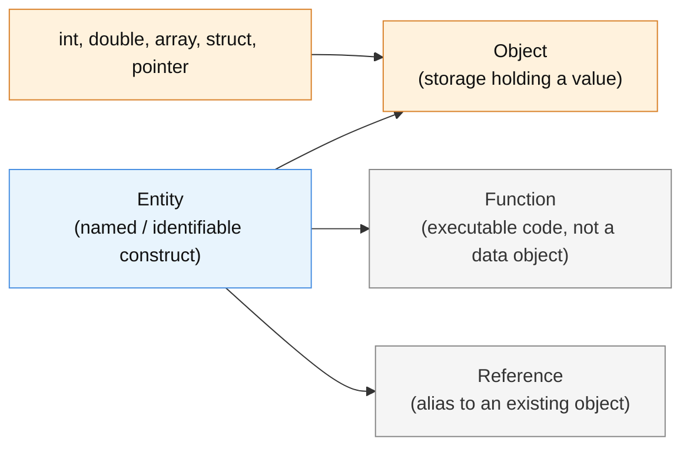
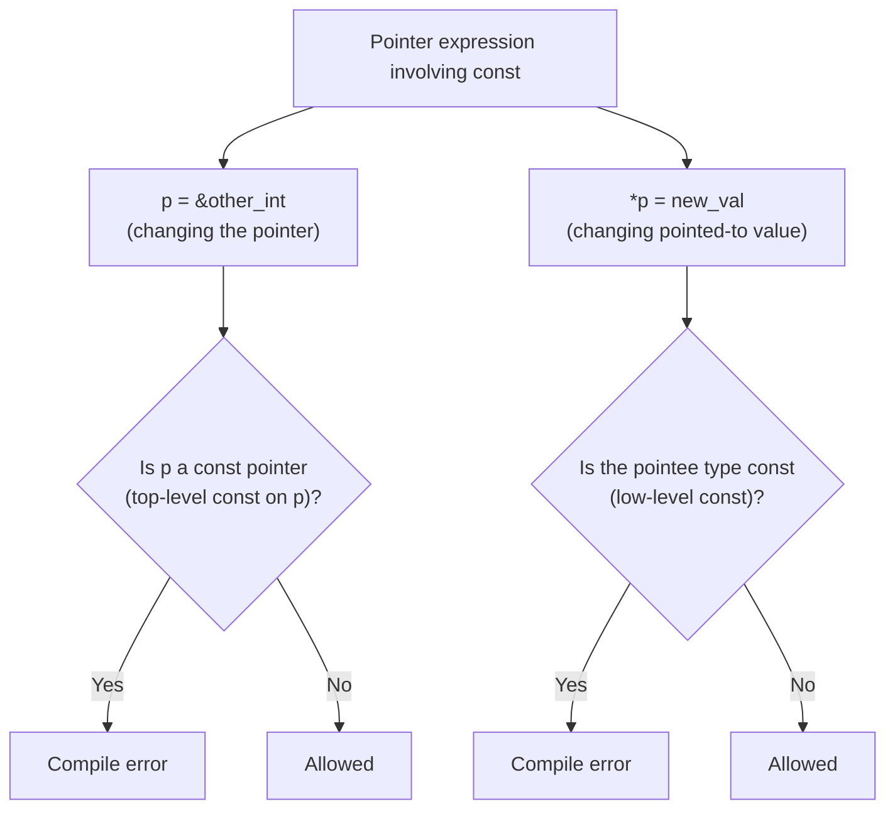

# Variables, Memory, and `const`

::: tip What you'll learn
- Separate a **name** in source code from the **memory** it refers to at runtime
- Understand **type**, **address**, **size**, and **alignment** without getting bogged down in jargon
- Distinguish **objects** and **entities**, and see why functions and references are not ordinary data objects
- Tell **top-level `const`** apart from **low-level `const`** across `int`, `int*`, `const int*`, and `int* const`
- Avoid the most common beginner traps around `const` and pointers
:::

## Motivation

Suppose you just learned how to write `int x = 10;` and `int* p = &x;`. Everything makes sense until you add `const` and hit a puzzling contrast:

```cpp
const int x = 1;
x = 2;  // Compiler error: cannot assign to variable 'x' with const-qualified type

int y = 20;
const int* p = &x;
*p = 5;  // Compiler error: read-only variable is not assignable
p = &y;  // Compiles! Why is p allowed to point somewhere else?
```

At first glance, that looks contradictory. Why can `x` not be reassigned, why can `*p` not be modified, and yet `p = &y;` is completely fine?

To answer those questions cleanly, you need a mental model of how C++ connects **names**, **types**, **memory**, and **`const`**. When those pieces are blurred together, `const` feels arbitrary. When they are separated, the rules become consistent and predictable.

::: tip When this matters most
Reading function signatures (`const std::string&`, `const char*`), understanding compiler errors involving `const`, writing safe pointer/reference code, and preparing for references, move semantics, and `constexpr`.
:::

::: info When you can ignore it
Only if you never read or write `const`, pointers, or references — which is almost impossible in real C++, since standard libraries and APIs use them everywhere.
:::

::: danger First, separate the name from the box
A variable name in your code (like `x` or `p`) is **not** the memory itself. The name is a label you write in source code; the memory is storage at runtime. Confusing the label with what sits inside or outside the box is where `const` confusion begins.
:::

## Core Idea & Intuition

### First, names, types, and memory

When you write a variable declaration such as:

```cpp
int x = 10;
```

three distinct concepts come into play:

1. **Name (identifier):** The spelling `x` in your source code. It lets you refer to a thing in your program. A name is a compile-time convenience for humans; the CPU works with addresses and machine instructions.
2. **Type:** The classification `int`. A type tells the compiler how to interpret the raw bits in memory (for example, as a two's-complement integer rather than floating-point numbers or characters) and which operations are allowed (`+`, `-`, assignment, etc.).
3. **Memory space:** Storage set aside for the value at runtime. That memory has three key properties:
   - **Address:** Where the storage begins in the program's address space (often printed in hexadecimal).
   - **Size:** How many bytes that storage occupies (for example, `sizeof(int)` is commonly `4` bytes on desktop platforms).
   - **Alignment:** A rule stating that the object's address must be a multiple of a certain byte boundary (for example, a 4-byte `int` often prefers or requires an address divisible by `4`) so hardware can read and write it efficiently.

Think of a type as the **blueprint/rulebook** and the memory space as the **physical storage** where bytes live.
Later on, you will also see how **storage duration** (when raw bytes are allocated and reclaimed) differs from **object lifetime** (when a valid, initialized object actually exists in those bytes) — for now, we focus on how names, types, and `const` govern reading and writing.

### The intuition, in one sentence

A variable name is a **label** pointing to a **typed region of memory**, and `const` restricts **how you may access or modify** what that label reaches — not necessarily every bit in the universe.

### Objects vs. entities (and why functions and references are special)

In everyday speech, people call almost anything in code an "object." In C++, the term has a specific meaning:

- **Object:** A region of storage in the execution environment that holds a value of some object type (such as an `int`, a `double`, an array, a struct, or a pointer). Even a pointer is an object: its value is an address, and that address itself lives in memory somewhere.
- **Entity:** A broader umbrella term in C++ for named or identifiable program constructs — including **objects**, **functions**, **references**, **namespaces**, **types**, **templates**, and their members.

Why does this distinction matter? Because **not every entity is an object**:

- **Functions** are entities (you can name them and call them), not data objects holding values in writable variable boxes.
- **References** (such as `int& ref = x;`) are entities — aliases bound to an existing object — rather than data objects themselves in C++'s language model (even if a compiler/ABI may allocate storage for a reference in certain contexts, such as class members or function arguments).



### Analogy — and where it breaks

::: tip Locker labels and viewing windows
Imagine a row of lockers in a hallway.

A **name** (`x`) is a **nametag** clipped onto a locker door.
The **type** (`int`) tells you what kind of item fits and how to read it.
The locker's **address** is its number in the hallway, its **size** is how wide the locker is, and its **alignment** is the spacing rule on the wall.

Now picture **`const`**:
- Putting `const` on the **item inside** (`const int`) is like putting a **glass cover** over the item: you can look at it, but you cannot reach in and swap it out through that `const` view.
- Putting `const` on the **pointer itself** (`int* const`) is like **gluing the nametag/strap** so the pointer cannot be re-aimed at another locker — even if you can still open the locker it points to.
:::

::: warning Where the analogy breaks
In the real world, a physical lock on a locker can stop anyone from touching the item.
In C++, `const` is primarily a **compile-time access rule** on a type/expression, not an unbreakable hardware lock on physical RAM.

If you have a non-`const` variable `int a = 10;` and a `const int* p = &a;`, the underlying memory of `a` is still mutable through `a`.
Furthermore, if someone illegally casts away `const` with `const_cast` on an object that *was* originally defined as `const`, modifying it causes **undefined behavior** — C++ does not guarantee a neat runtime error; anything can happen.
:::

### Top-level `const` vs. low-level `const`

When pointers enter the picture, there are **two places** where `const` can appear:

1. **Top-level `const`:** Applies to the **object itself** (for example, the pointer object itself cannot be reassigned to point elsewhere, or a non-pointer variable `const int x = 1;` cannot be modified).
2. **Low-level `const`:** Applies to the **pointed-to (or referenced) type** — meaning you cannot modify the value *through* that pointer/reference.

A classic reading rule helps: **read a type declaration from right to left**, starting at the identifier:

- `int x` — `x` is an `int`.
- `const int x` (same as `int const x`) — `x` is a `const int` (top-level `const` on `x`).
- `const int* p` — `p` is a pointer (`*`) to a `const int`. The `const` is **low-level** (the pointed-to `int` is `const`; `p` itself can point to another `int`).
- `int* const p` — `p` is a `const` pointer (`const` after `*`) to an `int`. The `const` is **top-level** (the pointer `p` itself cannot be changed to point elsewhere; the `int` it points to *can* be changed via `*p`).
- `const int* const p` — `p` is a `const` pointer to a `const int`. **Both** low-level `const` (cannot modify `*p`) and top-level `const` (cannot reassign `p`) apply.

## Formal Definition / Mechanism

### How C++ models storage, types, and `const`

1. **Storage duration & layout:** An object occupies contiguous bytes of storage with a determined size (`sizeof(T)`) and alignment requirement (`alignof(T)`). You can obtain the address of most objects with the address-of operator `&`, whereas non-objects such as bit-fields and non-addressable temporary/rvalue expressions cannot have their address taken with `&`.
2. **Type qualifiers:** `const` is a type qualifier. Adding `const` to a type produces a `const`-qualified version of that type, restricting operations that mutate values through that qualified type.
3. **Pointer declarator rules:** In a pointer declarator, `const` before `*` modifies the pointee type (low-level relative to the pointer), whereas `const` after `*` modifies the pointer itself (top-level on that pointer).
4. **Implicit conversion to `const`:** In C++, you can implicitly convert a non-`const` pointer to a pointer to `const` (for example, `int*` to `const int*`), adding `const` protection. The reverse — implicitly converting `const int*` to `int*` — is forbidden because it would silently drop `const` protection.

::: warning Two subtleties worth memorizing
**`const int` and `int const` mean the exact same thing.** Placing `const` before or after the base type specifier (`int`) produces the identical type.
Consistency in your codebase matters more than which order you pick, though you must read `const` on the *right* of `*` as applying to the pointer itself.

**`const` does not automatically make a runtime value a compile-time constant.**
In C++, `const int n = get_runtime_value();` is valid: `n` cannot be modified after initialization, yet its value is only known at runtime.
(Compile-time constant expressions are a related, stricter concept, often associated with `constexpr`.)
:::

### Quick comparison of `int` and pointer `const` forms

| Declaration | Can modify `x` directly? | Can reassign `p` (`p = &other`)? | Can modify pointee via `*p` (`*p = val`)? | Which `const` is present? |
| --- | --- | --- | --- | --- |
| `const int x = 1;` | No | N/A (not a pointer) | N/A | Top-level on `x` |
| `int* p = &a;` | N/A | Yes | Yes | None |
| `const int* p = &a;` | N/A | Yes | No | Low-level (on pointee) |
| `int* const p = &a;` | N/A | No | Yes | Top-level (on `p`) |
| `const int* const p = &a;` | N/A | No | No | Both low-level and top-level |

### How `const` interacts with pointer operations



## Step-by-Step Example

Let's walk through a small, self-contained program that inspects sizes, addresses, and `const` behavior step by step.

### Step 1 — inspect size, alignment, and address of a variable

```cpp
#include <iostream>

int main() {
    int x = 10;

    std::cout << "sizeof(x):    " << sizeof(x) << " bytes\n";
    std::cout << "alignof(x):   " << alignof(x) << " bytes\n";
    std::cout << "address of x: " << static_cast<const void*>(&x) << "\n";
}
```

- `sizeof(x)` reports how many bytes the object `x` occupies.
- `alignof(x)` reports the alignment requirement of `x`'s type (`int`).
- `&x` obtains the address of `x`. Casting to `const void*` explicitly formats the value as a generic pointer address in `std::cout` (which is especially important when printing `char*` or `const char*` values so they are not treated as C-style strings).

### Step 2 — see how a pointer is its own object with its own address

```cpp
#include <iostream>

int main() {
    int x = 10;
    int y = 20;
    int* p = &x;

    std::cout << "x value:                  " << x << ", &x: " << static_cast<const void*>(&x) << "\n";
    std::cout << "p value (target addr):    " << static_cast<const void*>(p) << "\n";
    std::cout << "&p (pointer's own addr):  " << static_cast<const void*>(&p) << "\n";

    p = &y;  // p now holds y's address
    std::cout << "after p = &y, *p:         " << *p << "\n";
}
```

- `x` and `p` live in **different** memory locations (`&x` and `&p` are different addresses).
- The *value* stored inside `p` is the *address* of `x`, and later the *address* of `y`.

### Step 3 — compare top-level `const` and low-level `const` on pointers

```cpp
#include <iostream>

int main() {
    int a = 10;
    int b = 20;

    // 1. Low-level const: cannot change *pLow, can change pLow
    const int* pLow = &a;
    std::cout << "*pLow = " << *pLow << "\n";
    // *pLow = 15;  // Error: pointed-to int is const via pLow
    pLow = &b;      // OK: pLow itself is not const
    std::cout << "after pLow = &b, *pLow = " << *pLow << "\n";

    // 2. Top-level const: cannot change pTop, can change *pTop
    int* const pTop = &a;
    *pTop = 99;    // OK: a is modified through pTop
    std::cout << "a is now " << a << "\n";
    // pTop = &b;  // Error: pTop itself is const

    // 3. Both low-level and top-level const
    const int* const pBoth = &a;
    std::cout << "*pBoth = " << *pBoth << "\n";
    // *pBoth = 50;  // Error
    // pBoth = &b;   // Error
}
```

**Walkthrough of what happens:**
- `pLow` protects the *target* (`const int`) from being written through `pLow`, while still letting `pLow` point to `b`.
- `pTop` locks the *pointer* (`int* const`) so it always points to `a`, while still letting you write to `a` through `*pTop`.
- `pBoth` locks both.

::: tip Key insight
When reading a pointer declaration, look for where `const` sits relative to `*`: **left of `*`** mainly restricts what you reach by dereferencing (`*p`); **right of `*`** restricts the pointer variable `p` itself.
:::

### Step 4 — observe that `const` on a view does not freeze a mutable owner

```cpp
#include <iostream>

int main() {
    int original = 100;
    const int* view = &original;

    std::cout << "before: " << *view << "\n";
    original = 250;  // Mutated through the non-const owner 'original'
    std::cout << "after modifying 'original', *view is: " << *view << "\n";
}
```

`view` promised not to modify `original` *through* `view`.
It did not promise that `original` could never change anywhere else in the program.

## Common Misunderstandings & Pitfalls

### Pitfall 1 — Treating a `const` view as unchangeable memory

::: danger False
If you have `const int* p = &x;` where `x` is a non-`const` `int`, `x` can still be modified through `x` (or another non-`const` pointer).
`const` on `p` restricts *you when using* `p`; it does not make `x`'s bytes read-only in hardware.
:::

### Pitfall 2 — Confusing `const int*` and `int* const`

::: danger False
Beginners often assume `const int*` means "constant pointer." In fact, `const int*` means "pointer to `const int`."
To make the pointer itself `const`, put `const` after `*`: `int* const`.
:::

### Pitfall 3 — Assuming `const` always means "evaluated at compile time"

::: warning Subtle distinction
In C++, `const` means **read-only through this name/access path**, not necessarily **compile-time constant**.
A `const` variable can be initialized from a runtime expression (such as user input or a function return value).
If you specifically need a compile-time constant, look into `constexpr` as you advance.
:::

### Pitfall 4 — Thinking a `const` variable can never be initialized

::: warning Initialization is not assignment
You **must** initialize a `const` variable when you define it (because you cannot assign to it later):

```cpp
const int k = 42;  // Initialization: valid
// k = 43;         // Assignment: error
```

Initializing is setting its initial value when created; assigning is overwriting it afterward.
:::

### Pitfall 5 — Trying to silently drop `const` from a pointer

::: danger False
```cpp
const int x = 10;
const int* cp = &x;
int* p = cp;  // Error: cannot convert 'const int*' to 'int*'
```

If the compiler allowed this implicitly, you could write `*p = 20;` and silently break the `const` contract of `cp` — and since `x` is defined as `const`, modifying it (even via `const_cast`) causes undefined behavior.
:::

### Pitfall 6 — Calling functions or references "data objects"

::: warning Terminology trap
In C++, a function is an entity, not a data object you hold a value inside, and a reference is an alias to an existing object rather than a standalone data object in the language model (though underlying implementations may reserve storage for it in some cases).
Keeping this straight prevents confusion later when learning references, pointers to functions, and `sizeof`.
:::

## Practice Check

**Exercise 1.** For each line, say whether it compiles or fails to compile, and briefly explain why:

```cpp
int a = 3;
int b = 4;

const int* p1 = &a;
*p1 = 10;    // (1)
p1 = &b;     // (2)

int* const p2 = &a;
*p2 = 10;    // (3)
p2 = &b;     // (4)
```

**Exercise 2.** What does the following program print?

```cpp
#include <iostream>

int main() {
    int value = 5;
    const int* ptr = &value;
    value = 12;
    std::cout << *ptr << "\n";
}
```

**Exercise 3.** Match each description to the right declaration (`const int* p`, `int* const p`, or `const int* const p`):

- **(a)** You can change what `p` points to, but you cannot change the integer through `*p`.
- **(b)** You cannot change what `p` points to, and you cannot change the integer through `*p`.
- **(c)** You cannot change what `p` points to, but you *can* change the integer through `*p`.

### Solutions

::: details Exercise 1 — compilation and explanation
- **(1) Fails to compile:** `p1` points to `const int`, so `*p1` cannot be assigned to.
- **(2) Compiles:** `p1` is not a `const` pointer; it can be reassigned to point to `b`.
- **(3) Compiles:** `p2` is a `const` pointer to a non-`const` `int`, so modifying `*p2` is allowed.
- **(4) Fails to compile:** `p2` has top-level `const` (`int* const`), so `p2` cannot be pointed at `b`.
:::

::: details Exercise 2 — output of the snippet
Output:

```text
12
```

Even though `ptr` points to `const int`, `value` itself was defined as a non-`const` `int` and was modified directly through `value`.
Reading `*ptr` then reads the updated value `12` from that memory location.
:::

::: details Exercise 3 — matching declarations
- **(a)** `const int* p` (low-level `const` only)
- **(b)** `const int* const p` (both low-level and top-level `const`)
- **(c)** `int* const p` (top-level `const` only)
:::

## Summary

- A **name** in source code refers to a **typed** region of **memory** that has an **address**, **size** (`sizeof`), and **alignment** (`alignof`).
- Every **object** is an **entity** with storage holding a value, while other **entities** (like functions and references) are not ordinary data objects.
- `const` restricts mutability along a given access path; it is not a magic runtime lock that freezes memory everywhere.
- **Top-level `const`** restricts the entity/pointer itself; **low-level `const`** restricts modifying the value through a pointer/reference to a `const` type.
- Always initialize `const` variables at definition, and never drop `const` implicitly from a pointer.

## Quick Reference

| Concept / Form | Meaning in Plain English | Typical Rule / Behavior |
| --- | --- | --- |
| Identifier / Name | The spelling you write in code (`x`, `p`) | Refers to an entity in scope |
| Type | Rulebook for interpreting bits & allowed operations | Determines `sizeof`, `alignof`, and valid operators |
| Address / Size / Alignment | Where it sits, how many bytes it takes, boundary rule | Inspected via `&x`, `sizeof(x)`, `alignof(x)` |
| Object vs. Entity | Object = value storage; Entity = broader named/identifiable construct | Functions and references are entities, not data objects |
| `const int x = 1;` | `x` cannot be reassigned after initialization | Must be initialized when defined |
| `const int* p` | Pointer to `const int` (low-level `const`) | Cannot do `*p = ...`; can do `p = ...` |
| `int* const p` | `const` pointer to `int` (top-level `const`) | Can do `*p = ...`; cannot do `p = ...` |
| `const int* const p` | `const` pointer to `const int` (both) | Cannot do `*p = ...` and cannot do `p = ...` |
