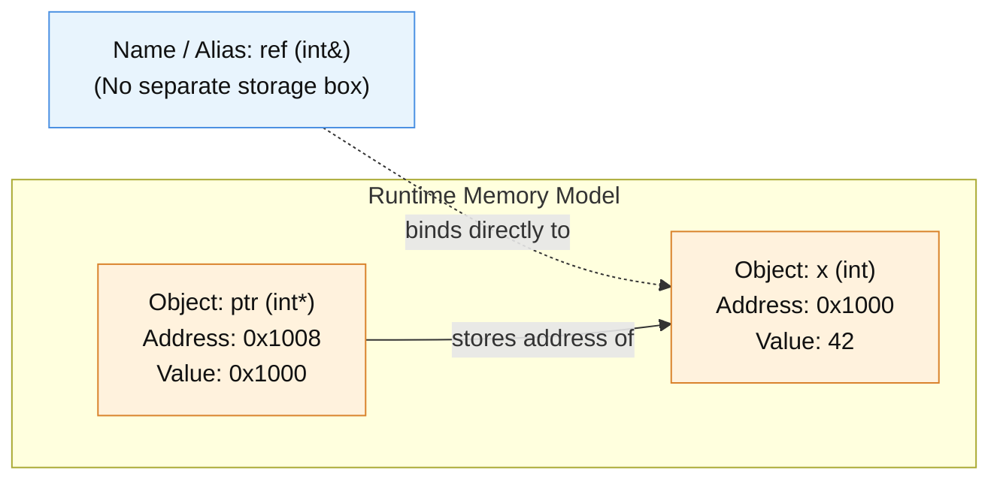
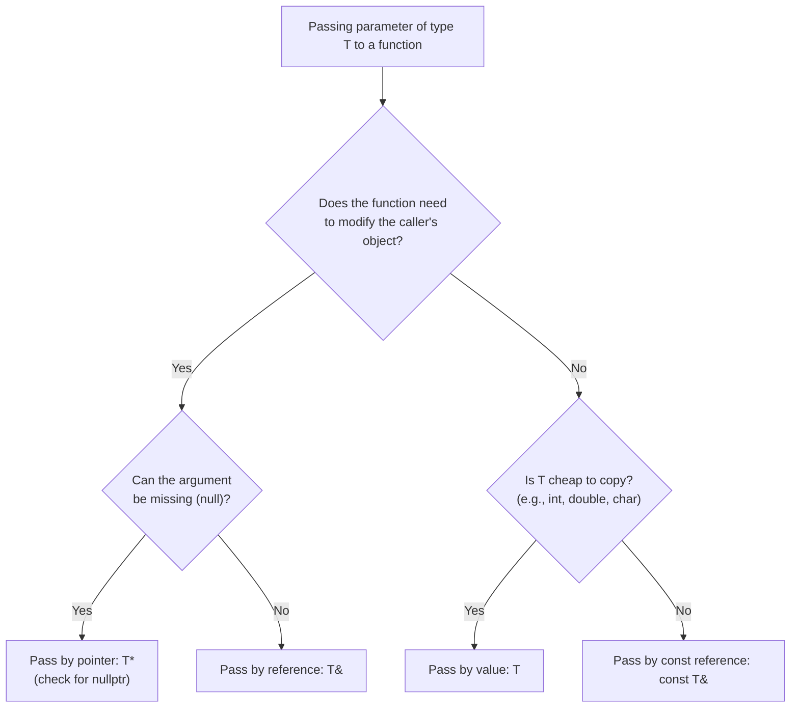

# Pointers and References: Aliases, Addresses, and Parameter Passing

::: tip What you'll learn
- Understand the real motivation for using pointers and references instead of copying everything
- Distinguish **pointers** (address-holding objects that can rebind or be null) from **references** (aliases that must bind on creation and cannot rebind)
- See why a reference is **not an independent object** in the C++ object model, and what `&ref` and `sizeof(ref)` actually reveal
- Choose safely among **pass-by-value**, **pass-by-reference (`T&`)**, and **pass-by-const-reference (`const T&`)**
- Understand **array-to-pointer decay** and why passing an array to a function loses its size information
- Avoid common traps such as returning references or pointers to local variables, uninitialized pointers, and accidental mutations
:::

## Motivation

When you write a simple C++ function such as `int add(int a, int b)`, passing arguments by value is effortless: `a` and `b` are small integers, and copying them costs almost nothing.

Problems appear as soon as your programs grow:

1. **Performance cost of copying:** A larger object (such as a `std::string`, a `std::vector`, or a `struct` with many fields) may allocate heap memory or copy dozens of bytes every time it is passed into or returned from a function by value.
2. **Mutating caller state:** A function often needs to update an existing variable in the caller's scope rather than modify a throwaway local copy.
3. **Optional or reseatable targets:** Sometimes code needs to represent "no target available" (`nullptr`) or switch which object it points to over time; other times, an API wants a guarantee that a valid object is already bound.

C++ provides two primary indirection mechanisms to solve these problems: **pointers** and **references**.
Understanding how they work — and why they behave differently — is essential before moving on to object lifetimes, value categories, move semantics, and templates.

::: tip When this matters most
Passing non-trivial objects to functions, modifying caller data cleanly, building linked data structures (trees, graphs, intrusive lists), working with C APIs or optional targets, and preparing for rvalue references and `decltype`.
:::

::: info When you can ignore it
Small, trivially copyable types (such as `int`, `double`, `char`, or tiny structs) passed to pure functions that do not need to mutate the caller's argument — though even there, knowing how references bind prevents subtle bugs.
:::

::: danger First, unlearn the "second variable" myth
A **reference** is **not** a separate variable that secretly holds a pointer you can inspect or re-aim. In C++, a reference is an **alias** — another name bound directly to an existing object.
Treating a reference as a standalone data object will trip you up on `&`, `sizeof`, lifetime, and later topics such as value categories and `decltype`.
:::

## Core Idea & Intuition

### Objects, addresses, and indirection

At runtime, an **object** in C++ occupies a region of storage with a **type**, a **value**, and (in almost all cases) a **memory address**.

- A **pointer** (`T*`) is an **object in its own right** whose stored value is a memory address (or `nullptr`). Because it holds an address as data, you can inspect that address, overwrite it to point elsewhere, or leave it null.
- A **reference** (`T&`) is an **alias** bound to an existing object at initialization. Once bound, every use of the reference's name refers directly to that underlying object.



### The intuition, in one sentence

A **pointer** is a separate variable that holds an **address** (which you can change or set to `nullptr`), whereas a **reference** is a permanent **nickname** glued to an existing object from the moment it is created.

### Pointers vs. references: the core contrast

| Property | Pointer (`T*`) | Reference (`T&`) |
| --- | --- | --- |
| What it is in C++ | A standalone object holding a memory address (or `nullptr`) | An entity that acts as an alias for an existing object |
| Must initialize on creation? | No (but uninitialized pointers hold garbage addresses — dangerous!) | Yes (must bind to a valid object or function when defined) |
| Can rebind to another object? | Yes (`ptr = &other;`) | No (`ref = other;` assigns to the *referenced object*, not rebinding `ref`) |
| Can be null (`nullptr`)? | Yes | No (in well-defined C++, a reference always refers to a valid target) |
| Independent storage address? | Yes (`&ptr` yields the pointer object's own address) | No (`&ref` yields the address of the *referenced object*) |
| Access / member syntax | `*ptr` to dereference; `ptr->member` for members | `ref` directly; `ref.member` for members |

### Why "a reference is not an independent object"

Recall that in C++, every **object** is an **entity**, but not every **entity** is an object.
A reference is an **entity**, not an object with its own independent storage box. That single rule explains four otherwise surprising language restrictions:

1. **No arrays of references:** `int& arr[4];` is illegal because array elements must be objects, and references are not objects (unlike a reference to an array, `int (&ref)[4]`, which binds to an existing `int[4]` array).
2. **No pointers to references:** `int&* p;` is ill-formed because pointers can only point to objects or functions, and a reference is neither.
3. **`&ref` returns the target's address:** Taking the address of a reference asks "where does the bound object live?", not "where does the alias live?"
4. **`sizeof(ref)` returns `sizeof(T)`:** Asking for the size of a reference reports the size of the referenced type `T` (for example, `sizeof(int)`), not `sizeof(void*)`.

### Analogy — and where it breaks

::: tip Two names for one house
Imagine a house on Elm Street (`x`) that your family also calls "the lake house" (`ref`).

- If you paint the front door of "the lake house" (`ref = 100;`), the house on Elm Street (`x`) now has a freshly painted door (`x` becomes `100`).
- If you ask for the street address of "the lake house" (`&ref`), you get the exact same address as `&x`.
- You cannot peel the nickname "the lake house" off that building and attach it to a different house down the road.

By contrast, a **pointer** (`int* ptr = &x;`) is a **sticky note** with `x`'s street address written on it.
The sticky note sits on your desk (it has its own location, `&ptr`), you can visit the house written on it (`*ptr`), or you can erase it and write a different house's address (`ptr = &y;`).
:::

::: warning Where the analogy breaks
At the machine-code level, a compiler often implements a reference *under the hood* using a CPU register or a hidden memory address — especially when passing a reference across function boundaries. However, **compiler implementation is not language semantics**.
At the C++ language level, a reference cannot be null, cannot be reseated, and does not support pointer arithmetic (`++ref` increments the *referenced value*, whereas `++ptr` advances the *pointer address*).
:::

### When to choose `const T&`, `T&`, or `T*`

- **Use `const T&`** by default when a function needs to **read** a non-trivial object without copying it and without modifying it. It guarantees a valid target, avoids copies, and accepts temporary objects (rvalues).
- **Use `T&`** when a function's purpose is to **modify** a caller's existing object and a valid target is always required.
- **Use `T*` (or `const T*`)** when **"no object" (`nullptr`) is a valid state**, when you need to **rebind** which object is targeted over time, when building pointer-linked structures, or when interacting with C-style APIs.

## Formal Definition / Mechanism

### Pointer declaration and dereferencing mechanics

A pointer type `T*` represents addresses of objects of type `T` (or `nullptr`).

```cpp
int value = 10;
int* ptr = &value;  // ptr stores the address of value

*ptr = 25;          // dereferences ptr to modify value
```

- **Address-of (`&value`):** Produces a pointer of type `int*` holding the starting address of `value`.
- **Dereference (`*ptr`):** Accesses the object located at the address stored inside `ptr`. Dereferencing `nullptr`, an uninitialized pointer, or a pointer to a destroyed object causes **undefined behavior**.

### Reference binding mechanics

An lvalue reference declaration `T& ref = expr;` binds the identifier `ref` to an existing object:

```cpp
int value = 10;
int& ref = value;  // ref is an lvalue reference bound to value

ref = 30;          // assigns 30 to value; ref remains bound to value
```

Three core rules govern reference binding:

1. **Mandatory initialization:** A reference must be initialized when defined (including via function call arguments, constructor member initializer lists, or `extern` declarations).
2. **Permanent binding (no reseating):** Once bound, `ref` can never be redirected to another object. Any assignment `ref = other;` invokes the assignment operator on the underlying `T` object.
3. **`const` binding rules:**
   - A non-const lvalue reference (`T&`) can bind **only** to a modifiable lvalue of type `T`. It cannot bind to a `const T` or to a temporary value (rvalue), because allowing a non-const reference to mutate a temporary or a `const` object would break type safety.
   - A `const` lvalue reference (`const T&`) can bind to modifiable lvalues, `const` lvalues, **and** temporary values (rvalues). When bound directly to a temporary, `const T&` extends that temporary's lifetime to match the lifetime of the reference (with important caveats noted in Pitfall 2).

### Parameter passing: value vs. `T&` vs. `const T&`



- **Pass by value (`void f(BigObj x)`):** Constructs a new `BigObj` parameter inside `f` from the caller's argument. Mutating `x` affects only `f`'s local parameter.
- **Pass by reference (`void f(BigObj& x)`):** Binds `x` directly to the caller's lvalue with zero copying. Mutating `x` mutates the caller's variable. Cannot accept temporaries such as `f(BigObj{})`.
- **Pass by const reference (`void f(const BigObj& x)`):** Binds `x` with zero copying while preventing modification through `x`. Accepts both named variables (lvalues) and temporaries (rvalues).

### Array-to-pointer decay

In C++, a built-in array's type includes both its element type and its fixed length — for example, `int arr[4]` has type `int[4]`, and `sizeof(arr)` equals `4 * sizeof(int)`.

However, whenever an array is used in most value expressions — including passing `arr` to a function parameter declared as `int*` or `int arr[]` — it undergoes **array-to-pointer decay**: it implicitly converts to a pointer to its first element (`&arr[0]`, of type `int*`).

```cpp
void inspect(int* p) {
    // 'p' is just an int*, NOT int[4].
    // sizeof(p) is sizeof(int*) (typically 8 bytes on 64-bit systems),
    // NOT 4 * sizeof(int).
}
```

Why does this happen? For compatibility with C, C++ does not copy entire built-in arrays by value when passing them to functions; instead, it passes the address of element `0`.
Because a raw pointer `T*` carries no length metadata, you must pass the element count explicitly (`std::size_t n`) or use modern wrappers such as `std::array<T, N>` or `std::span<T>`.

### Combining arrays, pointers, and references: reading the declarations

Because `[]` has higher precedence than `*` and `&`, parentheses change what the declaration means:

```cpp
int a = 1, b = 2, c = 3, d = 4;
int raw[4] = {a, b, c, d};

int* ptr_arr[4] = {&a, &b, &c, &d};  // Array of 4 pointers to int
int (*arr_ptr)[4] = &raw;            // Pointer to an int[4] array
int (&arr_ref)[4] = raw;             // Reference bound to an int[4] array
// int& ref_arr[4];                  // Illegal: array of references is not allowed
```

| Declaration | What It Actually Is | Key Note |
| --- | --- | --- |
| `int* p[4];` | **Array of pointers:** an array of 4 `int*` elements | `[]` binds before `*`; each element can point elsewhere or be `nullptr` |
| `int (*p)[4];` | **Pointer to array:** a single pointer to an `int[4]` | Parentheses group `*p` first; `p + 1` advances by `sizeof(int[4])` |
| `int (&ref)[4];` | **Reference to array:** an alias bound to an `int[4]` | Preserves exact array length `4` and avoids array decay |
| `int& arr[4];` | **Array of references (illegal)** | Array elements must be objects; references are not objects |

## Step-by-Step Example

Let's walk through four focused examples that verify every concept above in runnable code.

### Step 1 — Inspect address identity and `sizeof`

```cpp
#include <iostream>

int main() {
    int original = 42;
    int& alias = original;
    int* pointer = &original;

    std::cout << "&original = " << static_cast<const void*>(&original) << '\n';
    std::cout << "&alias    = " << static_cast<const void*>(&alias) << '\n';
    std::cout << "pointer   = " << static_cast<const void*>(pointer) << '\n';
    std::cout << "&pointer  = " << static_cast<const void*>(&pointer) << '\n';

    std::cout << "sizeof(original) = " << sizeof(original) << " bytes\n";
    std::cout << "sizeof(alias)    = " << sizeof(alias) << " bytes\n";
    std::cout << "sizeof(pointer)  = " << sizeof(pointer) << " bytes\n";
}
```

**What this demonstrates:**

- `&original`, `&alias`, and the value stored in `pointer` all print the **exact same address**, confirming that `alias` refers directly to `original`.
- `&pointer` prints a **different address**, proving that `pointer` is a separate object in memory.
- `sizeof(alias)` matches `sizeof(original)` (`4` bytes on typical desktop platforms), whereas `sizeof(pointer)` is the size of a memory address (`8` bytes on 64-bit systems).

### Step 2 — Rebinding a pointer vs. assigning through a reference

```cpp
#include <iostream>

int main() {
    int a = 10;
    int b = 20;

    int& ref = a;
    ref = b;   // Copies b's value (20) into 'a' — does NOT rebind 'ref' to 'b'!

    int* ptr = &a;
    ptr = &b;  // Rebinds 'ptr' so it now points to 'b'

    a = 99;
    std::cout << "a = " << a << ", ref = " << ref << '\n';
    std::cout << "b = " << b << ", *ptr = " << *ptr << '\n';
}
```

**Output:**

```text
a = 99, ref = 99
b = 20, *ptr = 20
```

Setting `a = 99` updates `ref` (`99`) because `ref` is still bound to `a`, while `*ptr` remains `20` because `ptr` was re-aimed at `b`.

### Step 3 — Compare pass-by-value, `T&`, and `const T&`

```cpp
#include <iostream>
#include <string>

struct Profile {
    std::string name;
    int score;
};

void show_by_value(Profile p) {
    p.score += 100;  // Modifies only the local copy 'p'
    std::cout << "[by value]  inside: " << p.name << " (" << p.score << ")\n";
}

void show_by_const_ref(const Profile& p) {
    // p.score += 100;  // Compiler error: cannot modify through const reference
    std::cout << "[by const&] inside: " << p.name << " (" << p.score << ")\n";
}

void award_bonus(Profile& p, int bonus) {
    p.score += bonus;  // Directly modifies the caller's Profile
}

int main() {
    Profile user{"Maya", 50};

    show_by_value(user);  // Copies 'user' (including std::string buffer)
    std::cout << "after show_by_value: score = " << user.score << '\n';

    show_by_const_ref(user);                  // Zero-copy read-only access
    show_by_const_ref(Profile{"Guest", 10});  // Valid: const& binds to temporary

    award_bonus(user, 25);                    // Mutates 'user.score' in place
    std::cout << "after award_bonus:   score = " << user.score << '\n';
}
```

**Output:**

```text
[by value]  inside: Maya (150)
after show_by_value: score = 50
[by const&] inside: Maya (50)
[by const&] inside: Guest (10)
after award_bonus:   score = 75
```

### Step 4 — Observe array decay and how to preserve array size

```cpp
#include <cstddef>
#include <iostream>

// 'nums' decays from int[4] to const int*, so 'n' must be passed separately
void print_elements(const int* nums, std::size_t n) {
    for (std::size_t i = 0; i < n; ++i) {
        std::cout << nums[i] << (i + 1 < n ? ", " : "\n");
    }
}

// Binding to a reference to an array preserves the exact length in the type
void print_exact_four(const int (&arr)[4]) {
    std::cout << "sizeof(arr) inside print_exact_four = " << sizeof(arr) << " bytes\n";
}

int main() {
    int scores[4] = {88, 92, 79, 95};

    std::cout << "sizeof(scores) in main = " << sizeof(scores) << " bytes\n";
    print_elements(scores, 4);  // Decays to const int*
    print_exact_four(scores);   // No decay: binds directly to int[4]
}
```

::: tip Key insight
Array-to-pointer decay does **not** occur when an array is the operand of `sizeof`, `alignof`, `decltype`, the address-of operator `&` (`&scores` has type `int (*)[4]`), or when initializing a reference to an array (`int (&ref)[4] = scores;`).
:::

## Common Misunderstandings & Pitfalls

### Pitfall 1 — Returning a reference or pointer to a local variable

::: danger Undefined behavior (dangling reference / dangling pointer)
```cpp
int& bad_ref() {
    int local = 10;
    return local;  // UB: 'local' is destroyed when bad_ref() exits!
}

int* bad_ptr() {
    int local = 10;
    return &local;  // UB: returned address points to reclaimed stack storage
}
```

Local variables have **automatic storage duration** and are destroyed as soon as their enclosing function returns.
Returning a reference or pointer to `local` leaves the caller holding a dangling alias or address.
Return by value instead (`int good() { int local = 10; return local; }`).
:::

### Pitfall 2 — Lifetime extension does not cross function return boundaries

::: warning Subtle lifetime trap
While binding a `const T&` directly to a temporary extends that temporary's lifetime to the end of that reference's scope, **returning a reference to a temporary — or passing a temporary through a helper function that returns `const T&` — does not extend its lifetime**:

```cpp
#include <string>

const std::string& dangerous_forward(const std::string& s) {
    return s;  // Returns reference to whatever 's' bound to
}

void demo() {
    // Temporary std::string("temp") is destroyed at the semicolon!
    const std::string& dangling = dangerous_forward(std::string("temp"));
    // Using 'dangling' here reads a destroyed object (undefined behavior).
}
```

By the time `dangling` is used after the call, the temporary `std::string` has already been destroyed.
:::

### Pitfall 3 — Leaving raw pointers uninitialized

::: danger Undefined behavior on dereference
```cpp
int* p;   // Uninitialized: holds an indeterminate address
*p = 42;  // Undefined behavior (often a segmentation fault or silent corruption)
```

Unlike references, the compiler does not force you to initialize a pointer.
Always initialize every pointer either to a valid object's address (`&x`) or explicitly to `nullptr`, and check `if (p != nullptr)` before dereferencing when null is possible.
:::

### Pitfall 4 — Thinking `ref = other;` rebinds a reference

::: danger False
```cpp
int x = 1;
int y = 2;
int& ref = x;
ref = y;  // Does NOT make 'ref' point to 'y'! Sets x = 2.
```

Once initialized, a reference is permanently bound to `x`. Writing `ref = y;` performs value assignment on `x`, leaving `ref` bound to `x`.
:::

### Pitfall 5 — Passing a temporary to a non-const lvalue reference (`T&`)

::: warning Compiler error
```cpp
void increment(int& x) { ++x; }

increment(5);  // Compiler error: cannot bind non-const lvalue reference to an rvalue
```

C++ forbids binding `T&` to a temporary (`5`) because mutating an anonymous value that is about to vanish is almost always a bug.
If the function only needs to read the value, change the parameter to `const int&` (or `int` for small types).
:::

### Pitfall 6 — Assuming `void f(int arr[10])` enforces an array of size 10

::: warning Declaration adjustment rule
In a function parameter list, `void f(int arr[10])` and `void f(int arr[])` are adjusted by the compiler to the exact same signature as `void f(int* arr)`.
The `10` is ignored by the type system, and `sizeof(arr)` inside `f` is `sizeof(int*)`.
:::

## Practice Check

**Exercise 1.** What does the following program print?

```cpp
#include <iostream>

int main() {
    int a = 5;
    int b = 10;

    int& r = a;
    int* p = &a;

    r = b;
    p = &b;
    *p = 30;

    std::cout << a << " " << b << " " << r << '\n';
}
```

**Exercise 2.** For each function call below, state whether it **compiles** or **fails to compile**, and explain why:

```cpp
void read_only(const std::string& s) {}
void mutate(std::string& s) {}

int main() {
    std::string text = "hello";
    const std::string ctext = "world";

    read_only(text);       // (1)
    read_only(ctext);      // (2)
    read_only("literal");  // (3)
    mutate(text);          // (4)
    mutate(ctext);         // (5)
    mutate("literal");     // (6)
}
```

**Exercise 3.** On a 64-bit platform where `sizeof(double) == 8` and `sizeof(void*) == 8`, what are the values of `sizeof(arr)`, `sizeof(ref)`, and `sizeof(ptr)`?

```cpp
double arr[5] = {1.0, 2.0, 3.0, 4.0, 5.0};
double& ref = arr[0];
double* ptr = arr;
```

### Solutions

::: details Exercise 1 — output of the snippet
Output:

```text
10 30 10
```

- `r` is bound to `a`, so `r = b;` assigns `10` to `a`.
- `p = &b;` rebinds `p` to point to `b`, and `*p = 30;` sets `b` to `30`.
- At the end, `a` is `10`, `b` is `30`, and `r` (still an alias for `a`) is `10`.
:::

::: details Exercise 2 — compilation and explanation
- **(1) Compiles:** `const std::string&` can bind to a non-const lvalue (`text`).
- **(2) Compiles:** `const std::string&` can bind to a `const` lvalue (`ctext`).
- **(3) Compiles:** `"literal"` implicitly constructs a temporary `std::string`, and `const std::string&` can bind to temporaries (rvalues).
- **(4) Compiles:** `std::string&` binds to a modifiable lvalue (`text`).
- **(5) Fails to compile:** Cannot bind a non-const reference (`std::string&`) to a `const` object (`ctext`).
- **(6) Fails to compile:** Cannot bind a non-const lvalue reference (`std::string&`) to a temporary `std::string` constructed from `"literal"`.
:::

::: details Exercise 3 — sizes of array, reference, and pointer
- `sizeof(arr)` is `40` (`5 * sizeof(double)` = `5 * 8` bytes; `sizeof` does not trigger array decay).
- `sizeof(ref)` is `8` (`ref` is an alias for `arr[0]` of type `double`, so `sizeof(ref)` equals `sizeof(double)`).
- `sizeof(ptr)` is `8` (`arr` decayed to `double*`, and a 64-bit pointer occupies `8` bytes).
:::

## Summary

- A **pointer** (`T*`) is an independent object storing a memory address (or `nullptr`) that can be inspected, null-checked, and rebound to different targets.
- A **reference** (`T&`) is an **alias** (an entity, not a separate data object) that must be bound to a valid target at creation and can never be reseated.
- `&ref` yields the address of the bound object, and `sizeof(ref)` yields `sizeof(T)`.
- Prefer **pass-by-value** for small, cheap-to-copy types, **`const T&`** for read-only access to larger types or temporaries, **`T&`** for mandatory in-place mutation, and **`T*`** when `nullptr` or rebinding is needed.
- Built-in arrays implicitly **decay** to a pointer to their first element in most expressions, losing their length information unless passed explicitly, bound via `int (&ref)[4]`, or wrapped in `std::array` / `std::span`.
- Pay attention to declaration grouping: `int* p[4]` is an array of pointers, `int (*p)[4]` is a pointer to an `int[4]` array, `int (&ref)[4]` is a reference to an `int[4]` array, and `int& arr[4]` is ill-formed because references are not objects.
- Never return a pointer or reference to a local variable whose lifetime ends when the function returns.

## Quick Reference

| Syntax / Concept | Meaning in Plain English | Key Rule / Behavior |
| --- | --- | --- |
| `T* ptr = &obj;` | Pointer storing `obj`'s address | Can be `nullptr` and can be reassigned (`ptr = &other;`) |
| `*ptr` / `ptr->m` | Dereference pointer / access member | Undefined behavior if `ptr` is null, uninitialized, or dangling |
| `T& ref = obj;` | Lvalue reference (alias) bound to `obj` | Must initialize on creation; cannot be null or rebound |
| `&ref` / `sizeof(ref)` | Address / size of a reference | Yields `&obj` and `sizeof(T)` (not a separate pointer's address/size) |
| `void f(T x)` | Pass by value | Copies/moves argument; best for small, cheap types |
| `void f(const T& x)` | Pass by `const` reference | Zero-copy read-only view; accepts lvalues and temporaries |
| `void f(T& x)` | Pass by mutable reference | Zero-copy in-place modification; requires a non-const lvalue |
| `void f(T* p)` | Pass by pointer | Allows `nullptr` (optional target) or rebinding to another object |
| Array decay (`arr` → `&arr[0]`) | `T[N]` implicitly converts to `T*` | Loses array length `N`; avoided by `sizeof`, `&arr`, or `T (&)[N]` |
| `int* p[4];` | Array of 4 `int*` pointers | `[]` has higher precedence than `*`; each element is a pointer |
| `int (*p)[4];` | Pointer to an `int[4]` array | Parentheses bind `*` first; `p` points to a whole 4-element array |
| `int (&ref)[4];` | Reference bound to an `int[4]` array | Alias for an `int[4]` array; retains length `4` without decay |
| `int& arr[4];` | Array of references (illegal) | Ill-formed: array elements must be objects, references are not |
