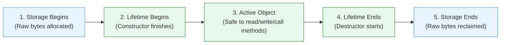

# Storage Duration, Lifetime & Temporaries

::: tip What you'll learn

- Separate **Storage Duration** from **Lifetime** — two distinct concepts that beginners routinely conflate
- Master the four C++ storage durations and the exact rules governing construction and reverse-order destruction
- Understand **full-expressions** and the exact moment temporary objects are created and destroyed
- Master **C++17 temporary materialization**, **guaranteed copy elision**, and **reference lifetime extension** — along with the five exceptions that silently create dangling references
:::

## Motivation

Have you ever written a line of C++ like `const auto& x = get_wrapper().data;` or `const char* p = make_string().c_str();` that compiled cleanly, passed quick local tests, and then crashed unpredictably under optimization with a segmentation fault or garbled memory?

Most beginners assume that if a variable or expression gives you a reference or a pointer, the underlying object stays alive as long as you hold that handle. In C++, **memory existing** and **an object being alive** are two different things, and temporary objects have strictly defined expiration points. Understanding these mechanics answers:

- why a piece of memory can exist before an object is born and after it has already died,
- the exact order in which local variables, globals, and temporaries are constructed and destroyed,
- why `const std::string& s = "hello";` is completely safe while `const char* p = std::string("hello").c_str();` is a use-after-free bug,
- why `T x = T{};` in C++17 requires neither a copy constructor nor a move constructor,
- why returning a `const T&` from a helper function breaks reference lifetime extension.

::: tip When this matters most
Writing RAII wrappers, designing factory functions, returning references or views (`std::string_view`, `std::span`), using range-based `for` loops over chained calls, and debugging undefined behavior caused by dangling references.
:::

::: info When you can ignore it
Writing self-contained numeric algorithms that pass small scalar types (`int`, `double`) strictly by value with no references, raw pointers, or custom destructors.
:::

::: danger First, unlearn a common assumption
Holding a reference (`const T&` or `T&&`) or a pointer (`const T*`) to an object **does not keep that object alive** in general. Reference lifetime extension is a narrow, syntactic rule that only fires at the exact moment a temporary is bound directly to a reference variable — not across function boundaries or member accessors.
:::

## Core Idea & Intuition

### Storage Duration vs. Lifetime

To reason accurately about C++ objects, you must separate **where and when the raw bytes exist** from **when a valid C++ object occupies those bytes**:

- **Storage Duration** answers: _When is the raw memory (the house) allocated, and when is it reclaimed by the stack, heap, or OS?_
- **Lifetime** answers: _When does the object living inside that memory (the tenant) finish initialization, and when does its destruction begin?_

For a class type with a non-trivial constructor and destructor:
1. **Storage begins** when raw memory is obtained (e.g., entering a block or calling `operator new`).
2. **Lifetime begins** when the object's initialization (its constructor) **completes**.
3. **Lifetime ends** when the object's destructor call **starts** (or, for trivial types, when its storage is reused or released).
4. **Storage ends** when the raw memory is returned to the stack frame, allocator, or operating system.



Notice the two gaps at the edges: between **Step 1 and Step 2** (e.g., right after `malloc` or `operator new`, before placement `new`), and between **Step 4 and Step 5** (e.g., after an explicit `ptr->~T()`, before `operator delete`). During those windows, the memory address is valid, **but no object is alive there**. Accessing an object outside its lifetime is **undefined behavior (UB)**.

### The Four Storage Durations

Every object in C++ belongs to one of four storage durations:

| Storage Duration | How it is created | When storage & lifetime begin | When lifetime & storage end |
| --- | --- | --- | --- |
| **Automatic** | Local variables, function parameters, non-static temporaries | Storage allocated upon entering the enclosing block `{ ... }`; lifetime begins at the variable's declaration | Destroyed in **strict reverse order of construction** upon exiting the block |
| **Static** | Namespace-scope globals, `static` locals, `static` data members | Zero-initialized before startup; globals initialize before `main`, `static` locals initialize on **first control flow** through their declaration | Destroyed in **reverse order of completion of construction** after `main()` returns |
| **Dynamic** | `new` / `delete`, `std::allocator`, `std::make_unique` / `std::make_shared` | Allocated and constructed on demand at runtime | Destroyed and deallocated explicitly by program logic (or RAII owner) |
| **Thread** | Variables declared with `thread_local` | Independent instance per thread; initialized before first use in that thread | Destroyed in reverse order of construction when that specific thread exits |

::: warning The Static Initialization Order Fiasco
Globals defined in the *same* `.cpp` file (translation unit) are initialized top-to-bottom. However, globals across *different* `.cpp` files have an **unspecified** initialization order. If global `A` in `a.cpp` reads global `B` in `b.cpp` during startup, `B` might not have begun its lifetime yet. Wrapping `B` inside a function as a `static` local variable (*Construct On First Use* idiom) solves this because `static` locals initialize deterministically on first call.
:::

### Temporaries and the Full-Expression Rule

When you evaluate an expression like `make_widget().process()`, C++ often creates an unnamed **temporary object** to hold intermediate results. When does that temporary die?

> **The Full-Expression Rule:** Unless explicitly extended by reference lifetime extension, every temporary object is destroyed as the **last step in evaluating the full-expression** that (lexically) contains the point where it was created. If multiple temporaries are created in the same full-expression, they are destroyed in **reverse order of construction**.

A **full-expression** is an expression that is not a subexpression of any larger expression — most commonly an entire statement ending with `;`, the controlling condition of an `if` / `while` statement, or the initializer of a variable.

```cpp
// The entire line below is ONE full-expression:
consume(make_a(), make_b());
// 1. make_a() creates temporary A
// 2. make_b() creates temporary B  (order of A vs B is unspecified before C++17, right-to-left or left-to-right)
// 3. consume(...) runs using both A and B
// 4. Semicolon reached -> B is destroyed, then A is destroyed (reverse of construction)

```

Because destruction happens at the **end of the full-expression** (not immediately when `consume` returns, and not before `consume` starts), passing temporaries as function arguments is completely safe for the entire duration of the function call.

### Analogy — and Where It Breaks

::: tip A hotel room and a guest
Think of **storage duration** as your hotel room reservation (say, Monday to Friday) and **lifetime** as the guest's actual stay (checking in Monday at 3 PM, checking out Friday at 11 AM).

The room physically exists before check-in and after check-out, but you cannot expect the guest's luggage to still be there on Friday afternoon after checkout. A **temporary object** is a day-use guest whose checkout time is strictly set to the end of the current sentence (`;`).
:::

::: warning Where the analogy breaks
Unlike a hotel guest who might linger in the lobby, a C++ compiler aggressively assumes that once an object's destructor runs, the object no longer exists. Under optimization (`-O2`), reading a member from a destroyed object does not merely read "stale bytes" — the compiler can delete dead stores or eliminate null checks based on the assumption that undefined behavior never occurs.
:::

## Formal Definition / Mechanism

### C++17 Temporary Materialization Conversion

Prior to C++17, a prvalue like `Widget{}` was thought of as immediately creating a temporary object in memory, which was then copied or moved into its destination (with compilers permitted to elide the copy).

C++17 fundamentally redesigned this model by separating **initialization** from **object creation**:

1. **A prvalue is not an object — it is an initialization recipe.** Evaluating `Widget{}` does not allocate storage or create a temporary object yet; it simply describes *how* to initialize a `Widget`.
2. **Guaranteed Copy Elision:** When a prvalue initializes an object of the same (cv-unqualified) type — such as `Widget w = Widget{};` or `return Widget{};` — the recipe is executed **directly in the target object's storage**. Zero temporary objects are created, and `Widget` does not even need a copy or move constructor.
3. **Temporary Materialization Conversion:** Whenever a prvalue appears in a context that actually *requires* a glvalue (an object with identity and a memory address), the compiler performs an implicit **temporary materialization conversion**, turning the prvalue into an **xvalue** by allocating a temporary object and initializing it with the prvalue's recipe.

Temporary materialization happens in only a specific set of situations:

* Binding a reference (`const T&` or `T&&`) to a prvalue.
* Accessing a non-static data member of a class prvalue (e.g., `make_pair().first`).
* Subscripting an array prvalue (`Arr{1, 2}[0]`).
* Performing an lvalue-to-rvalue conversion on a prvalue (e.g., passing a scalar prvalue to a function or evaluating `Widget{}` as a discarded-value expression `Widget{};`).
* Initializing a `std::initializer_list<T>` from a braced init list.

::: info Why this matters
Notice that `sizeof(Widget{})` and `decltype(Widget{})` do **not** require an object identity, so no temporary is materialized. By contrast, `Widget{}.x` accesses a member in memory, so C++17 materializes a temporary object (producing an **xvalue**) and destroys it at the end of the full-expression.
:::

### Reference Lifetime Extension Rules

Normally, a temporary object dies at the end of its full-expression. However, the C++ standard defines a special rule:

> When a **temporary object** (or a non-static data member/base subobject of a temporary object, such as `make_pair().first`) is **directly bound** to a reference variable (`const T&` or `T&&`), the lifetime of the entire temporary object is extended to match the lifetime of that reference.

```cpp
{
    const std::string& ref = std::string("hello"); // Temporary materialized and bound directly to `ref`
    // Temporary stays alive here!
    std::cout << ref << '\n';
} // `ref` goes out of scope -> extended temporary is destroyed here

```

### The Five Exceptions Where Lifetime Is NOT Extended

Because lifetime extension is a **local syntactic rule** checked at the declaration of the reference, the compiler cannot track temporaries across function boundaries or through pointers. Lifetime extension **does NOT happen** in these five cases:

1. **Returning a reference from a function:**
```cpp
const std::string& bad_return() {
    return std::string("dangling"); // Temporary dies when bad_return() exits!
}

```


2. **Binding a temporary to a reference member in a constructor's member initializer list:**
```cpp
struct Holder {
    const std::string& ref;
    Holder() : ref(std::string("dangling")) {} // Temporary dies when Holder() finishes!
};

```


3. **Passing a temporary through a function that returns a reference (forwarding/accessor functions):**
```cpp
const int& identity(const int& x) { return x; }

const int& r = identity(42); // `42` materializes a temporary for parameter `x`,
                             // which dies at the semicolon! `r` is immediately dangling.

```


*(This is the exact reason `const int& m = std::min(1, 2);` is a classic C++ bug!)*
4. **Initializing a reference inside a `new` expression:**
Binding a temporary to a reference member via `new Holder{std::string("x")}` never extended lifetime (and is ill-formed since C++20).
5. **Expressions that do not directly denote the temporary (such as ternary `?:` with mixed lvalue/rvalue branches or user-defined conversions):**
If a temporary is created *inside* a subexpression whose result is not the temporary itself (e.g., `const char* p = std::string("hi").c_str();`), `p` is a pointer, not a reference to the `std::string`, so the `std::string` dies at the semicolon.

## Step-by-Step Example

Let us build a small `Tracer` class that prints exact construction and destruction events alongside memory addresses so we can observe storage duration, reverse destruction, and lifetime extension in action.

### Step 1 — Define a `Tracer` helper

```cpp
#include <iostream>
#include <string>
#include <utility>

struct Tracer {
    std::string name;

    explicit Tracer(std::string n) : name(std::move(n)) {
        std::cout << "[Construct] " << name << " @ " << this << '\n';
    }
    Tracer(const Tracer& other) : name(other.name + "_copy") {
        std::cout << "[Copy]      " << name << " @ " << this << '\n';
    }
    Tracer(Tracer&& other) noexcept : name(other.name + "_moved") {
        std::cout << "[Move]      " << name << " @ " << this << '\n';
    }
    ~Tracer() {
        std::cout << "[Destroy]   " << name << " @ " << this << '\n';
    }
};

```

### Step 2 — Automatic storage and strict reverse destruction

```cpp
void scope_demo() {
    Tracer a{"a"};
    {
        Tracer b{"b"};
        Tracer c{"c"};
        std::cout << "--- leaving inner block ---\n";
    }
    Tracer d{"d"};
    std::cout << "--- leaving outer block ---\n";
}

```

Output:

```text
[Construct] a @ 0x7ffd10
[Construct] b @ 0x7ffd30
[Construct] c @ 0x7ffd50
--- leaving inner block ---
[Destroy]   c @ 0x7ffd50
[Destroy]   b @ 0x7ffd30
[Construct] d @ 0x7ffd30
--- leaving outer block ---
[Destroy]   d @ 0x7ffd30
[Destroy]   a @ 0x7ffd10

```

**Walkthrough:**

1. `b` and `c` are constructed in order, and destroyed in exact reverse order (`c`, then `b`) when the inner `{ ... }` exits.
2. Notice the memory address `0x7ffd30`: after `b`'s lifetime and storage end, the compiler reuses that stack slot for `d`!
3. When `scope_demo()` finishes, `d` is destroyed first, followed by `a`.

### Step 3 — Full-expression temporaries vs. reference lifetime extension

```cpp
Tracer make_tracer(std::string name) {
    return Tracer{std::move(name)}; // Guaranteed copy elision in C++17!
}

void temporary_demo() {
    std::cout << "1. Discarded temporary:\n";
    make_tracer("temp1");
    std::cout << "   (after semicolon)\n\n";

    std::cout << "2. Extended via const T&:\n";
    const Tracer& ref = make_tracer("temp2");
    std::cout << "   (still alive inside scope!)\n";
}

```

Output:

```text
1. Discarded temporary:
[Construct] temp1 @ 0x7ffd70
[Destroy]   temp1 @ 0x7ffd70
   (after semicolon)

2. Extended via const T&:
[Construct] temp2 @ 0x7ffd90
   (still alive inside scope!)
[Destroy]   temp2 @ 0x7ffd90

```

**Walkthrough:**

1. In `make_tracer("temp1");`, no copy or move constructor runs thanks to C++17 guaranteed copy elision. The temporary is materialized and destroyed **before** `"   (after semicolon)"` prints.
2. In `const Tracer& ref = make_tracer("temp2");`, `temp2` binds directly to `ref`, extending its lifetime past the semicolon until `temporary_demo()` exits.

### Step 4 — The hidden trap in chained expressions and range-based `for`

Consider a wrapper that owns a `Tracer` and exposes it via a getter returning a reference:

```cpp
struct Wrapper {
    Tracer item{"inner"};
    const Tracer& get() const { return item; }
};

void dangling_demo() {
    // TRAP 1: Getter breaks lifetime extension
    const Tracer& bad = Wrapper{}.get();
    std::cout << "Using bad reference: " << bad.name << '\n'; // UB! `Wrapper` already died!
}

```

Why did `bad` dangle? Because `Wrapper{}` is a temporary, and `.get()` is a **member function call** returning `const Tracer&`. The compiler only sees a function call returning a reference — it cannot see inside `.get()` to know that the returned reference points inside the temporary `Wrapper{}`. Thus `Wrapper{}` (along with its member `item`) is destroyed at the semicolon!

::: danger The classic range-based `for` trap (and the C++23 fix)
Before C++23, writing `for (auto& x : get_wrapper().items())` expanded to:

```cpp
auto&& __range = get_wrapper().items(); // `get_wrapper()` temporary dies right here!

```

Because `get_wrapper()` was an intermediate temporary whose `.items()` method returned a reference, `get_wrapper()` was destroyed **before the first loop iteration even started**. **C++23** explicitly fixed range-based `for` initializers so that all temporaries created in the range initializer remain alive until the loop finishes — though normal variable declarations like `const auto& r = get_wrapper().items();` still dangle!
:::

## Common Misunderstandings & Pitfalls

### Pitfall 1 — "`const T&` always extends the lifetime of any temporary"

::: danger False
Lifetime extension only works when a temporary (or a direct data member / array element of a temporary, like `Wrapper{}.item`) binds **directly** to the reference variable. The moment a function call sits in between — such as `Wrapper{}.get()` or `std::min(1, 2)` — the chain breaks and the temporary dies at the end of the full-expression.
:::

### Pitfall 2 — "C++17 copy elision is just an optimization that breaks under `-O0`"

::: danger False
Before C++17, copy elision (NRVO/RVO) was an optional optimization that still required an accessible copy or move constructor. Since **C++17**, initializing an object from a prvalue of the same type (`T x = T{};` or `return T{};`) is **guaranteed by the language specification** to construct directly in place. Even types with deleted copy and move constructors (like `std::mutex` or `std::atomic<int>`) can be returned by value from factory functions.
:::

### Pitfall 3 — "Temporaries passed as function arguments die before the function finishes"

::: danger False
Temporaries created inside a function call expression survive until the **entire enclosing full-expression** finishes evaluating — which is *after* the called function returns. Taking `const std::string&` as a function parameter and reading it inside that function is always safe (provided you do not store that reference somewhere that outlives the call).
:::

### Pitfall 4 — "`std::move(x)` ends the lifetime of `x`"

::: danger False
`std::move(x)` is merely a cast to `T&&`. Moving from `x` transfers its internal resources (such as heap pointers) into another object, leaving `x` in a valid but unspecified state. **The lifetime of `x` continues unchanged** until `x` naturally leaves its scope or full-expression, at which point its destructor runs as usual.
:::

### Pitfall 5 — "After an object's destructor runs, reading its memory is safe if nothing overwrote it"

::: danger False
Once a non-trivial destructor begins execution, the object's **lifetime has ended**. Reading or writing non-static data members or calling member functions on that address is **undefined behavior**, even if the underlying stack or heap bytes have not yet been reused.
:::

## Practice Check

**Exercise 1.** Predict the exact order in which `t1`, `t2`, `t3`, and `t4` are destroyed in the following code:

```cpp
void exercise1() {
    Tracer t1{"t1"};
    const Tracer& t2 = Tracer{"t2"};
    {
        Tracer t3{"t3"};
        Tracer{"t4"};
        std::cout << "Inside inner block\n";
    }
    std::cout << "Before function exit\n";
}

```

**Exercise 2.** Identify which of the following five snippets produce a **dangling reference / pointer** (undefined behavior) and explain why:

```cpp
// Snippet A
const std::string& a = std::string("hello") + " world";

// Snippet B
const char* b = (std::string("hello") + " world").c_str();

// Snippet C
struct Pair { std::string first; int second; };
const std::string& c = Pair{"abc", 123}.first;

// Snippet D
const int& d = std::max(10, 20);

// Snippet E
void take(const std::string& s) { std::cout << s << '\n'; }
void caller() { take(std::string("temporary")); }

```

**Exercise 3.** Under C++17 rules, which of the following expressions trigger **temporary materialization** (creating an actual temporary object in memory)?

1. `sizeof(Tracer{"a"})`
2. `Tracer x = Tracer{"b"};`
3. `Tracer{"c"}.name`
4. `const Tracer& r = Tracer{"d"};`

### Solutions

::: details Exercise 1 — Destruction order walkthrough

Exact destruction order: **`t4` $\rightarrow$ `t3` $\rightarrow$ `t2` $\rightarrow$ `t1**`.

1. `Tracer{"t4"};` creates a temporary whose lifetime is not extended, so **`t4`** is destroyed immediately at its semicolon — *before* `"Inside inner block"` prints.
2. When the inner `{ ... }` exits, **`t3`** is destroyed.
3. `"Before function exit"` prints.
4. When `exercise1()` exits, local variables (and lifetime-extended temporaries bound to local references) are destroyed in strict reverse order of construction: **`t2`** first, then **`t1`**.
:::

::: details Exercise 2 — Dangling reference audit

* **Snippet A — SAFE ✅:** The prvalue `std::string` resulting from `+` binds directly to `const std::string& a`, extending its lifetime to the end of `a`'s scope.
* **Snippet B — DANGLING ❌:** `.c_str()` returns a `const char*` pointer into the temporary `std::string`'s internal buffer. Because `b` is a pointer (not a reference to the `std::string`), the temporary dies at the semicolon, leaving `b` dangling.
* **Snippet C — SAFE ✅:** Binding a reference directly to a non-static data member (`Pair{...}.first`) of a temporary extends the lifetime of the **entire** `Pair` temporary to match `c`.
* **Snippet D — DANGLING ❌:** `10` and `20` materialize temporary `int` objects bound to `std::max`'s `const int&` parameters. `std::max` returns one of those references, and both temporaries are destroyed at the semicolon, leaving `d` dangling.
* **Snippet E — SAFE ✅:** The temporary `std::string("temporary")` remains alive for the entire full-expression `take(...)`, which includes the full execution of `take()`.
:::

::: details Exercise 3 — C++17 temporary materialization

1. `sizeof(Tracer{"a"})` — **No materialization.** `sizeof` is an unevaluated operand; the compiler only inspects the static type.
2. `Tracer x = Tracer{"b"};` — **No materialization.** Guaranteed copy elision constructs `x` directly in place from the prvalue recipe.
3. `Tracer{"c"}.name` — **Materialized ✅.** Accessing a data member requires a glvalue (an object in memory), so C++17 materializes a temporary `Tracer` (as an xvalue) and destroys it at the end of the full-expression.
4. `const Tracer& r = Tracer{"d"};` — **Materialized ✅.** Binding a reference requires an object identity in memory, so a temporary `Tracer` is materialized and its lifetime is extended to match `r`.
:::

## Summary

* **Storage duration** governs when raw memory is allocated and reclaimed; **lifetime** governs when a valid object exists inside that memory (from constructor completion to destructor start). Accessing an object outside its lifetime is undefined behavior.
* C++ defines four storage durations: **automatic** (block scope, reverse destruction), **static** (program scope, Construct On First Use avoids cross-TU init order bugs), **dynamic** (`new`/`delete`, managed via RAII), and **thread** (`thread_local`).
* Unless extended, temporary objects are destroyed at the **end of the enclosing full-expression** in reverse order of construction.
* Since **C++17**, a prvalue is an initialization recipe rather than an object; **guaranteed copy elision** constructs objects directly in place, and **temporary materialization** only creates an object in memory when a glvalue identity is required.
* Binding a temporary directly to `const T&` or `T&&` extends its lifetime to match the reference, **but passing a temporary through any function or getter breaks the extension chain**.

## Quick Reference

### Storage Durations at a Glance

| Storage Duration | Keyword / Declaration | Initialization Timing | Destruction Timing |
| --- | --- | --- | --- |
| **Automatic** | Local variable / parameter | When execution reaches declaration | Reverse order at block exit `}` |
| **Static (Global)** | Namespace scope / `static` member | Before `main()` (unspecified order across `.cpp` files) | Reverse order after `main()` |
| **Static (Local)** | `static` inside function | Thread-safe on first execution of declaration | Reverse order after `main()` |
| **Dynamic** | `new` / `std::make_unique` | At `new` expression evaluation | At `delete` or owner destruction |
| **Thread** | `thread_local` | Before first use in each thread | Reverse order on thread exit |

### Reference Lifetime Extension: Safe vs. Dangling

| Pattern | Safe or Dangling? | Reason |
| --- | --- | --- |
| `const T& r = make_T();` | ✅ Safe | Temporary prvalue binds directly to `r` |
| `T&& r = make_T();` | ✅ Safe | Temporary prvalue binds directly to `r` |
| `const auto& m = make_struct().member;` | ✅ Safe | Direct data member of temporary extends whole temporary |
| `foo(make_T());` (where `foo(const T&)`) | ✅ Safe | Temporary lives until outer full-expression `;` ends |
| `const auto& m = make_struct().getter();` | ❌ Dangling | Function call hides the temporary from the compiler |
| `const int& m = std::min(1, 2);` | ❌ Dangling | `std::min` returns a reference to a parameter temporary |
| `const char* p = make_str().c_str();` | ❌ Dangling | Pointer does not extend `std::string` temporary |
| `const T& f() { return make_T(); }` | ❌ Dangling | Returning a reference never extends a local temporary |

```
