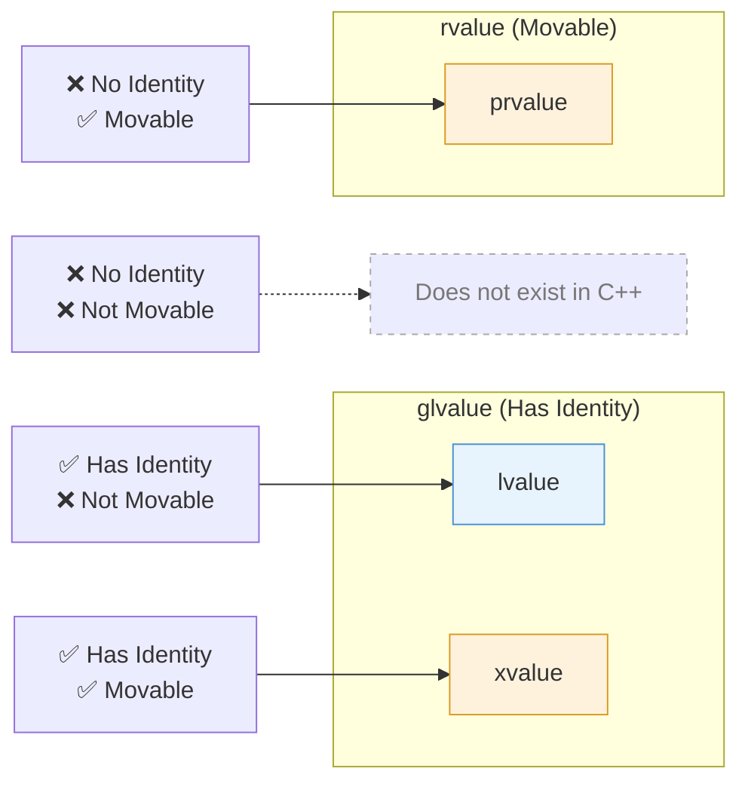

# Expressions and Value Categories: lvalues, prvalues, and xvalues

::: tip What you'll learn
* Why every C++ expression carries **two independent attributes**: a **type** and a **value category**
* How to classify any expression using two simple questions (**identity** and **reusability**)
* The exact relationships among **lvalues**, **prvalues**, **xvalues**, **glvalues**, and **rvalues**
* How to observe value categories firsthand using function overload resolution (`f(int&)` vs. `f(int&&)`)
* How to avoid the most common beginner traps — including why a named rvalue reference is actually an lvalue
:::

## Motivation

Suppose you write the following declaration and four expressions in C++:

```cpp
int a = 10;
```

1. `a`
2. `a + 5`
3. `42`
4. `std::move(a)`

All four are completely valid expressions, and all four produce an `int`. Yet the compiler treats them very differently. If you try to take their memory addresses with `&`, only **one** of them compiles:

```cpp
&a;             // OK: compiles cleanly
&(a + 5);       // Error: cannot take the address of an rvalue
&42;            // Error: cannot take the address of an rvalue
&std::move(a);  // Error: cannot take the address of an rvalue
```

Why does `&a` work while `&(a + 5)` and `&std::move(a)` fail, even though every single one has the type `int`?

The answer lies in **value categories**. Type alone only tells the compiler *what kind of data* an expression represents (for example, a 32-bit integer) and *what operations* are valid on that data. It does not tell the compiler *where that data lives*, *how long it will survive*, or *whether its internal resources may be safely cannibalized*.

Value categories fill that gap. They govern:

* whether you can take an expression's address (`&expr`),
* whether an expression can appear on the left-hand side of built-in assignment (`=`),
* which overloaded function the compiler selects (`f(int&)` vs. `f(int&&)`),
* when temporary objects get their lifetimes extended, and
* how modern C++ implements **move semantics** without breaking backward compatibility.

::: tip When this matters most
Understanding compiler errors like *"cannot bind non-const lvalue reference to an rvalue"*, writing or reading modern C++ APIs that accept `T&&`, and knowing when `std::move` actually enables a move versus silently falling back to a copy.
:::

::: danger First, unlearn the old classroom slogan
If you have heard *"lvalues go on the left of `=`, and rvalues go on the right of `=`"*, **forget it right now**. That rule came from 1970s C, and C++ violates it in both directions:

* `const int x = 5;` — `x` is an **lvalue**, yet `x = 10;` is illegal because it is `const` (non-modifiable).
* `int y = x;` — `x` is an **lvalue**, yet it sits on the **right** of `=` (via lvalue-to-rvalue conversion).
* `std::string{"hi"} = "bye";` — `std::string{"hi"}` is a **prvalue**, yet calling its non-`const` `operator=` member function on the left of `=` is allowed in C++.

Position around `=` is a historical accident, not a definition.
:::

## Core Idea & Intuition

### Every expression has two independent attributes

An **expression** is any piece of code that computes a value or designates an object or function — such as `42`, `a`, `a + b`, `++a`, or `std::move(a)`.

Whenever the C++ compiler analyzes an expression, it tracks **two completely separate properties**:

1. **Type** — What kind of value or object does this expression produce or designate? (`int`, `double`, `std::string`, etc.)
2. **Value Category** — How does this expression behave in terms of object identity and resource reusability? (`lvalue`, `prvalue`, or `xvalue`)

::: warning Crucial rule: Expressions never have reference types
If you declare `int& ref = a;` or `int&& rref = 42;`, the **variables** `ref` and `rref` have reference types (`int&` and `int&&`). However, as soon as you use `ref` or `rref` in an expression, C++ strips the reference from the expression's type before doing anything else.

Both the expression `ref` and the expression `rref` have the non-reference **type** `int`. What distinguishes them from `42` is their **value category**.
:::

### Two questions that classify every expression

Instead of memorizing dozens of arbitrary rules, ask two straightforward questions about any expression `E`:

1. **Does `E` have identity?**
Can you point to a specific, identifiable location in memory (or a specific function) that outlives the immediate subexpression? In practical terms: *if you evaluated `E` twice, would you be referring to the exact same object?*
* If **Yes**, `E` is a **glvalue** (*generalized lvalue*).
* If **No**, `E` has no persistent home; it is just a transient result.


2. **Can `E`'s resources be reused (i.e., moved from)?**
Is the object behind `E` either an unnamed temporary or explicitly marked as "about to be discarded", meaning another function is allowed to steal its internal buffers or handles without breaking anything?
* If **Yes**, `E` is an **rvalue**.
* If **No**, `E` is actively in use and must not be pilfered.


Combining these two yes/no answers yields four logical combinations. C++ uses three of them as its fundamental value categories; the fourth — neither identity nor movability — would be useless, so it does not exist:



### The three primary categories and two umbrella groups

| Category | Identity? | Movable? | Plain-English Meaning |
| --- | --- | --- | --- |
| **lvalue** | ✅ Yes | ❌ No | A regular, identifiable object in memory that you plan to keep using. |
| **prvalue** | ❌ No | ✅ Yes | A **p**ure **r**value: a raw value or unmaterialized temporary with no name or address. |
| **xvalue** | ✅ Yes | ✅ Yes | An e**x**piring value: an identifiable object whose resources are cleared for reuse. |

Because some C++ rules care only about *identity* while others care only about *movability*, the standard groups these three into **two overlapping umbrella categories**:

* **glvalue** = `lvalue` $\cup$ `xvalue` (everything that has **identity**).
* **rvalue** = `prvalue` $\cup$ `xvalue` (everything that is **movable**).

Notice that **`xvalue` sits in the overlap**: it has identity like an `lvalue`, but permission to be moved from like a `prvalue`.

### An everyday analogy — and where it stops

::: tip A house, a cup of coffee, and an estate sale
* An **lvalue** is **your house**. It has a street address (identity), you can invite guests over (`&house`), and nobody is allowed to haul away your furniture without asking.
* A **prvalue** is **the aroma of freshly brewed coffee** drifting across the kitchen. You can enjoy it right now (use it to initialize a variable or compute a result), but you cannot mail a letter to the aroma — it has no street address.
* An **xvalue** is **a house on closing day with an "Everything Must Go" sign**. It still has a street address (identity), so you know exactly which house it is, but the owner has explicitly declared that movers may strip the furniture out of it.
:::

::: warning Where the analogy breaks
An `xvalue` does **not** automatically destroy or empty the object. Putting an "Everything Must Go" sign on the house (`std::move(x)`) only grants **permission**. If nobody shows up with a moving truck (i.e., if no move constructor or move assignment operator runs), the furniture stays right where it is.
:::

## Common Expressions at a Glance

Before writing code, let's see how common C++ expressions map onto the three categories — and *why*.

### 1. Literals (`42`, `3.14`, `true`, `nullptr`) → **prvalue**

Numeric, boolean, and pointer literals represent pure values baked into instructions. They do not occupy addressable objects in memory, so they have no identity.

*(Exception: String literals such as `"hello"` are stored in static read-only memory as `const char[6]` arrays, so `"hello"` is an **lvalue** — you can even write `&"hello"`.)*

### 2. Variable names (`a`, `ref`, `rref`) → **lvalue**

Any identifier naming a variable, function parameter, or function has a concrete address in memory and persists beyond the current expression. Even if the variable was declared as `int&& rref`, the expression `rref` has a name, so it has identity and is an **lvalue**.

### 3. Built-in arithmetic (`a + b`, `a * 2`, `-a`) → **prvalue**

Adding `a` and `b` computes a brand-new result. That result is neither `a` nor `b`; it is a transient value with no name, hence a **prvalue**.

### 4. Prefix vs. Postfix Increment (`++a` vs. `a++`) → **lvalue** vs. **prvalue**

This classic comparison makes the "identity" test crystal clear:

* **`++a` (prefix)**: Increments `a` in place and returns `a` itself. Because the result *is* the identifiable object `a`, `++a` is an **lvalue** (`&(++a)` is valid!).
* **`a++` (postfix)**: Saves a snapshot of `a`'s old value, increments `a`, and returns that temporary snapshot. Because the snapshot is a transient copy rather than `a` itself, `a++` is a **prvalue** (`&(a++)` fails to compile).

### 5. Member access (`obj.member`) → inherits from `obj`

When accessing a non-static data member `m` of an object `obj`:

* If `obj` is an **lvalue** (e.g., `person.name`), `person.name` is an **lvalue** — `name` is part of an existing, persistent object.
* If `obj` is an **rvalue** (e.g., `make_person().name` or `std::move(person).name`), the outer object is about to expire, so its subobject `name` is also expiring. Thus `obj.name` becomes an **xvalue**.

### 6. `std::move(a)` and `static_cast<T&&>(a)` → **xvalue**

`std::move(a)` does not execute any runtime instructions. Under the hood, it is literally a type cast: `static_cast<std::remove_reference_t<T>&&>(a)`. Casting an object to an rvalue reference tells the compiler: *"Keep pointing at `a`'s memory address (identity), but treat its resources as eligible for reuse (movable)."* That is exactly the definition of an **xvalue**.

## Hands-On Lab: Observing Value Categories via Overload Resolution

The most practical way to see value categories in action is to watch how C++ chooses between two overloaded functions:

* `void inspect(int& x)` — accepts **only lvalues** (mutable objects we must not steal from).
* `void inspect(int&& x)` — accepts **only rvalues** (`prvalue`s and `xvalue`s — temporaries or expiring objects we are allowed to move from).

### Step 1 — Set up the probe functions

Create a file named `value_categories.cpp` and write the two overloads:

```cpp
#include <iostream>
#include <utility>

void inspect(int& x)
{
    std::cout << "[lvalue]  received value = " << x << '\n';
}

void inspect(int&& x)
{
    std::cout << "[rvalue]  received value = " << x << '\n';
}
```

Why does this work as a detector?

1. An **lvalue** cannot bind to `int&&` (C++ prevents you from accidentally stealing resources from an active variable without explicit permission), so `inspect(int&)` is the only match.
2. An **rvalue** (`prvalue` or `xvalue`) cannot bind to a non-const `int&` (mutating an unnamed temporary that is about to vanish is usually a bug), so `inspect(int&&)` is the only match.

### Step 2 — Feed different expressions into `inspect`

Add a `main()` function that tests variables, literals, operators, `std::move`, and a named rvalue reference:

```cpp
int main()
{
    int a = 10;
    int& lref = a;
    int&& rref = 20;  // rref binds to temporary 20, extending its lifetime

    std::cout << "1. Variable a:          ";
    inspect(a);

    std::cout << "2. Literal 42:          ";
    inspect(42);

    std::cout << "3. Arithmetic a + 5:    ";
    inspect(a + 5);

    std::cout << "4. Prefix ++a:          ";
    inspect(++a);

    std::cout << "5. Postfix a++:         ";
    inspect(a++);

    std::cout << "6. std::move(a):        ";
    inspect(std::move(a));

    std::cout << "7. lvalue ref lref:     ";
    inspect(lref);

    std::cout << "8. Named rvalue rref:   ";
    inspect(rref);  // <-- Watch closely here!

    std::cout << "9. std::move(rref):     ";
    inspect(std::move(rref));

    return 0;
}
```

### Step 3 — Compile and verify the output

Compile with any modern C++ compiler (`g++ -std=c++17 value_categories.cpp -o vc && ./vc`):

```text
1. Variable a:          [lvalue]  received value = 10
2. Literal 42:          [rvalue]  received value = 42
3. Arithmetic a + 5:    [rvalue]  received value = 15
4. Prefix ++a:          [lvalue]  received value = 11
5. Postfix a++:         [rvalue]  received value = 11
6. std::move(a):        [rvalue]  received value = 12
7. lvalue ref lref:     [lvalue]  received value = 12
8. Named rvalue rref:   [lvalue]  received value = 20
9. std::move(rref):     [rvalue]  received value = 20
```

**Look closely at lines 4–5 and 8–9:**

* **Lines 4 & 5 (`++a` vs. `a++`)**: `++a` incremented `a` from `10` to `11` and routed to `[lvalue]`. Then `a++` evaluated to the old value `11` (a temporary snapshot) and routed to `[rvalue]`, while quietly incrementing `a` to `12` in the background (which you can see on line 6).
* **Line 8 (`inspect(rref)`)**: Even though `rref` was declared as `int&&`, passing `rref` by name called `inspect(int&)`. Because `rref` has a name, you could use `rref` again on line 9! If line 8 had silently treated `rref` as an rvalue and cannibalized its resources, line 9 would be reading from a gutted object. C++ protects you by making **every named variable an lvalue**, regardless of its declared type.

::: tip Going one step further: distinguishing prvalue vs. xvalue
Overload resolution (`T&` vs. `T&&`) groups `prvalue` and `xvalue` together as **rvalues**. If you ever want the compiler to distinguish all three categories, wrap the expression in double parentheses inside `decltype((expr))`:

* `decltype((expr))` yields `T&` if `expr` is an **lvalue**
* `decltype((expr))` yields `T&&` if `expr` is an **xvalue**
* `decltype((expr))` yields `T` if `expr` is a **prvalue**
:::

## Common Misunderstandings & Pitfalls

### Pitfall 1 — "An lvalue must appear on the left of `=`, and an rvalue on the right"

::: danger False
This rule breaks in both directions:

```cpp
const int a = 10;
a = 20;  // Error: 'a' IS an lvalue (you can take &a), just non-modifiable.

int b = a;  // 'a' is on the RIGHT of '=', yet 'a' is still an lvalue!
```

Whether an expression is an lvalue depends on whether it designates an **identifiable object**, not where it sits around `=`. When an lvalue appears on the right-hand side of `=`, C++ simply performs an implicit **lvalue-to-rvalue conversion** to read its stored value.
:::

### Pitfall 2 — "A named rvalue reference variable is an rvalue"

::: danger False — This is the #1 bug in beginner move-semantics code
```cpp
void process(std::string&& s)
{
    // Inside this function, 's' has a name and an address (&s is valid).
    // Therefore, the expression 's' is an LVALUE!
    std::string copy = s;              // Calls COPY constructor, NOT move!
    std::string moved = std::move(s);  // Calls MOVE constructor.
}
```

**Rule of thumb:** *If it has a name, it is an lvalue.* Always distinguish between:

* **Variable type** (`std::string&&`): determines what `s` can bind to during initialization.
* **Expression value category** (`lvalue`): determines how `s` behaves when used in subsequent statements.
:::

### Pitfall 3 — "`std::move(x)` immediately moves or destroys `x`"

::: danger False
`std::move(x)` does **zero runtime work**. It does not touch `x`'s memory, set pointers to `nullptr`, or invoke a destructor.

```cpp
std::string name = "Alice";
std::move(name);  // Compiles, does literally nothing! 'name' is still "Alice".

const std::string title = "Engineer";
std::string other = std::move(title);  // Still COPIES! 'const' blocks moving.
```

`std::move(x)` merely converts the expression `x` from an **lvalue** into an **xvalue** — an "eligible to be moved from" tag. Actual resource transfer happens **only if** that xvalue is subsequently passed to a function or constructor that accepts an rvalue reference (such as `std::string(std::string&&)`). If you pass `std::move(title)` where `title` is `const`, `std::move` produces a `const std::string&&`, which cannot bind to a non-const `std::string&&` move constructor, so C++ quietly falls back to `const std::string&` and copies it anyway.
:::

## Practice Check

Test your understanding on the exercises below before checking the solutions.

**Exercise 1.** Given the declarations below, classify each expression as **lvalue**, **prvalue**, or **xvalue**, and state whether `&expr` compiles:

```cpp
int x = 5;
int arr[4] = {1, 2, 3, 4};
int&& r = std::move(x);
```

1. `x`
2. `100`
3. `x * 2`
4. `++x`
5. `x++`
6. `arr[2]`
7. `r`
8. `std::move(x)`
9. `"C++"`

**Exercise 2.** Predict the exact console output of the following program:

```cpp
#include <iostream>
#include <utility>

void tag(int&)  { std::cout << "L\n"; }
void tag(int&&) { std::cout << "R\n"; }

void forward_attempt(int&& param)
{
    tag(param);
    tag(std::move(param));
}

int main()
{
    int v = 1;
    tag(v);
    forward_attempt(2);
}
```

**Exercise 3.** Spot the subtle performance bug in this constructor:

```cpp
#include <string>
#include <utility>

struct User {
    std::string username;

    User(std::string&& name)
        : username(name) {}
};
```

### Solutions

::: details Exercise 1 — Answers

| # | Expression | Category | `&expr` compiles? | Reason |
| --- | --- | --- | --- | --- |
| 1 | `x` | lvalue | ✅ Yes | Named variable with a persistent memory address. |
| 2 | `100` | prvalue | ❌ No | Pure numeric literal; no addressable object. |
| 3 | `x * 2` | prvalue | ❌ No | Built-in arithmetic produces a transient result. |
| 4 | `++x` | lvalue | ✅ Yes | Prefix increment mutates and returns `x` itself. |
| 5 | `x++` | prvalue | ❌ No | Postfix increment returns a temporary copy of the old value. |
| 6 | `arr[2]` | lvalue | ✅ Yes | Subscripting an array lvalue yields an identifiable element. |
| 7 | `r` | lvalue | ✅ Yes | `r` is a named variable; expressions with names are lvalues. |
| 8 | `std::move(x)` | xvalue | ❌ No | Cast to `int&&`; has identity (`x`) and is movable (an rvalue). |
| 9 | `"C++"` | lvalue | ✅ Yes | String literals live in static storage as `const char[4]` arrays. |

:::

::: details Exercise 2 — Answers
Output:

```text
L
L
R
```

1. `tag(v)` passes the named variable `v` (an **lvalue**), calling `tag(int&)` → prints `L`.
2. `forward_attempt(2)` binds `param` to the prvalue `2`. Inside `forward_attempt`, `param` is a **named variable**, so `tag(param)` treats `param` as an **lvalue** and calls `tag(int&)` → prints `L`.
3. `tag(std::move(param))` casts `param` to an **xvalue**, which is an rvalue, so it calls `tag(int&&)` → prints `R`.
:::

::: details Exercise 3 — Answers
Inside `User(std::string&& name)`, `name` has a variable name, making the expression `name` an **lvalue**. Writing `: username(name)` invokes `std::string`'s **copy constructor** instead of its move constructor, allocating a brand-new heap buffer even though the caller explicitly passed an rvalue!

Fix: cast `name` back to an xvalue with `std::move`:

```cpp
User(std::string&& name)
    : username(std::move(name)) {}
```
:::

## Summary

* Every C++ expression has **two independent attributes**: a non-reference **type** and a **value category** (`lvalue`, `prvalue`, or `xvalue`).
* Classify any expression with **two questions**:
1. Does it have **identity** (an identifiable memory address or function)? → **glvalue** (`lvalue` or `xvalue`).
2. May its resources be **reused / moved from**? → **rvalue** (`prvalue` or `xvalue`).


* **lvalue**: has identity, not movable (`a`, `++a`, `arr[i]`, `"hello"`, and any named reference variable like `rref`).
* **prvalue**: no identity, movable (`42`, `a + b`, `a++`, functions returning by value).
* **xvalue**: has identity *and* movable (`std::move(a)`, `static_cast<T&&>(a)`, member access on an rvalue).
* **`std::move` does not move anything** — it is a zero-cost cast that produces an **xvalue**, granting permission for `T&&` overloads (like move constructors) to steal resources.

## Quick Reference

| Expression | Category | Identity (`glvalue`)? | Movable (`rvalue`)? | `&expr` legal? | Overload selected (`T&` vs. `T&&`) |
| --- | --- | --- | --- | --- | --- |
| `x` (variable name) | lvalue | ✅ | ❌ | ✅ | `T&` |
| `ref` (`int&` variable) | lvalue | ✅ | ❌ | ✅ | `T&` |
| `rref` (`int&&` variable) | lvalue | ✅ | ❌ | ✅ | `T&` |
| `"hello"` (string literal) | lvalue | ✅ | ❌ | ✅ | `const T&` |
| `++x` (built-in prefix) | lvalue | ✅ | ❌ | ✅ | `T&` |
| `x++` (built-in postfix) | prvalue | ❌ | ✅ | ❌ | `T&&` |
| `42` (non-string literal) | prvalue | ❌ | ✅ | ❌ | `T&&` |
| `x + y` (built-in arithmetic) | prvalue | ❌ | ✅ | ❌ | `T&&` |
| `&x` (address-of result; `&(&x)` invalid) | prvalue | ❌ | ✅ | ❌ | `T&&` |
| `func()` (returns by value) | prvalue | ❌ | ✅ | ❌ | `T&&` |
| `func()` (returns `T&`) | lvalue | ✅ | ❌ | ✅ | `T&` |
| `func()` (returns `T&&`) | xvalue | ✅ | ✅ | ❌ | `T&&` |
| `std::move(x)` | xvalue | ✅ | ✅ | ❌ | `T&&` |
| `static_cast<T&&>(x)` | xvalue | ✅ | ✅ | ❌ | `T&&` |
| `obj.m` (`obj` is lvalue) | lvalue | ✅ | ❌ | ✅ | `T&` |
| `obj.m` (`obj` is rvalue) | xvalue | ✅ | ✅ | ❌ | `T&&` |

## Bridge to Lifetime: "Movable" Does Not Mean "Still Alive"

Value categories tell you **how an expression may be used** (whether it has identity, and whether its resources are permitted to be moved from) — they do **not** tell you whether the underlying object is still alive:

* **Movable (`xvalue` / `prvalue`) is not the same as alive:** If a local object has already gone out of scope or been destroyed, turning it into an `xvalue` (`std::move(...)`) does not bring a dead object back to life.
* **`std::move` does not end lifetime:** Calling `std::move(x)` only produces an `xvalue` view; `x` remains alive in a valid-but-unspecified state until its own lifetime/scope ends and its destructor runs.
* **Next up — when temporaries are born and destroyed:** Expressions frequently produce temporaries (`prvalue`s and materialized temporaries), and `const T&` / `T&&` interact with their lifespans. In the next chapter, we examine **storage duration, object lifetime, copy elision, and dangling references**.
