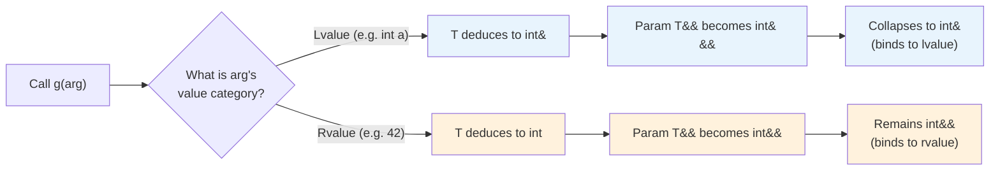
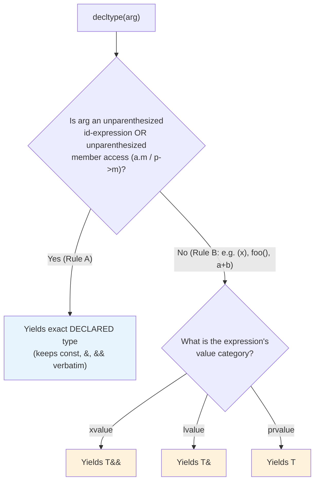

# Reference Binding, Collapsing & `decltype`

::: tip What you'll learn

- Master the complete **reference binding matrix** across `T&`, `const T&`, `T&&`, and `const T&&`
- Internalize the four rules of **reference collapsing** (`&` and `&&`) and the exact contexts where they trigger
- Distinguish a true **forwarding reference** from an ordinary **rvalue reference** at a glance
- Master the two independent rule sets behind `decltype(e)` vs `decltype((e))` — the engine behind value-category detection
:::

## Motivation

Consider two functions whose signatures differ by a single keyword:

```cpp
void f(int&& x);                        // non-template
template <class T> void g(T&& x);       // template

```

If you pass an lvalue `int a = 42;` to both:

* `f(a)` fails to compile: *"cannot bind rvalue reference of type `int&&` to lvalue of type `int`."*
* `g(a)` compiles cleanly and runs without complaint.

Now look at `decltype`:

```cpp
int x = 10;
decltype(x)   a = x;   // type: int
decltype((x)) b = x;   // type: int&

```

Adding a single pair of parentheses turns a value type into a reference type.

Both behaviors look like compiler magic until you see the underlying machinery. Together, **reference binding**, **reference collapsing**, and **`decltype`** bridge C++'s type system and value categories:

* **Reference binding** decides which arguments a function parameter can accept and which overload wins when several are viable.
* **Reference collapsing** explains how the compiler resolves "references to references" (`int& &&`) generated during template instantiation and type-alias substitution — making `T&&` act as a universal receiver.
* **`decltype`** inspects either a declaration or an expression's value category, allowing generic code (like `std::forward`) to preserve whether an argument arrived as an lvalue or an rvalue.

::: tip When this matters most
Writing function templates, implementing move constructors and perfect-forwarding wrappers (`make_unique`, `emplace_back`), using `decltype(auto)` return types, and debugging template deduction or overload-resolution errors.
:::

::: info When you can ignore it
Writing straightforward non-template code that passes small types by value or `const T&` — though understanding `decltype(auto)` and overload rules still prevents subtle lifetime bugs.
:::

## Core Idea & Intuition

### The four reference types and the binding matrix

C++ provides four combinations of `const` and `&` / `&&` for binding to an object of type `T`:

1. **`T&` (non-const lvalue reference):** The pickiest reference. Because the callee is allowed to mutate the referent, it only accepts **modifiable lvalues**. Binding it to a `const` object would break `const`-correctness; binding it to a temporary (rvalue) would let you mutate an object that is about to vanish.
2. **`const T&` (const lvalue reference):** The universal acceptor. Because it promises not to modify the referent, it binds to **everything** — modifiable lvalues, `const` lvalues, modifiable rvalues, and `const` rvalues (extending the lifetime of temporaries).
3. **`T&&` (non-const rvalue reference):** The resource-stealing reference. It binds only to **non-const rvalues** (temporaries and `std::move` results) whose resources can safely be pilfered. It refuses lvalues (so it will not accidentally gut a variable you still plan to use) and refuses `const` rvalues (because moving typically mutates the source).
4. **`const T&&` (const rvalue reference):** Binds only to rvalues, yet forbids modifying them. You almost never write this as an active overload; its primary real-world job is `= delete` to explicitly block rvalues from calling a `const T&` overload (for example, `std::cref(const T&&) = delete` prevents dangling references to temporaries).

#### Complete Reference Binding & Overload Priority Matrix

When multiple overloads coexist, the compiler does not merely check legality — it ranks viable matches (`1st` = best match, `2nd` = fallback, `3rd` = last resort):

| Argument Category | `T&` | `const T&` | `T&&` | `const T&&` |
| --- | --- | --- | --- | --- |
| **Modifiable lvalue** | ✅ (**1st**) | ✅ (**2nd**) | ❌ | ❌ |
| **`const` lvalue** | ❌ | ✅ (**1st**) | ❌ | ❌ |
| **Modifiable rvalue** | ❌ | ✅ (**3rd**) | ✅ (**1st**) | ✅ (**2nd**) |
| **`const` rvalue** | ❌ | ✅ (**2nd**) | ❌ | ✅ (**1st**) |

Notice two crucial takeaways from this grid:

* **`const T&` is the only column with four ✅ checkmarks.** Whenever no specialized overload exists, `const T&` catches every possible argument.
* **Exact cv-qualification and reference-kind beat conversions.** A modifiable rvalue prefers `T&&` (1st) over `const T&&` (2nd, requires adding `const`), which in turn beats `const T&` (3rd, requires converting rvalue to const lvalue).

---

### Reference collapsing: the "multiplication table" of references

C++ syntax strictly forbids programmers from writing a reference to a reference directly:

```cpp
int x = 1;
int& & r = x;   // ❌ Syntax error: cannot declare a reference to a reference

```

Why? Because a reference is an alias, not an object in memory — you cannot create an alias to an alias.

However, **indirect type substitution** routinely produces "references to references" behind the scenes. Specifically, reference collapsing occurs in **four language contexts**:

1. **Template type parameter deduction** (`template <class T> void f(T&&)`)
2. **`auto&&` type deduction** (`auto&& r = expr;`)
3. **`typedef` / `using` type aliases** (`using LRef = int&; LRef&& r = x;`)
4. **`decltype` type specifiers** (`decltype(r)& x = a;`)

Whenever two reference tokens meet through one of these four mechanisms, the compiler collapses them according to four deterministic rules:

| Outer \ Inner | `&` (lvalue ref) | `&&` (rvalue ref) |
| --- | --- | --- |
| **`&`** | `T&  &` $\rightarrow$ **`T&`** | `T&  &&` $\rightarrow$ **`T&`** |
| **`&&`** | `T&& &` $\rightarrow$ **`T&`** | `T&& &&` $\rightarrow$ **`T&&`** |

::: tip One-sentence rule of thumb
**Lvalue references are contagious:** if *either* side has a single `&`, the result collapses to `&`. The result is `&&` **if and only if** *both* sides are `&&`.
:::

---

### Forwarding reference vs. ordinary rvalue reference

When you see `T&&` in C++ code, it means one of two completely different things depending on context.

::: danger The Golden Criterion for Forwarding References
A parameter written as `T&&` (or `auto&&`) is a **forwarding reference** (historically called a *universal reference*) **if and only if** both conditions hold:

1. **Type deduction occurs** for `T` at the point where the parameter is bound (such as a function template's own template parameter, or `auto&&`).
2. **The parameter's declared form is strictly `T&&` or `auto&&**` — with **no** `const`/`volatile` qualifiers and **no** surrounding type constructors (like `std::vector<T>&&`).

If either condition fails, `T&&` is a plain **rvalue reference**.
:::

Let us trace what happens inside `template <class T> void g(T&& param)` for both argument categories:



Look at why this works:

* **Case 1 — Passing an lvalue (`int a = 10; g(a);`):** C++ has a special template argument deduction rule for forwarding references: when the argument is an lvalue of type `U`, `T` is deduced as **`U&`** (`int&`). Substituting `T = int&` into `T&&` yields `int& &&`, which collapses to **`int&`**. Thus `param` becomes an lvalue reference bound to `a`.
* **Case 2 — Passing an rvalue (`g(42);` or `g(std::move(a));`):** When the argument is an rvalue of type `U`, `T` is deduced as a non-reference **`U`** (`int`). Substituting `T = int` into `T&&` yields **`int&&`**. Thus `param` becomes an rvalue reference bound to the temporary.

Notice the clever encoding: **`T` itself records the value category of the caller's argument** (`T` is `U&` for lvalues, and non-reference `U` for rvalues). That single fact is what makes `std::forward<T>(param)` possible.

## Formal Definition / Mechanism

### The two independent rule sets of `decltype`

Unlike `auto` (which uses template argument deduction and strips references and top-level `const`), `decltype` inspects the exact AST node you pass to it using **two completely separate rules**:

#### Rule A — Unparenthesized identifier or class member access: `decltype(e)`

If `e` is:

* an **unparenthesized id-expression** (the name of a variable, function, parameter, or data member, e.g. `decltype(x)`), **or**
* an **unparenthesized class member access** (`decltype(obj.member)` or `decltype(ptr->member)`),

then `decltype(e)` evaluates to the **exact declared type** of that entity — preserving top-level `const`, `volatile`, `&`, and `&&` untouched.

#### Rule B — Any other expression: `decltype(expr)` (including `decltype((x))`)

If `expr` is **any other expression** — including a variable wrapped in extra parentheses `decltype((x))`, a function call `decltype(foo())`, an arithmetic expression `decltype(a + b)`, or an assignment `decltype(a = b)` — then `decltype(expr)` inspects the expression's **value category** and non-reference type `T`:

* If `expr` is an **xvalue** $\rightarrow$ `decltype(expr)` is **`T&&`**
* If `expr` is an **lvalue** $\rightarrow$ `decltype(expr)` is **`T&`**
* If `expr` is a **prvalue** $\rightarrow$ `decltype(expr)` is **`T`**



::: warning Why `decltype((x))` changes the result
In C++, `x` is an identifier naming a variable (Rule A), whereas `(x)` is a parenthesized expression whose evaluation produces an lvalue referring to `x` (Rule B). Wrapping a variable in parentheses switches the compiler from **"look up its declaration"** to **"evaluate its value category."**
:::

---

### Why `decltype(auto)` preserves return types — and its classic trap

Introduced in C++14, `decltype(auto)` tells the compiler: *"infer the type from the initializer, but use `decltype`'s rules instead of `auto`'s template-deduction rules."*

Compare how `auto` and `decltype(auto)` deduce the same expressions:

```cpp
int x = 10;
const int& cref = x;

auto           v1 = cref;   // int        (auto strips reference and top-level const)
decltype(auto) v2 = cref;   // const int& (Rule A: exact declared type of cref)
decltype(auto) v3 = (x);    // int&       (Rule B: (x) is an lvalue expression of type int)

```

This makes `decltype(auto)` indispensable in generic wrapper functions that must return whatever a wrapped callable returns — whether by value (`T`) or by reference (`T&` / `const T&`):

```cpp
template <typename Func, typename... Args>
decltype(auto) call_and_log(Func&& f, Args&&... args)
{
    // If f returns int&, this returns int&.
    // If f returns std::string by value, this returns std::string.
    return std::forward<Func>(f)(std::forward<Args>(args)...);
}

```

::: danger The `return (local);` dangling-reference trap
With `decltype(auto)` as a return type, adding parentheses around a local variable name is undefined behavior:

```cpp
decltype(auto) bad_factory()
{
    int local = 42;
    return (local);   // ❌ (local) is an lvalue expression -> return type becomes int&!
                      //    Returns a dangling reference to a destroyed stack variable.
}

decltype(auto) good_factory()
{
    int local = 42;
    return local;     // ✅ local is an unparenthesized id -> return type is int (by value).
}

```

:::

## Step-by-Step Example

Let us verify every rule in runnable C++ code.

### Step 1 — Overload resolution in action

```cpp
#include <iostream>
#include <utility>

void probe(int&)        { std::cout << "1: int&\n"; }
void probe(const int&)  { std::cout << "2: const int&\n"; }
void probe(int&&)       { std::cout << "3: int&&\n"; }
void probe(const int&&) { std::cout << "4: const int&&\n"; }

int main()
{
    int x = 10;
    const int cx = 20;

    probe(x);              // modifiable lvalue -> 1: int&
    probe(cx);             // const lvalue      -> 2: const int&
    probe(30);             // modifiable rvalue -> 3: int&&
    probe(std::move(x));   // modifiable rvalue -> 3: int&&
    probe(std::move(cx));  // const rvalue      -> 4: const int&&
}

```

Output:

```text
1: int&
2: const int&
3: int&&
3: int&&
4: const int&&

```

If you comment out overload `4` (`const int&&`), `probe(std::move(cx))` falls back to overload `2` (`const int&`), because a `const` rvalue cannot bind to `int&&` (which would drop `const`), leaving `const int&` as the sole viable candidate.

### Step 2 — Hand-computing reference collapsing with `using` aliases

```cpp
#include <type_traits>

using LRef = int&;
using RRef = int&&;

static_assert(std::is_same_v<LRef&,  int&>);   // int&  &  -> int&
static_assert(std::is_same_v<LRef&&, int&>);   // int&  && -> int&
static_assert(std::is_same_v<RRef&,  int&>);   // int&& &  -> int&
static_assert(std::is_same_v<RRef&&, int&&>);  // int&& && -> int&&

```

Look at the third assertion (`RRef&` $\rightarrow$ `int&`): even if a typedef already holds an rvalue reference `int&&`, applying `&` to it collapses the type back into an lvalue reference `int&`.

### Step 3 — The two faces of a forwarding reference

Inside a template taking `T&& arg`, `T` captures the caller's value category, yet the parameter `arg` *itself* has a name — which makes `arg` an lvalue expression inside the function body:

```cpp
#include <iostream>
#include <type_traits>
#include <utility>

template <typename T>
void inspect(T&& arg)
{
    std::cout << "is_lvalue_reference<T>:              "
              << std::is_lvalue_reference_v<T> << '\n';
    std::cout << "is_lvalue_reference<decltype((arg))>: "
              << std::is_lvalue_reference_v<decltype((arg))> << "\n\n";
}

int main()
{
    int a = 5;
    std::cout << "--- Passing lvalue a ---\n";
    inspect(a);

    std::cout << "--- Passing rvalue 5 ---\n";
    inspect(5);
}

```

Output:

```text
--- Passing lvalue a ---
is_lvalue_reference<T>:              1
is_lvalue_reference<decltype((arg))>: 1

--- Passing rvalue 5 ---
is_lvalue_reference<T>:              0
is_lvalue_reference<decltype((arg))>: 1

```

Notice the second block: when `5` is passed, `T` is deduced as `int` (not a reference), so `arg` has declared type `int&&`. Nevertheless, `decltype((arg))` is `int&` because `arg` is a named variable — an lvalue! That is why passing `arg` onward without `std::forward<T>(arg)` would always pass an lvalue.

### Step 4 — `decltype(e)` vs `decltype((e))` side by side

```cpp
#include <type_traits>
#include <utility>

struct Box {
    int val;
    int& ref;
};

int main()
{
    int a = 1;
    int&& r = std::move(a);
    Box box{a, a};

    // 1. Variable with rvalue-reference declared type
    static_assert(std::is_same_v<decltype(r),   int&&>);  // Rule A: declared type
    static_assert(std::is_same_v<decltype((r)), int&>);   // Rule B: r is an lvalue

    // 2. Member access on an lvalue object
    static_assert(std::is_same_v<decltype(box.val),   int>);   // Rule A: declared type of val
    static_assert(std::is_same_v<decltype((box.val)), int&>);  // Rule B: lvalue member access
    static_assert(std::is_same_v<decltype(box.ref),   int&>);  // Rule A: declared type of ref
    static_assert(std::is_same_v<decltype((box.ref)), int&>);  // Rule B: lvalue of type int

    // 3. Member access on an rvalue object
    static_assert(std::is_same_v<decltype(Box{a, a}.val),   int>);    // Rule A: declared type of val
    static_assert(std::is_same_v<decltype((Box{a, a}.val)), int&&>);  // Rule B: xvalue member access!
}

```

Look closely at the last two lines: `Box{a, a}.val` is an unparenthesized member access, so Rule A returns `int` (the member's declared type). Adding parentheses `(Box{a, a}.val)` activates Rule B; because accessing a non-static data member of an rvalue produces an **xvalue**, `decltype((Box{a, a}.val))` yields `int&&`.

## Common Misunderstandings & Pitfalls

### Pitfall 1 — "`const T&&` is a `const` forwarding reference"

::: danger False

```cpp
template <class T>
void f(const T&& x);  // NOT a forwarding reference!

int a = 10;
f(a);  // ❌ Compile error: cannot bind rvalue reference to lvalue

```

The standard specifies that a forwarding reference must have the exact form `cv-unqualified T&&`. Adding `const` disqualifies `T&&` from special lvalue deduction; `x` becomes an ordinary `const` rvalue reference that rejects all lvalues.
:::

### Pitfall 2 — "`T&&` inside a class template member function is a forwarding reference"

::: danger False

```cpp
template <class T>
struct MyVec {
    void push(T&& x);  // NOT a forwarding reference!
};

MyVec<int> v;
int a = 10;
v.push(a);  // ❌ Compile error: T is already fixed to int!

```

When you instantiate `MyVec<int>`, `T` is immediately replaced with `int`, turning the signature into `void push(int&& x)`. No template argument deduction happens when `v.push(...)` is called. To make a member function accept forwarding references, it needs its **own** template parameter — which is why `std::vector<T>::emplace_back` is declared as:

```cpp
template <class... Args>
reference emplace_back(Args&&... args);  // ✅ Args is deduced per call

```

:::

### Pitfall 3 — "`decltype((x))` has redundant parentheses"

::: danger False
In normal C++ expressions, `(x)` and `x` evaluate to the exact same object. Inside `decltype(...)`, however, the outer parentheses are syntactically significant: `decltype(x)` queries the **declaration** (Rule A), while `decltype((x))` queries the **expression's value category** (Rule B). Never add "defensive parentheses" inside `decltype(...)` unless you deliberately want Rule B.
:::

### Pitfall 4 — "Passing a `const` lvalue to `template <class T> void f(T&&)` deduces `T = const int`"

::: danger False

```cpp
template <class T>
void f(T&& x);

const int cx = 42;
f(cx);  // T is deduced as `const int&`, NOT `const int`!

```

Because `cx` is an lvalue of type `const int`, the forwarding-reference deduction rule sets `T = const int&`. Substituting `T` into `T&&` produces `const int& &&`, which collapses to `const int&`. Both `const`-ness and lvalue-ness are preserved cleanly.
:::

### Pitfall 5 — "Using `auto&&` guarantees an rvalue reference"

::: warning Careful — `auto&&` is a forwarding reference
`auto&&` obeys the exact same deduction and reference-collapsing rules as `template <class T> void f(T&&)`:

```cpp
int x = 1;
auto&& r1 = x;   // x is lvalue  -> r1 has type int&
auto&& r2 = 42;  // 42 is rvalue -> r2 has type int&&

```

This is why `for (auto&& elem : container)` is the idiomatic range-based `for` loop in generic code: it binds cleanly to both ordinary containers (yielding `T&` or `const T&`) and proxy-iterator containers like `std::vector<bool>` (where `*it` returns a temporary proxy rvalue, which binds to `auto&&` as `T&&`).
:::

## Practice Check

**Exercise 1 (Reference binding & overload resolution).** Given the overloads below, determine whether each call compiles, and if so, which overload (`A`, `B`, or `C`) is selected:

```cpp
void g(int&);        // Overload A
void g(const int&);  // Overload B
void g(int&&);       // Overload C

int x = 1;
const int cx = 2;

g(x);              // (1)
g(cx);             // (2)
g(3);              // (3)
g(std::move(x));   // (4)
g(std::move(cx));  // (5)

```

Now suppose Overload `B` (`const int&`) is removed, leaving only `A` (`int&`) and `C` (`int&&`). Which of calls `(1)` through `(5)` still compile?

---

**Exercise 2 (Hand-computing reference collapsing).** Given `using L = int&;` and `using R = int&&;`, determine the final collapsed type for each expression:

1. `L&`
2. `L&&`
3. `R&`
4. `R&&`
5. `const L&` (trick question — remember `const` applied to a reference type!)
6. `T&&` when `T = const double&`

---

**Exercise 3 (Spotting true forwarding references).** Which of the following parameters `x` are **forwarding references**?

```cpp
// (1)
template <class T> void f1(T&& x);

// (2)
template <class T> void f2(const T&& x);

// (3)
template <class T> void f3(std::vector<T>&& x);

// (4)
template <class T>
struct Widget {
    void f4(T&& x);

    template <class U>
    void f5(U&& x);
};

// (6)
auto&& x = get_value();

```

---

**Exercise 4 (`decltype` mastery).** Given the declarations below, write the exact type produced by each `decltype`:

```cpp
struct S {
    int m;
    const int& r;
};

int a = 0;
const int ca = 1;
int&& rr = std::move(a);
S s{a, ca};

// (1) decltype(a)
// (2) decltype((a))
// (3) decltype(ca)
// (4) decltype((ca))
// (5) decltype(rr)
// (6) decltype((rr))
// (7) decltype(s.r)
// (8) decltype((s.r))

```

### Solutions

::: details Exercise 1 — Reference binding & overload resolution

With all three overloads present:

1. `g(x)` $\rightarrow$ **Overload A (`int&`)**: exact match for a modifiable lvalue (`B` is viable too, but `A` wins on non-const exactness).
2. `g(cx)` $\rightarrow$ **Overload B (`const int&`)**: `A` cannot bind to `const`; `C` cannot bind to an lvalue.
3. `g(3)` $\rightarrow$ **Overload C (`int&&`)**: exact match for a modifiable rvalue (`B` is viable as fallback, but `C` wins).
4. `g(std::move(x))` $\rightarrow$ **Overload C (`int&&`)**: `std::move(x)` is a modifiable xvalue (an rvalue).
5. `g(std::move(cx))` $\rightarrow$ **Overload B (`const int&`)**: `std::move(cx)` is a `const int` xvalue. `C` (`int&&`) cannot bind because it would strip `const`, so `B` is the only viable match.

If Overload `B` (`const int&`) is removed:

* `(1)` `g(x)` $\rightarrow$ compiles (calls `A`).
* `(2)` `g(cx)` $\rightarrow$ **Compile error** (no overload accepts a `const` lvalue).
* `(3)` `g(3)` $\rightarrow$ compiles (calls `C`).
* `(4)` `g(std::move(x))` $\rightarrow$ compiles (calls `C`).
* `(5)` `g(std::move(cx))` $\rightarrow$ **Compile error** (no overload accepts a `const` rvalue).
:::

::: details Exercise 2 — Hand-computing reference collapsing

1. `L&` = `int& &` $\rightarrow$ **`int&`**
2. `L&&` = `int& &&` $\rightarrow$ **`int&`**
3. `R&` = `int&& &` $\rightarrow$ **`int&`**
4. `R&&` = `int&& &&` $\rightarrow$ **`int&&`**
5. `const L&` $\rightarrow$ **`int&`**. Top-level `const` applied to a reference type alias (`L` is `int&`, not `int`) is ignored in C++ (`const (int&)` is still `int&`), and `int& &` collapses to `int&`. (Contrast this with `const int&`, where `const` qualifies `int`!)
6. `T&&` with `T = const double&` $\rightarrow$ `const double& &&` $\rightarrow$ **`const double&`**.
:::

::: details Exercise 3 — Spotting true forwarding references

* **(1) `f1(T&& x)**` $\rightarrow$ **Yes.** `T` is deduced at call time and the form is unqualified `T&&`.
* **(2) `f2(const T&& x)**` $\rightarrow$ **No.** Qualified with `const`; this is an ordinary `const` rvalue reference.
* **(3) `f3(std::vector<T>&& x)**` $\rightarrow$ **No.** The parameter form is `std::vector<T>&&`, not `T&&`; it only accepts rvalue vectors.
* **(4) `Widget<T>::f4(T&& x)**` $\rightarrow$ **No.** `T` is a class template parameter already fixed when `Widget<T>` is instantiated, not deduced when `f4` is called.
* **(5) `Widget<T>::f5(U&& x)**` $\rightarrow$ **Yes.** `U` is deduced independently when `f5` is called, and the form is unqualified `U&&`.
* **(6) `auto&& x = get_value();**` $\rightarrow$ **Yes.** `auto&&` follows template argument deduction rules with an unqualified `&&`.
:::

::: details Exercise 4 — `decltype` mastery

1. `decltype(a)` $\rightarrow$ **`int`** (Rule A: unparenthesized variable; declared type is `int`).
2. `decltype((a))` $\rightarrow$ **`int&`** (Rule B: `(a)` is an lvalue expression of type `int`).
3. `decltype(ca)` $\rightarrow$ **`const int`** (Rule A: declared type preserves top-level `const`).
4. `decltype((ca))` $\rightarrow$ **`const int&`** (Rule B: `(ca)` is an lvalue expression of type `const int`).
5. `decltype(rr)` $\rightarrow$ **`int&&`** (Rule A: declared type of variable `rr` is `int&&`).
6. `decltype((rr))` $\rightarrow$ **`int&`** (Rule B: the expression `rr` is an lvalue of non-reference type `int`).
7. `decltype(s.r)` $\rightarrow$ **`const int&`** (Rule A: unparenthesized member access yields the member's declared type).
8. `decltype((s.r))` $\rightarrow$ **`const int&`** (Rule B: `(s.r)` is an lvalue expression whose non-reference type is `const int`, yielding `const int&`).
:::

## Summary

* **Four reference flavors cover distinct access contracts:** `T&` binds only to modifiable lvalues; `const T&` binds to everything; `T&&` binds only to modifiable rvalues; `const T&&` binds only to rvalues (mainly used with `= delete`).
* **Reference collapsing resolves nested references deterministically:** whenever template deduction, `auto&&`, `typedef`/`using`, or `decltype` creates a reference to a reference, any single `&` wins (`T& &`, `T& &&`, `T&& &` $\rightarrow$ `T&`), and `T&&` survives only when both sides are `&&`.
* **Forwarding references require two strict conditions:** type deduction at the point of binding *and* the exact, cv-unqualified syntax `T&&` or `auto&&`. They work because lvalues deduce `T = U&` (collapsing `T&&` to `U&`), while rvalues deduce `T = U` (keeping `T&&` as `U&&`).
* **`decltype` runs two separate engines:** `decltype(id)` or `decltype(obj.member)` returns the exact **declared type** (Rule A); `decltype(any_other_expr)` — including `decltype((id))` — maps the expression's **value category** to `T&` (lvalue), `T&&` (xvalue), or `T` (prvalue) (Rule B).
* **Watch the parentheses with `decltype(auto)`:** `return x;` returns by value (`T`), whereas `return (x);` turns `x` into an lvalue expression and returns a dangling reference (`T&`).

## Quick Reference

### 1. Reference Binding & Overload Priority

| Argument Value Category | `T&` | `const T&` | `T&&` | `const T&&` |
| --- | --- | --- | --- | --- |
| **Modifiable lvalue** | ✅ (**1st**) | ✅ (**2nd**) | ❌ | ❌ |
| **`const` lvalue** | ❌ | ✅ (**1st**) | ❌ | ❌ |
| **Modifiable rvalue** | ❌ | ✅ (**3rd**) | ✅ (**1st**) | ✅ (**2nd**) |
| **`const` rvalue** | ❌ | ✅ (**2nd**) | ❌ | ✅ (**1st**) |

### 2. Reference Collapsing Rules

| Formed Type | Collapsed Type | Rule |
| --- | --- | --- |
| `T&  &` | `T&` | At least one `&` $\rightarrow$ lvalue ref |
| `T&  &&` | `T&` | At least one `&` $\rightarrow$ lvalue ref |
| `T&& &` | `T&` | At least one `&` $\rightarrow$ lvalue ref |
| `T&& &&` | `T&&` | Both are `&&` $\rightarrow$ rvalue ref |

### 3. `decltype(e)` vs `decltype((e))`

| Construct | Active Rule | Result |
| --- | --- | --- |
| `decltype(x)` (unparenthesized) | Rule A | Exact declared type of `x` (keeps `const`, `&`, `&&`) |
| `decltype(a.m)` / `decltype(p->m)` | Rule A | Exact declared type of member `m` |
| `decltype((x))` (parenthesized) | Rule B | `T&` (since named variable `x` is an lvalue) |
| `decltype(expr)` (lvalue) | Rule B | `T&` |
| `decltype(expr)` (xvalue) | Rule B | `T&&` |
| `decltype(expr)` (prvalue) | Rule B | `T` |

```
