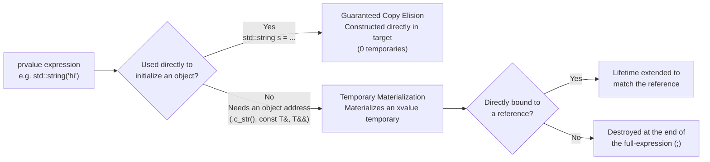

# Object Lifetime, Temporaries, and Dangling References

::: tip What you'll learn
- Distinguish **storage duration** from **object lifetime** (and why memory allocation is not the same as object existence)
- Know the exact rules for **when local objects and temporaries are destroyed**
- Understand **C++17 temporary materialization** and **guaranteed copy elision**
- Master **reference lifetime extension** — when it works and the exact cases where it breaks
- Build a `Tracer` class to observe construction, destruction, and dangling moments firsthand
- Avoid the most common dangling-pointer and dangling-reference traps
:::

## Motivation

Consider these two innocent-looking lines of modern C++:

```cpp
const std::string& s = "hi";                       // Line A: completely safe
const char* p        = std::string("hi").c_str();  // Line B: undefined behavior (dangling pointer!)
```

Both lines create a temporary `std::string` from `"hi"`. Both compile without a single warning on many default compiler configurations. Yet **Line A** runs cleanly every single time, while **Line B** leaves `p` pointing at freed heap memory — causing intermittent garbage output, silent data corruption, or crashes.

Why does the temporary survive in Line A, yet vanish immediately in Line B?

To answer that with certainty instead of guesswork, you need to connect **how objects live in memory** with **how expressions are evaluated**. Understanding object lifetime decides:

* why returning a reference or `std::string_view` to a local variable is catastrophic,
* why chained member calls like `get_config().name()` work on one line but fail when stored in a reference,
* why `for (auto&& x : get_vec().items())` can trigger subtle undefined behavior,
* when `const T&` actually extends a temporary's life — and when it silently does nothing.

::: tip When this matters most
Designing APIs that return views (`std::string_view`, `std::span`) or references, writing range-based `for` loops over temporary containers, debugging intermittent memory corruption, and understanding C++17 value-category rules.
:::

::: info When you can ignore it
Writing straightforward code that passes and returns objects purely by value (`std::string`, `std::vector`) without storing raw pointers, references, or view types across statements.
:::

::: danger First, separate memory from lifetime
A block of raw bytes existing on the stack or heap does **not** mean a C++ object is alive there. **Storage duration** governs when raw memory is allocated and freed; **lifetime** governs when a valid object actually exists inside that memory. Confusing the two is the root cause of most use-after-free bugs.
:::

## Core Idea & Intuition

### Storage Duration vs. Object Lifetime

Every C++ object has two distinct timelines:

1. **Storage duration** — the span of time during which the *raw memory* (bytes) reserved for the object remains allocated.
2. **Object lifetime** — the span of time during which the object is in a *valid, initialized state* and legal to use.

For a class type with a non-trivial constructor and destructor (like `std::string` or `std::vector`), these two boundaries do not happen at the same instant:

```text
Memory allocated        Constructor finishes                  Destructor begins        Memory freed
       │                         │                                    │                     │
       ▼                         ▼                                    ▼                     ▼
───────┼─────────────────────────┼────────────────────────────────────┼─────────────────────┼───────► time
       │◄─── raw storage ───────►│◄───────── OBJECT LIFETIME ────────►│◄─── raw storage ───►│
       │                         │   (legal to read/write members)    │                     │
       │◄─────────────────────────────── STORAGE DURATION ─────────────────────────────────►│
```

* **Lifetime begins** when the object's initialization (constructor) completes.
* **Lifetime ends** the instant its destructor starts executing (or, for trivial types without destructors, when its storage is reused or released).
* Accessing an object *before* its constructor finishes or *after* its destructor starts is **Undefined Behavior (UB)** — even if the underlying stack or heap bytes have not been overwritten yet.

### The Four Storage Durations

C++ defines exactly four storage durations, determined by how and where an object is created:

| Storage Duration | Where it lives | When storage begins | When storage ends | Typical examples |
| --- | --- | --- | --- | --- |
| **Automatic** | Usually the call stack (or CPU registers) | Entering the enclosing block `{ ... }` | Exiting that block (in reverse order of construction) | Local variables (`int x;`), function parameters, temporaries |
| **Static** | Static data segment (`.data` / `.bss`) | Before `main()` starts (or first control pass for `static` locals) | After `main()` returns, during program teardown | Global variables, `namespace`-scope variables, `static` local variables, `static` data members |
| **Dynamic** | Free store (heap) | Explicit allocation (`new`, `std::make_unique`, allocator) | Explicit deallocation (`delete`, smart pointer destruction) | Objects created via `new` or `std::make_shared` |
| **Thread** | Thread-local storage (TLS) | When the thread starts | When the thread exits | Variables declared with `thread_local` |

### The Intuition, in One Sentence

> **Named local objects** live until the closing `}` of their block (destroyed in reverse order of creation), whereas **unnamed temporary objects** live only until the end of the **full-expression** that created them — unless a reference directly binds to them and extends their life.

### Analogy — and Where It Breaks

::: tip A leased apartment vs. a hotel day-pass
Think of **storage duration** as the physical building structure, and **object lifetime** as an active, valid lease.

* A **named local variable** is a tenant with a lease until the end of the block (`}`). Tenants move out in exact reverse order of move-in (LIFO) so later tenants who depend on earlier ones never lose their foundation.
* A **temporary object** is a visitor on a single-statement day-pass: once the semicolon (`;`) of that statement is reached, the pass expires immediately.
* **Reference lifetime extension** is like signing a direct co-lease with that visitor at the front desk (`const std::string& s = "hi";`): the visitor's stay is extended to match your own lease.
:::

::: warning Where the analogy breaks
You can only extend a visitor's stay **at the front desk when they first arrive** (direct initialization of a reference from a prvalue). If the visitor checks in elsewhere and hands you their room key (`const char* p = std::string("hi").c_str();`), holding the key does **not** extend their stay — they still check out at the semicolon, leaving you with a key to an empty room.
:::

## Formal Definition / Mechanism

### 1. Destruction Rules: Block Scope vs. Full-Expressions

#### Named local objects (block scope)

Within any compound statement `{ ... }`, local objects with automatic storage duration are destroyed when control leaves the block — whether normally at `}`, via `return`, `break`, `continue`, or stack unwinding from an exception.

* **Ordering rule:** Destruction always occurs in the **strict reverse order of construction** (Last-In, First-Out).
* **Why this matters:** If `b` is constructed after `a`, `b` may safely hold a pointer or reference to `a`. Because `b` is guaranteed to be destroyed *before* `a`, `b`'s destructor can still safely inspect `a`.

#### Temporary objects (full-expressions)

A **full-expression** is an expression that is not a subexpression of any larger expression. In everyday code, a full-expression is typically everything up to the semicolon `;` (or the controlling condition in `if (...)`, `while (...)`, etc.).

* **General rule:** Temporary objects are destroyed as the **last step** in evaluating the full-expression that contains the point where they were created.
* **Multiple temporaries:** If several temporaries are created within the same full-expression, they are destroyed in **reverse order of their creation**.

```cpp
// Full-expression ends at the semicolon:
std::size_t len = (std::string("hello") + std::string(" world")).size();
//                 └───── Temp 1 ─────┘   └────── Temp 2 ──────┘
//                 └─────────────── Temp 3 (concatenation) ──────┘
// Destruction order at ';': Temp 3 -> Temp 2 -> Temp 1.
```

### 2. C++17 Temporary Materialization & Guaranteed Copy Elision

Before C++17, returning a class by value or passing a temporary like `Widget{}` was conceptually treated as creating a temporary object and then copying or moving it (which compilers were *allowed*, but not *required*, to optimize away).

Starting in **C++17**, the language rules changed fundamentally using value categories:

* **A prvalue is not an object — it is an initialization recipe.**
  An expression like `std::string("hi")` or `make_widget()` is a **prvalue**. By itself, a prvalue does not allocate a temporary object; it simply describes *how to initialize* a target object.
* **Guaranteed Copy Elision (Zero temporaries):**
  When a prvalue is used to initialize an object of the same type, the prvalue constructs the object **directly in its final destination**:

```cpp
std::string make_greeting() {
    return std::string("hello");  // prvalue: no temporary created here
}

std::string s = make_greeting();  // constructs directly into 's' — zero copies, zero moves!
```

* **Temporary Materialization Conversion:**
  When a prvalue appears in a context that requires an actual object in memory (a **glvalue**), the compiler performs **temporary materialization** — turning the prvalue recipe into a real, materialized temporary object (an **xvalue**). This happens when:
  1. Binding a reference (`const T&` or `T&&`) to a prvalue: `const std::string& r = "hi";`
  2. Accessing a member on a prvalue: `std::string("hi").c_str()`
  3. Performing array subscripting on a temporary array, or discarding a prvalue expression statement: `std::string("hi");`



### 3. Reference Lifetime Extension: When It Works vs. When It Fails

Normally, a materialized temporary dies at the semicolon `;`. However, C++ has a special rule:

> **The Lifetime Extension Rule:** When a temporary object is materialized to initialize a reference (`const T&` or `T&&`), the lifetime of that temporary is extended to match the lifetime of the reference itself.

This rule is intentionally narrow. Look closely at what **succeeds** and what **fails**:

#### Case A: Works — Direct binding to a local reference

```cpp
const std::string& s1 = std::string("hello");   // ✅ Temporary lives until s1 goes out of scope
std::string&&      s2 = std::string("world");   // ✅ Rvalue reference also extends lifetime
const std::string& s3 = "implicit conversion";  // ✅ Temporary std::string created and extended
```

#### Case B: Works — Binding to a subobject of a temporary

If you directly bind a reference to a **data member** (or array element) of a temporary, the **entire enclosing temporary object** gets its lifetime extended:

```cpp
struct Pair {
    std::string first;
    std::string second;
};

Pair make_pair() { return {"alpha", "beta"}; }

void example() {
    const std::string& ref = make_pair().first;  // ✅ Entire temporary Pair lives until '}'!
}
```

#### Case C: Fails — Returning a reference from a function

Lifetime extension **never** propagates across a function's `return` statement:

```cpp
// ❌ BUG: Temporary is created inside the function and dies when the function returns
const std::string& bad_return() {
    return std::string("temporary");  // Compiler warning: returning reference to temporary
}

// ❌ BUG: Even passing a reference through a helper breaks extension!
const std::string& identity(const std::string& s) {
    return s;
}

void caller() {
    const std::string& dangling = identity(std::string("temporary"));
    // Inside identity(), 's' bound to the temporary.
    // The full-expression ends at the semicolon ';', so the temporary dies right here!
    // 'dangling' now points to dead memory.
}
```

#### Case D: Fails — Constructor member initializer lists

Binding a reference member inside a constructor's initializer list extends the temporary **only until the constructor exits**, *not* for the lifetime of the enclosing class object:

```cpp
struct Holder {
    const std::string& ref;
    Holder(const std::string& s) : ref(s) {}
};

void caller() {
    Holder h(std::string("temporary"));
    // Temporary dies at ';'! h.ref is immediately dangling.
}
```

#### Case E: Fails — Non-reference views (`std::string_view`, `std::span`, raw pointers)

`std::string_view`, `std::span`, `const char*`, and iterators are **value types** (small structs holding a pointer + length), **not** C++ references. Binding or constructing them from a temporary **never** extends lifetime:

```cpp
std::string_view sv = std::string("hello");         // ❌ Temporary std::string dies at ';'!
const char*      p  = std::string("hello").c_str();  // ❌ Same bug!
```

| Scenario | Extends Temporary Lifetime? | Why? |
| --- | --- | --- |
| `const T& r = make_T();` | ✅ Yes | Direct initialization of a reference from a prvalue |
| `T&& r = make_T();` | ✅ Yes | Direct initialization of an rvalue reference from a prvalue |
| `const Member& m = make_Obj().member;` | ✅ Yes | Direct binding to a member subobject extends the whole temporary |
| `const T& r = pass_through(make_T());` | ❌ No | Reference was initialized from a function return (`T&`), not a prvalue |
| `const T& fn() { return make_T(); }` | ❌ No | Lifetime extension is explicitly disabled for function return values |
| `MemberRef(make_T())` in constructor | ❌ No | Temporary dies when the constructor finishes |
| `std::string_view sv = make_string();` | ❌ No | `std::string_view` is a class object, not a reference |

## Step-by-Step Lab: Watching Lifetime with a `Tracer` Class

Reading rules is helpful, but watching constructors and destructors fire in real time makes lifetime behavior unforgettable. Let's build a small `Tracer` class that logs every lifecycle event.

### Step 1 — Define the `Tracer` helper

```cpp
#include <iostream>
#include <string>
#include <utility>

struct Tracer {
    std::string name;
    bool alive = true;

    explicit Tracer(std::string n) : name(std::move(n)) {
        std::cout << "[+ Construct] " << name << " (@" << this << ")\n";
    }

    Tracer(const Tracer& other) : name(other.name + "_copy") {
        std::cout << "[+ Copy     ] " << name << " from " << other.name << "\n";
    }

    Tracer(Tracer&& other) noexcept : name(other.name + "_moved") {
        std::cout << "[+ Move     ] " << name << " from " << other.name << "\n";
        other.name += " (moved-from)";
    }

    ~Tracer() {
        std::cout << "[- Destruct ] " << name << " (@" << this << ")\n";
        alive = false;
    }

    const std::string& peek() const {
        if (!alive) {
            std::cout << "[!! DANGLING ACCESS !!] Reading destroyed object!\n";
        }
        return name;
    }
};

Tracer make_temp(std::string label) {
    return Tracer(std::move(label));  // C++17 guaranteed copy elision
}
```

### Step 2 — Observe block scope vs. full-expression destruction

```cpp
void experiment_1() {
    std::cout << "--- Enter block ---\n";
    Tracer a("A");

    std::cout << "--- Evaluate full-expression with temporary ---\n";
    std::cout << "Peek: " << make_temp("Temp1").peek() << "\n";
    std::cout << "--- After full-expression ---\n";

    Tracer b("B");
    std::cout << "--- Exit block ---\n";
}
```

**Output:**

```text
--- Enter block ---
[+ Construct] A (@0x7ffd10)
--- Evaluate full-expression with temporary ---
[+ Construct] Temp1 (@0x7ffd30)
Peek: Temp1
[- Destruct ] Temp1 (@0x7ffd30)
--- After full-expression ---
[+ Construct] B (@0x7ffd50)
--- Exit block ---
[- Destruct ] B (@0x7ffd50)
[- Destruct ] A (@0x7ffd10)
```

**What this proves:**

1. `Temp1` is constructed during the `std::cout << ...` statement and **destroyed immediately at the semicolon**, *before* `--- After full-expression ---` is printed.
2. `A` and `B` live until `--- Exit block ---`, where `B` is destroyed **before** `A` (strict LIFO order).

### Step 3 — Observe reference lifetime extension vs. dangling

```cpp
const Tracer& forward_ref(const Tracer& t) {
    return t;  // Passes reference through — breaks lifetime extension!
}

void experiment_2() {
    std::cout << "--- 1. Direct reference binding ---\n";
    const Tracer& extended = make_temp("ExtendedTemp");
    std::cout << "Still alive: " << extended.peek() << "\n";

    std::cout << "\n--- 2. Indirect reference binding (DANGLING!) ---\n";
    const Tracer& dangling = forward_ref(make_temp("DoomedTemp"));
    std::cout << "Line right after semicolon:\n";
    // WARNING: Calling dangling.peek() here is Undefined Behavior!
    // In this lab, raw stack bytes haven't been reused yet, so we can see 'alive == false':
    std::cout << "Accessing dangling: " << dangling.peek() << "\n";

    std::cout << "\n--- Exit experiment_2 ---\n";
}
```

**Output:**

```text
--- 1. Direct reference binding ---
[+ Construct] ExtendedTemp (@0x7ffd10)
Still alive: ExtendedTemp

--- 2. Indirect reference binding (DANGLING!) ---
[+ Construct] DoomedTemp (@0x7ffd30)
[- Destruct ] DoomedTemp (@0x7ffd30)
Line right after semicolon:
[!! DANGLING ACCESS !!] Reading destroyed object!
Accessing dangling: DoomedTemp (@0x7ffd30)

--- Exit experiment_2 ---
[- Destruct ] ExtendedTemp (@0x7ffd10)
```

**Look closely at the timestamps in the output:**

* `ExtendedTemp` is **not** destroyed at its semicolon; it survives all the way until `--- Exit experiment_2 ---`.
* `DoomedTemp` **is** destroyed immediately at its semicolon (`[- Destruct ] DoomedTemp`), *before* `Line right after semicolon:` even executes. By the next line, `dangling` refers to a dead object.

## Common Misunderstandings & Pitfalls

### Pitfall 1 — Extracting a raw pointer or view from a temporary

::: danger Classic crash: `.c_str()`, `.data()`, `std::string_view`, `std::span`

```cpp
const char* p        = std::string("hello").c_str();  // ❌ Dangling pointer!
std::string_view sv  = std::string("hello");          // ❌ Dangling view!
```

`std::string("hello")` creates a temporary `std::string` whose heap buffer is freed when `~std::string()` runs at the semicolon `;`. Both `p` and `sv` now point to deallocated heap memory.

**Fix:** Either store the `std::string` by value (`std::string s = "hello";`), or only pass the temporary directly into a function call that consumes it before the semicolon (`printf("%s\n", std::string("hello").c_str());` is safe because the temporary lives until the entire `printf` call finishes).
:::

### Pitfall 2 — Range-based `for` loop over chained temporaries

::: danger The hidden C++20/pre-C++23 range-for trap

```cpp
struct Container {
    std::vector<int> items = {1, 2, 3};
    const std::vector<int>& get_items() const { return items; }
};

Container make_container() { return {}; }

// ❌ UNDEFINED BEHAVIOR in C++11/14/17/20!
for (int x : make_container().get_items()) {
    std::cout << x << '\n';
}
```

**Why?** Under the hood, a range-based `for` loop expands roughly to:

```cpp
auto&& __range = make_container().get_items();  // <-- Full-expression ends here!
// 'make_container()' temporary is DESTROYED before the loop body even starts!
```

Because `get_items()` returns `const std::vector<int>&` (an lvalue reference), `__range` binds to the result of a function call — **not** directly to the temporary `Container`. The temporary `Container` dies at the semicolon of the initializer, destroying `items` before iteration begins. *(Note: C++23 finally patched this specific rule for range-based `for` initializers, but it remains broken in C++20 and earlier, and in regular statements.)*

**Fix:** Bind the outer temporary first:

```cpp
auto c = make_container();
for (int x : c.get_items()) { /* ✅ Safe in all C++ standards */ }
```
:::

### Pitfall 3 — Assuming `const T&` always extends lifetime

::: danger False
`const T&` only extends lifetime when initialized **directly** from a prvalue (or a member/element subobject of one). Wrapping the expression in a getter, a passthrough function, a ternary operator returning a reference, or a constructor parameter breaks the extension.
:::

### Pitfall 4 — Returning a reference or view to a local variable

::: danger Instant dangling reference

```cpp
const std::string& get_name() {
    std::string name = "Alice";
    return name;  // ❌ 'name' is destroyed as get_name() returns!
}
```

Automatic local variables are always destroyed when their function returns. Never return a reference, pointer, `std::string_view`, or `std::span` to a local variable (unless the local variable is declared `static`). Return by value instead — C++17 guaranteed copy elision or move semantics makes returning by value fast and safe.
:::

### Pitfall 5 — Confusing "moved-from" with "destroyed"

::: warning Subtle distinction
When you write `Tracer b = std::move(a);`, `a` is **not** destroyed yet. `a` is still alive in a valid-but-unspecified state, and its destructor `~Tracer()` will still run normally when `a` leaves scope. Moving transfers resources; it does not end object lifetime.
:::

## Practice Check

**Exercise 1.** In what exact order are objects `A`, `B`, `C`, and `T` constructed and destroyed in the following function?

```cpp
void f(const Tracer& t) {
    Tracer b("B");
}

void run() {
    Tracer a("A");
    f(Tracer("T"));
    Tracer c("C");
}
```

**Exercise 2.** Mark each line below as **Safe** or **Dangling (UB)**, and explain why in one sentence:

```cpp
struct Box { std::string value; };
Box make_box() { return Box{"secret"}; }
const std::string& unwrap(const Box& b) { return b.value; }

const std::string& r1 = make_box().value;          // (1)
const std::string& r2 = unwrap(make_box());        // (2)
std::string_view   v1 = make_box().value;          // (3)
const char*        p1 = make_box().value.c_str();  // (4)
```

**Exercise 3.** Why does `std::cout << make_box().value << '\n';` run safely without dangling, whereas `const char* p = make_box().value.c_str(); std::cout << p << '\n';` has undefined behavior?

### Solutions

::: details Exercise 1 — Construction and destruction timeline

1. **Construct `A`** (local variable in `run`).
2. **Construct `T`** (temporary materialized for parameter `t` of `f`).
3. **Construct `B`** (local variable inside `f`).
4. **Destruct `B`** (`f` exits its block).
5. **Destruct `T`** (the full-expression `f(Tracer("T"));` finishes).
6. **Construct `C`** (local variable in `run`).
7. **Destruct `C`** (`run` exits its block — reverse order of locals).
8. **Destruct `A**` (`run` exits its block).

Notice that `T` outlives `B` (because `f` runs inside the full-expression), and `T` is destroyed before `C` is constructed.
:::

::: details Exercise 2 — Safe vs. Dangling

* **(1) Safe:** `r1` directly binds to a member subobject (`value`) of the temporary `Box`, extending the entire temporary `Box`'s lifetime until `r1` goes out of scope.
* **(2) Dangling (UB):** `r2` is initialized from the return value of `unwrap()` (an lvalue reference), not directly from a prvalue, so the temporary `Box` dies at `;`.
* **(3) Dangling (UB):** `std::string_view` is a value type (not a C++ reference), so it never extends the lifetime of the temporary `Box`.
* **(4) Dangling (UB):** `p1` is a raw pointer (`const char*`), not a reference; the temporary `Box` and its inner `std::string` are destroyed at `;`.
:::

::: details Exercise 3 — Single full-expression vs. across statements

In `std::cout << make_box().value << '\n';`, the temporary `Box` is created inside the full-expression and stays alive until the **entire chained `operator<<` statement finishes** at the semicolon `;` — well after `std::cout` has finished reading `value`.

In contrast, splitting it into two statements causes the temporary `Box` to be destroyed at the **first** semicolon `;`, leaving `p` pointing to freed heap memory when `std::cout << p` runs on the second line.
:::

## Summary

* **Storage duration** (automatic, static, dynamic, thread) is when raw memory exists; **object lifetime** is from constructor completion to destructor start.
* **Named local objects** are destroyed at the closing `}` of their block in **strict reverse order of construction**.
* **Temporary objects** are destroyed at the end of the **full-expression** (`;`) that created them, in reverse order of creation.
* **C++17 guaranteed copy elision** constructs prvalues directly into target objects without creating temporaries; temporaries only exist when **temporary materialization** converts a prvalue into a glvalue.
* **Reference lifetime extension** works *only* when a reference (`const T&` or `T&&`) binds **directly** to a temporary (or its member/array subobject) — never through function returns, constructor member initializers, or view types like `std::string_view` and `std::span`.

## Quick Reference

| Construct | Lifetime Boundary | Safe to store across `;`? |
| --- | --- | --- |
| `T x;` (local variable) | Until enclosing block `}` (LIFO) | ✅ (within block) |
| `static T x;` | Until program exit | ✅ |
| `make_T()` (unreferenced temporary) | Until end of current full-expression (`;`) | ❌ |
| `const T& r = make_T();` | Extended to match lifetime of `r` | ✅ (within `r`'s scope) |
| `T&& r = make_T();` | Extended to match lifetime of `r` | ✅ (within `r`'s scope) |
| `const M& m = make_T().member;` | Extended to match lifetime of `m` (whole `T` survives) | ✅ (within `m`'s scope) |
| `const T& r = passthrough(make_T());` | Ends at `;` (extension broken by function return) | ❌ (dangling!) |
| `std::string_view sv = make_str();` | Ends at `;` (views are not references) | ❌ (dangling!) |
| `const char* p = make_str().c_str();` | Ends at `;` (raw pointers are not references) | ❌ (dangling!) |