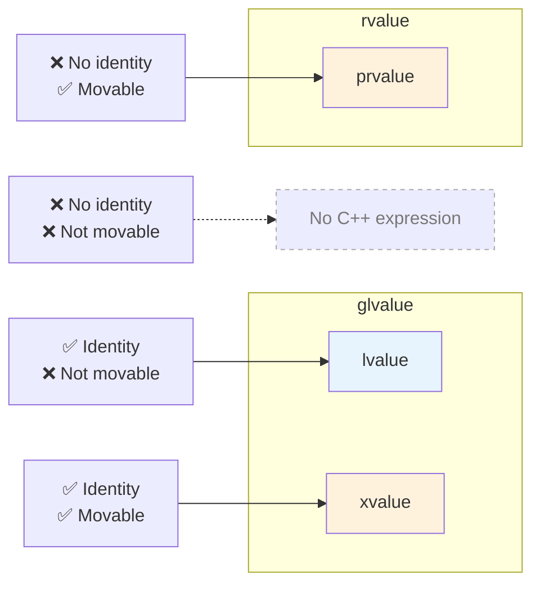
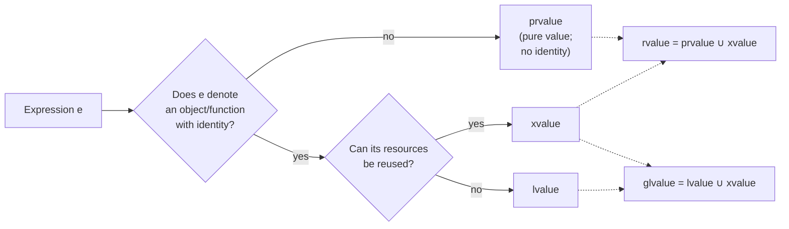

# Value Categories in C++: lvalues, prvalues, and xvalues

::: tip What you'll learn

- Really understand **lvalue / prvalue / xvalue**
- Master the `decltype((expr))` trick for detecting a category
- See exactly what makes move semantics and perfect forwarding work
- Avoid nine of the most common pitfalls around value categories
:::

## Motivation

Every C++ expression you have ever written — `x`, `x + y`, `foo()`, `std::move(x)`, `a[i]`, `p->m`, `[](){ return 42; }()` — has **two independent attributes**:

1. a **type** (e.g., `int`, `std::string`, `void`), and
2. a **value category** (one of `lvalue`, `prvalue`, `xvalue`).

Most beginners only think about type. That is enough to compile code, but not enough to _understand_ code. Value categories decide:

- whether `&expr` is legal,
- which constructor or overload gets picked (`foo(T&&)` vs `foo(const T&)`),
- whether a temporary lives long enough to be observed,
- why `auto&&` is the idiomatic "universal reference",
- why move semantics work at all,
- what `decltype((expr))` actually yields.

::: tip When this matters most
Move semantics, perfect forwarding, template metaprogramming, `decltype`, designing library APIs, and debugging _"why did this copy instead of move?"_
:::

::: info When you can ignore it
Writing plain procedural code with no references, no templates, and no overload resolution — but even then, misclassifying a value category is a frequent source of undefined-behavior bugs.
:::

::: danger First, unlearn the mnemonic
The single hardest thing about value categories is that _their names are historical lies_. An **lvalue** is not "something on the left of `=`", and an **rvalue** is not "something on the right of `=`". Both examples in the standard break those myths. **Unlearn the mnemonic first.**
:::

## Core Idea & Intuition

### First, what is an expression?

An **expression** is any fragment of C++ that produces something: a literal (`42`), a variable name (`x`), a function call (`foo()`), or an operator application (`a + b`). Each expression has:

- a **type**: what kind of value it produces, and
- a **value category**: _what kind_ of thing that value is with respect to identity and reusability.

Type and value category are **independent**: `int` can be an lvalue, a prvalue, or even the type of an xvalue. Conversely, two expressions of the same type may have different value categories.

### The intuition, in one sentence

> A value category answers two questions: _(1) does this expression refer to an identifiable object?_ and _(2) may that object's resources be reused (moved from) soon?_

- **Has identity** = "you can take its address or distinguish this particular object from another." That is the **glvalue** property.
- **Movable / reusable** = "it is about to die; its resources may be stolen." That is the **rvalue** property.

The two axes give four combinations; C++ uses only three of them as primary categories:



In words:

| Category    | Identity? | Movable / rvalue? | Intuition                                                          |
| ----------- | --------- | ----------------- | ------------------------------------------------------------------ |
| **lvalue**  | ✅        | ❌                | a named object you can look at and reuse                           |
| **xvalue**  | ✅        | ✅                | a named (or identifiable) object about to be destroyed / discarded |
| **prvalue** | ❌        | ✅                | a pure _value_: a number, a computed temporary with no name        |

Two umbrella terms wrap these:

- **glvalue** = lvalue ∪ xvalue. _g_ stands for "generalized".
- **rvalue** = prvalue ∪ xvalue.

The intersection is `{xvalue}`; the union is all expressions.

### Where the historical names came from (and why they lie)

::: danger "lvalue" and "rvalue" are approximations, not definitions
**"Lvalue"** originally meant "may appear on the left of an assignment". **"Rvalue"** originally meant "may appear on the right of an assignment". Both are approximations. In modern C++:

- `const int& c = ...; c = 6;` — `c` is an **lvalue**, but cannot be assigned to.
- `S{} = S{7};` — `S{}` is a **prvalue**, but this is legal because it invokes a class-type `operator=` member function (possibly implicitly generated), not the built-in assignment operator. Built-in assignment still requires its left operand to be a modifiable lvalue.

The assignment-position mnemonic is useful for intuition, never for formal reasoning.
:::

### Analogy — and where it breaks

::: tip A house, a smell, and a demolition
An **lvalue** is a house with a street address: you can walk to it, look inside, and use it whenever you like.

A **prvalue** is the smell of fresh bread — it exists as a value, but you cannot "address the smell"; there is no lasting house to point at.

An **xvalue** is a house that has been sold and is about to be demolished: it still has an address (identity), but you may salvage what you can.

Remember: a value category belongs to **expression**, not to the object itself. An object does not “become xvalue”; an expression referring to it can be an xvalue.
:::

::: warning Where the analogy breaks
An xvalue's "demolition" is **not** automatic. `std::move(x)` merely produces an xvalue. Whether resources are actually stolen depends on whether a move constructor or move assignment is invoked. Also, an xvalue like `static_cast<T&&>(x)` does not "expire" — it just _permits_ the receiving function to treat `x` as movable. **Value category is a permission, not a promise.**
:::

### What are value categories _for_?

Value categories serve overload resolution and lifetime rules:

- `T&&` binds to rvalues (prvalues and xvalues), enabling **move semantics**.
- `const T&` binds to lvalues _and_ rvalues, but cannot be moved from.
- `T&` binds only to lvalues — this is why some functions reject temporaries.
- `decltype((expr))` returns `T&` for lvalues, `T&&` for xvalues, and `T` for prvalues. This classification aligns with the logic `std::forward` uses to preserve the original value category.

## Formal Definition / Mechanism

### The formal taxonomy

From the C++ standard (paraphrased in full):

1. Every expression has a **non-reference type** and belongs to exactly one of `{lvalue, xvalue, prvalue}`.
2. A **glvalue** is an expression whose evaluation determines the identity of an object, bit-field, or function. Equivalent to "`lvalue` or `xvalue`".
3. A **prvalue** is an expression whose evaluation either (a) computes the value of an operand of a built-in operator (no result object), or (b) initializes an object (a _result object_: a variable, a heap object, a temporary, or a member thereof).
4. An **xvalue** is a glvalue denoting an object whose resources can be reused.
5. An **lvalue** is a glvalue that is not an xvalue.
6. **rvalue** = prvalue or xvalue.

::: warning Two subtleties worth memorizing
**Every expression has a non-reference type.** Even if you declare `int&& r = ...;`, the _expression_ `r` has type `int` (not `int&&`); the reference is a property of the _variable_, not of the _expression_. Value category then tells you it is an lvalue.

**Result objects (since C++17).** A prvalue of class or array type is _always_ considered to have an associated result object — even if it is immediately discarded (the "materialized temporary"). This is what allows member access on a class prvalue to be well-formed:

```cpp
struct S { int m; };
S f();
int x = f().m;   // OK: f() has a result object, so .m can be read
```
:::

### Enumeration of expressions per category

The table below is a working taxonomy; it is the operationally useful part.

| Category    | Typical examples                                                                                                                                                                                                                                                                                                                                                       |
| ----------- | ---------------------------------------------------------------------------------------------------------------------------------------------------------------------------------------------------------------------------------------------------------------------------------------------------------------------------------------------------------------------- |
| **lvalue**  | name of a variable, function, template-parameter object (C++20), or data member; a call returning `T&`; built-in `a = b`, `a += b`, `++a`, `--a`; built-in `*p`; built-in `a[i]` (with array lvalue); `a.m` (with `m` a data member, `a` an lvalue); `p->m`; string literal `"hi"`; cast to `T&`; non-type template parameter of lvalue-reference type                 |
| **prvalue** | literal (non-string), e.g. `42`, `true`, `nullptr`; a call returning non-reference `T`; built-in `a++`, `a--`; built-in arithmetic, logical, comparison; built-in `&a`; `a.m` / `p->m` where `m` is a member enumerator or non-static member function; cast to non-reference type; `this`; enumerator; non-type template parameter of scalar type; lambda expressions   |
| **xvalue**  | `a.m` where `a` is an rvalue and `m` is a non-static **non-reference** data member; `a.*mp` where `a` is rvalue and `mp` points to data member; call returning `T&&` (e.g. `std::move(x)`); built-in `a[n]` where `a` is an array rvalue; cast to `T&&`; any expression designating a temporary after temporary materialization (C++17); move-eligible expression (C++23) |

### Properties of the two umbrella categories

::: info glvalue (lvalue ∪ xvalue)

- May be implicitly converted to a prvalue via lvalue-to-rvalue, array-to-pointer, or function-to-pointer conversion.
- May be **polymorphic**: its dynamic type may differ from its static type.
- May have incomplete type where the expression permits it.
:::

::: info rvalue (prvalue ∪ xvalue)

- **Cannot** have its address taken by the built-in `&`: `&42`, `&int()`, `&i++`, `&std::move(x)` are all ill-formed.
- **Cannot** be used as the left-hand operand of a built-in assignment or compound assignment operator.
- May initialize a `const T&` — the temporary's lifetime extends to the reference's scope.
- May initialize a `T&&` — same lifetime extension.
- Binds preferentially to a `T&&` parameter over `const T&` when both overloads exist — this is the mechanism behind move construction.
:::

### A decision-tree overview



## Step-by-Step Example

We will build up from simple expressions, then verify with `decltype`.

### Step 1 — a plain variable is an lvalue

```cpp
int a = 42;  // variable a
```

- The **expression** `a` has type `int` and value category **lvalue**.
- `&a` is legal: the address of `a` can be taken.
- `a = 7;` is legal: `a` is modifiable.

### Step 2 — a literal is a prvalue

```cpp
42  // expression 42
```

- Type: `int`. Value category: **prvalue**.
- `&42` is **ill-formed**: no object to take the address of.
- But a prvalue _can_ initialize an object: `int x = 42;` copies the value into `x`.

### Step 3 — reference variables are lvalues _in expressions_

```cpp
int  a = 42;
int& b = a;              // b is an lvalue reference to a
int&& r = std::move(a);  // r is an rvalue reference to a
```

Now consider expressions:

- `b` — type `int`, value category **lvalue**. Even though the _variable_ `b` has type `int&`, the _expression_ `b` has type `int` and is an lvalue.
- `r` — type `int`, value category **lvalue**. **This surprises everyone.** The variable `r` has type `int&&`, but the expression `r` — the _name_ `r` — is an lvalue. That is precisely why `T&&` is not "a reference to a temporary"; it is "a reference that can bind to rvalues". The expression's value category is determined by _how you use the name_, not by the declared type.

::: danger The #1 source of confusion
**The name of an rvalue reference is an lvalue.** If you memorize nothing else, memorize this.
:::

### Step 4 — `std::move` makes an xvalue

```cpp
std::move(a)  // expression
```

- Type: `int`.
- Value category: **xvalue**.
- `std::move(x)` is essentially `static_cast<std::remove_reference_t<decltype(x)>&&>(x)` — a cast to an rvalue reference to the **underlying object type**, which is exactly the definition of an xvalue. (Writing just `static_cast<T&&>(x)` is only correct if `T` already denotes the non-reference type of `x`; for an lvalue `x`, `T` would deduce to `int&` and `T&&` collapses to `int&`.)
- `&std::move(a)` is ill-formed: rvalues cannot be addressed.

The point of the xvalue is not that it _forces_ a move; it is that the expression _qualifies_ to be bound by `T&&` overloads — most notably move constructors and move assignment operators — which may then steal resources.

### Step 5 — detect categories with `decltype((expr))`

`decltype(e)` (without extra parentheses) yields the _declared type_ of the name. `decltype((e))` — with the extra parentheses — yields the _reference-adjusted type_, which encodes the value category:

- lvalue → `T&`
- xvalue → `T&&`
- prvalue → `T`

The standard trick to test categories is pattern-matching on these types:

```cpp
#include <type_traits>
#include <utility>

// These helpers are ONLY designed to work with decltype((expr)).
// They rely on the rule: lvalue → T&, xvalue → T&&, prvalue → T.
// Do NOT pass raw decltype(expr) into them.

template <class T> struct is_prvalue : std::true_type  {};
template <class T> struct is_prvalue<T&>  : std::false_type {};
template <class T> struct is_prvalue<T&&> : std::false_type {};

template <class T> struct is_lvalue : std::false_type {};
template <class T> struct is_lvalue<T&>  : std::true_type  {};
template <class T> struct is_lvalue<T&&> : std::false_type {};

template <class T> struct is_xvalue : std::false_type {};
template <class T> struct is_xvalue<T&>  : std::false_type {};
template <class T> struct is_xvalue<T&&> : std::true_type  {};

int main()
{
    int  a{42};
    int& b{a};
    int&& r{std::move(a)};

    // literal 42 is a prvalue
    static_assert(is_prvalue<decltype((42))>::value);
    // name a is an lvalue
    static_assert(is_lvalue<decltype((a))>::value);
    // name b is an lvalue, even though its type is int&
    static_assert(is_lvalue<decltype((b))>::value);
    // name r is an lvalue — surprise!
    static_assert(is_lvalue<decltype((r))>::value);
    // std::move(a) is an xvalue
    static_assert(is_xvalue<decltype((std::move(a)))>::value);

    // The *variable* r has type int&&
    static_assert(std::is_rvalue_reference_v<decltype(r)>);
    // The *variable* b has type int&
    static_assert(std::is_lvalue_reference_v<decltype(b)>);
}
```

**Walkthrough of the `static_assert`s:**

1. `decltype((42))` → `int`. `is_prvalue<int>` inherits from `std::true_type`. ✅
2. `decltype((a))` → `int&` because `a` is an lvalue → `is_lvalue<int&>` = true. ✅
3. `decltype((b))` → `int&`. Same. Note that the _expression_ is what we are classifying, not the variable — `b` names an object, and you can take its address. ✅
4. `decltype((r))` → `int&`. The name `r` is an lvalue even though `decltype(r)` is `int&&`. ✅
5. `decltype((std::move(a)))` → `int&&` → `is_xvalue<int&&>` = true. ✅
6. `decltype(r)` (no extra parens) returns the declared type `int&&` — useful for different purposes.

::: tip Key insight
The extra parentheses around the expression are essential. Without them `decltype(a)` returns the declared type of the _name_; with them it returns the _reference-adjusted type of the expression_, which carries the value category.
:::

### Step 6 — how an xvalue drives overload resolution

```cpp
#include <iostream>
#include <utility>

void consume(int&)  { std::cout << "lvalue\n"; }
void consume(int&&) { std::cout << "rvalue\n"; }

int main()
{
    int a = 0;
    consume(a);             // lvalue  -> first overload
    consume(std::move(a));  // xvalue  -> second overload
    consume(42);            // prvalue -> second overload
}
```

Output:

```text
lvalue
rvalue
rvalue
```

Both `std::move(a)` (xvalue) and `42` (prvalue) are rvalues, so they bind to `int&&`. The distinction between prvalue and xvalue is _invisible to overload resolution_ — what matters is **lvalue vs rvalue**. The prvalue/xvalue split matters for other things, notably `decltype` and language rules about temporaries.

### Step 7 — an rvalue reference binds to a temporary

```cpp
const int& cref = 42;  // OK: const ref binds to prvalue
int&&      rref = 42;  // OK: rvalue ref binds to prvalue
```

Both extend the temporary's lifetime to the scope of the reference. This is legal because of the "rvalue binds to `T&&` (or `const T&`)" rule.

## Common Misunderstandings & Pitfalls

### Pitfall 1 — "lvalue means on the left of `=`"

::: danger False
`const int& c = ...;` gives you an lvalue `c` that cannot be assigned to. `S{} = S{7};` (a temporary on the left of an assignment) is legal, though it usually has no visible effect. The mnemonic is historical and misleading.
:::

### Pitfall 2 — "the name of an rvalue reference is an rvalue"

::: danger False

```cpp
int&& r = ...;
r  // this is an LVALUE
```

Names of objects — of _any_ declared reference or value — denote identifiable objects, so they are glvalues. A `T&&` variable just says the reference _bound_ to an rvalue; the name is still an lvalue. To get an xvalue back out, apply `std::move`.
:::

### Pitfall 3 — "value categories are about types"

::: danger False
They are independent. The _expression_ `r` has type `int` (non-reference), value category lvalue. The _variable_ `r` has type `int&&`. Conflating these is the single most common error in code that takes a value-category parameter.
:::

### Pitfall 4 — "`T&&` means 'reference to a temporary'"

::: danger False
It means "reference that binds to rvalues (and, in forwarding-reference contexts, to anything via template argument deduction)". An rvalue reference can bind to a **named object**, not only to a temporary — but you must first make the expression an rvalue:

```cpp
int a = 0;
int&& r = std::move(a);  // OK: r binds to the object a, not to a temporary
```

`int&& r = a;` is ill-formed: an rvalue reference cannot bind to an lvalue.
:::

### Pitfall 5 — "rvalues cannot appear on the left"

::: warning Careful — that rule is narrower than it looks
That rule is about **built-in assignment operators**. A class type may overload `operator=` to accept an rvalue `this` — an rvalue-qualified member function — or the compiler may generate an implicit move-assignment that behaves differently from the copy version. The spec's phrase "the built-in assignment operator" is important.
:::

### Pitfall 6 — "a prvalue has a result object only in some cases"

::: warning Subtle wording
For built-in operators, a prvalue may compute a value with **no result object** (`42 + 1` — the `int` result does not exist as an object). For class and array prvalues, C++17 guarantees a **result object**; when the prvalue is used in a context that needs an object (binding to a reference, member access, or a discarded-value expression), the result object is **materialized** so that lifetime and destructor ordering work out. Unevaluated operands such as `decltype` and `sizeof` do **not** materialize it.
:::

### Pitfall 7 — "`std::move` moves"

::: danger False
`std::move` is a **cast**. It does not perform any move. It just produces an xvalue. Whether resources are actually transferred depends on the receiving function/constructor. Passing `std::move(x)` to a function that takes `const T&` copies; the cast is invisible.
:::

### Pitfall 8 — "prvalue cannot have cv-qualifiers"

::: warning True for non-class, non-array prvalues
For **non-class, non-array** prvalues, top-level cv-qualifiers are stripped from the expression's type. So `static_cast<const int>(42)` is, as an expression, of type `int`:

```cpp
static_assert(std::is_same_v<decltype(static_cast<const int>(42)), int>);   // not const int
```

For **class** prvalues the qualifier is preserved, which is why `decltype` can surprise you here:

```cpp
struct S {};
static_assert(std::is_same_v<decltype(static_cast<const S>(S{})), const S>);
```
:::

### Pitfall 9 — "a class prvalue always creates a temporary object"

::: warning Distinguish "result object" from "materialized temporary"
Since C++17, a class or array prvalue has an associated **result object**, but that does not mean a temporary object is always created. In unevaluated operands such as `decltype(S{})`, `sizeof(S{})`, and `noexcept(...)`, the prvalue is **not materialized**, so no temporary object is created. `decltype` only inspects the type and value category; it never evaluates the expression. So the claim "every class prvalue creates a temporary" is false.
:::

## Practice Check

**Exercise 1.** For each expression below, state (i) whether it is an lvalue, xvalue, or prvalue, and (ii) whether `&(expr)` is well-formed:

```cpp
int a = 1;
int b[3];
struct S { int m; };

a
42
a + b[0]  // assume this is a valid built-in arithmetic expression
b
&a
++a
a++
std::move(a)
static_cast<int&&>(a)
"hello"
```

**Exercise 2.** What does the following program print?

```cpp
#include <iostream>
#include <utility>

template <class T> void probe(T&&) { std::cout << "T&&\n"; }
template <class T> void probe(T&)  { std::cout << "T&\n";  }

int main()
{
    int a = 0;
    probe(a);
    probe(std::move(a));
    probe(42);
}
```

**Exercise 3.** Fill in the blanks so that the `static_assert`s pass:

```cpp
int a = 0;
static_assert(std::is_same_v<decltype((a)), int&>);
static_assert(std::is_same_v<decltype(a),              /* (i)   */>);
static_assert(std::is_same_v<decltype((std::move(a))), /* (ii)  */>);
static_assert(std::is_same_v<decltype(std::move(a)),   /* (iii) */>);
```

### Solutions

::: details Exercise 1 — categories and addressability

| Expression                 | Category                                      | `&(expr)` legal?                                                      |
| -------------------------- | --------------------------------------------- | --------------------------------------------------------------------- |
| `a`                        | lvalue                                        | ✅                                                                    |
| `42`                       | prvalue                                       | ❌                                                                    |
| `a + b[0]`                 | prvalue                                       | ❌                                                                    |
| `b` (array name)           | lvalue (converts to pointer in most contexts) | ✅                                                                    |
| `&a`                       | prvalue                                       | ❌ (you cannot take the address of a prvalue — `&(&a)` is ill-formed) |
| `++a`                      | lvalue (built-in pre-increment)               | ✅                                                                    |
| `a++`                      | prvalue (built-in post-increment)             | ❌                                                                    |
| `std::move(a)`             | xvalue                                        | ❌                                                                    |
| `static_cast<int&&>(a)`    | xvalue                                        | ❌                                                                    |
| `"hello"` (string literal) | lvalue                                        | ✅                                                                    |

::: details Exercise 2 — overload resolution output

Output:

```text
T&
T&&
T&&
```

Why? For `probe(a)` where `a` is an lvalue:

- Overload 1 (`T&&`): `T` deduces to `int&`, and the parameter becomes `int& &&` = `int&`.
- Overload 2 (`T&`): `T` deduces to `int`, and the parameter becomes `int&`.

Both are viable and both are exact matches. **Partial ordering prefers `T&`** because it is more specialized: it can only accept lvalues, whereas the forwarding reference can accept both lvalues and rvalues. So the `T&` overload wins for an lvalue argument.

For `probe(std::move(a))` (an xvalue) and `probe(42)` (a prvalue), `T&` cannot bind to an rvalue, so only `T&&` is viable → prints `T&&`.
:::

::: details Exercise 3 — fill in the blanks

- **(i) `int`** — `decltype(a)` (no extra parens) gives the _declared type_.
- **(ii) `int&&`** — an xvalue.
- **(iii) `int&&`** — `std::move(a)` is an **xvalue**, and for a non-id, non-member-access expression `decltype(e)` follows the value category: xvalue → `T&&`. (The result coincides with the declared return type of `std::move`, but the rule that applies here is the value-category rule, not "use the declared return type".)
:::

## Summary

- Every C++ expression has a **type** and a **value category**; these are independent. The category is one of `lvalue`, `prvalue`, `xvalue`.
- **lvalue** = has identity, is not a movable resource. (Examples: named variables, `*p`, `a[i]` with array lvalue, `++a`, string literals, built-in assignment result.)
- **prvalue** = pure value, no identity. (Examples: `42`, `a++`, arithmetic results, `&a`, most function calls returning non-reference types.)
- **xvalue** = has identity **and** is about to be discarded. (Examples: `std::move(x)`, `static_cast<T&&>(x)`, member access on an rvalue, casts to rvalue reference.)
- Umbrella terms: **glvalue** = lvalue ∪ xvalue (has identity, may be polymorphic); **rvalue** = prvalue ∪ xvalue (binds to `T&&`, cannot be assigned to via built-in `=`).
- The names are historical, not semantic. **The name of an rvalue reference is an lvalue.** `decltype((e))` encodes the category as `T&`, `T&&`, or `T`.
- The category governs **overload resolution** (rvalue vs lvalue overloads), **lifetime extension** (`const T&` / `T&&` binding to rvalues), and **`decltype`** results. It is the engine behind move semantics and perfect forwarding.

## Quick Reference

| Expression                                          | Category | Can take `&`? | Left of built-in `=`?      |
| --------------------------------------------------- | -------- | ------------- | -------------------------- |
| `x` (variable name)                                 | lvalue   | ✅            | ✅ (if modifiable)         |
| `*p`                                                | lvalue   | ✅            | ✅                         |
| `a[i]` (array lvalue)                               | lvalue   | ✅            | ✅                         |
| `++x`                                               | lvalue   | ✅            | ✅                         |
| `x++`                                               | prvalue  | ❌            | ❌                         |
| `42`                                                | prvalue  | ❌            | ❌                         |
| `x + y`                                             | prvalue  | ❌            | ❌                         |
| `&x`                                                | prvalue  | ❌            | ❌                         |
| `"text"`                                            | lvalue   | ✅            | ❌ (array, not assignable) |
| `std::move(x)`                                      | xvalue   | ❌            | ❌                         |
| `static_cast<T&&>(x)`                               | xvalue   | ❌            | ❌                         |
| `a.m` (an lvalue, m data member)                    | lvalue   | ✅            | ✅                         |
| `a.m` (an rvalue, m non-reference data member)      | xvalue   | ❌            | ❌                         |
| `a.m` (m member function)                           | prvalue  | ❌            | ❌                         |
| `a ? b : c` (both lvalues)                          | lvalue   | ✅            | ✅                         |
| `a ? b : c` (one lvalue, one prvalue)               | prvalue  | ❌            | ❌                         |
| `(a, b)` (b lvalue)                                 | lvalue   | ✅            | ✅                         |
| `(a, b)` (b prvalue)                                | prvalue  | ❌            | ❌                         |
| `(a, b)` (b xvalue)                                 | xvalue   | ❌            | ❌                         |
