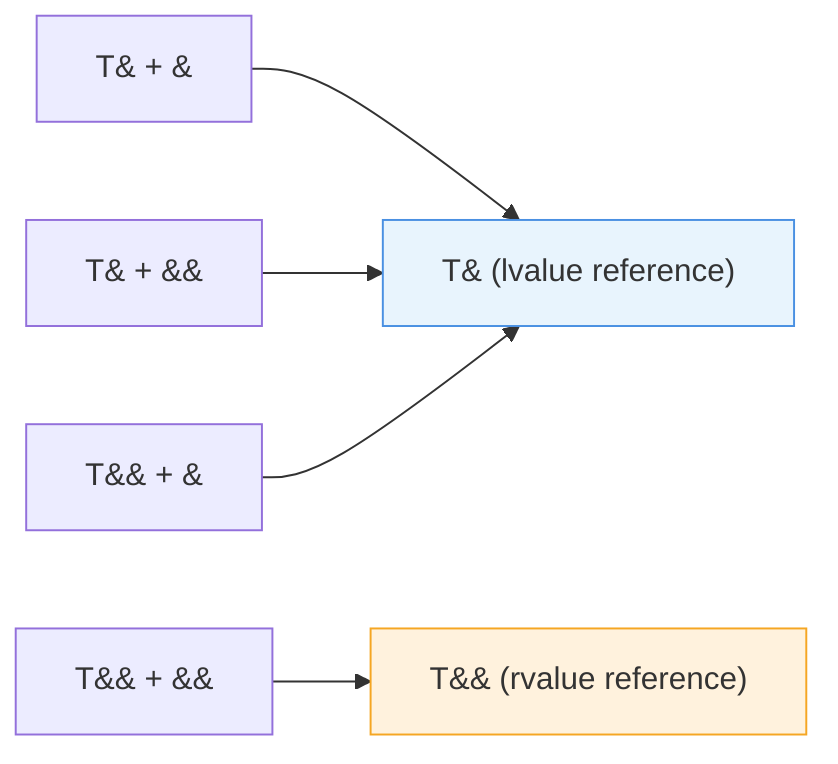
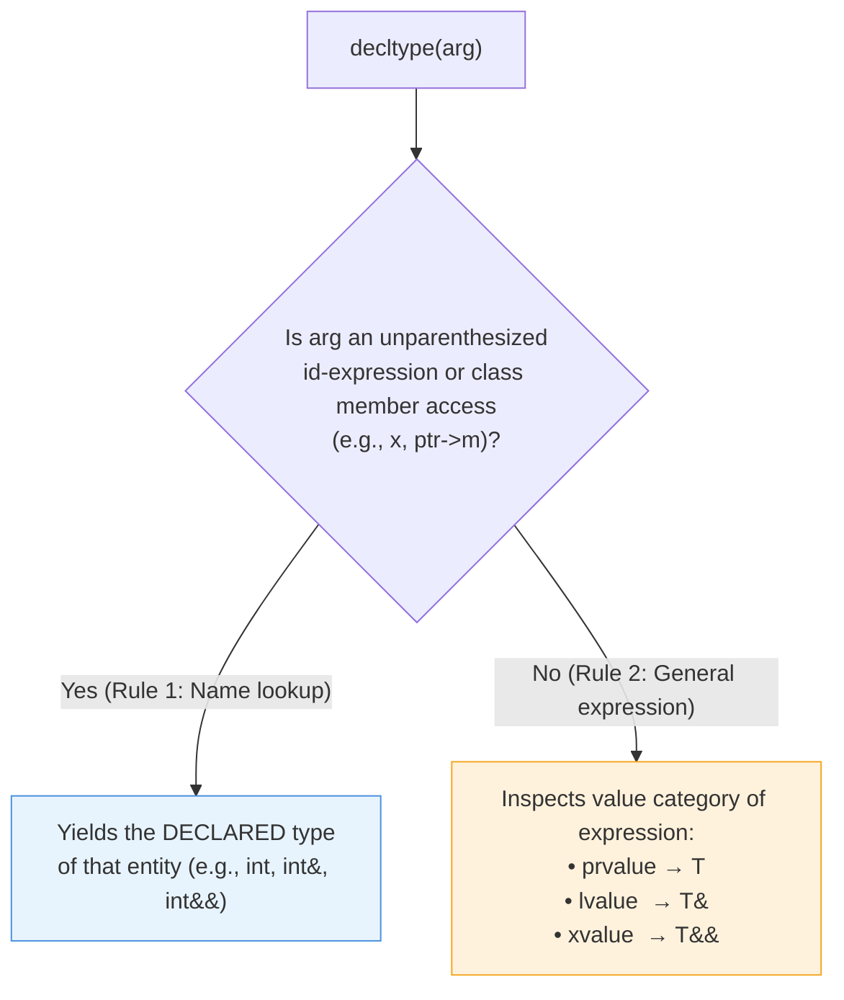

# Reference Collapsing, Forwarding References, and `decltype` in C++

::: tip What you'll learn

- Understand why **reference collapsing** exists and master its four rules in one sentence
- Distinguish **forwarding references** (`T&&` / `auto&&`) from ordinary **rvalue references**
- Master the difference between `decltype(e)` (declared type) and `decltype((e))` (expression value category)
- Avoid silent, undefined-behavior traps with `decltype(auto)` and class template member functions
:::

## Motivation

Consider two C++ functions whose signatures look nearly identical:

```cpp
void f(int&& x);                     // (1) rejects lvalues

template <class T>
void g(T&& x);                       // (2) accepts BOTH lvalues and rvalues!

```

If you pass an lvalue `int a = 42;` to `f(a)`, the compiler rejects it: an rvalue reference cannot bind to an lvalue. Yet if you pass that exact same `a` to `g(a)`, it compiles cleanly. Why does `T&&` act like an rvalue reference in some places and a "universal" reference in others?

Now look at a second puzzle involving `decltype`:

```cpp
int x = 42;
decltype(x)   a = x;   // type is int
decltype((x)) b = x;   // type is int& — adding parentheses changed the type!

```

Adding a pair of parentheses around a variable name normally changes nothing in C++. Here, it turns a value type into a reference type—a quirk that can quietly introduce dangling references when combined with `decltype(auto)`.

Both puzzles come down to the same underlying machinery: **how C++ type deduction interacts with value categories**.

::: tip When this matters most
Writing generic library functions (`std::forward`, `emplace_back`, `std::make_unique`), using `auto&&` in range-based loops, writing `decltype(auto)` return types, and reading compiler template error messages.
:::

::: info When you can ignore it
Writing straightforward, non-template application code with concrete types (`int`, `std::string`, `std::vector<T>`) and standard `auto` / `const auto&` bindings.
:::

::: danger First, unlearn the syntax myth
Seeing `&&` in C++ does **not** automatically mean "rvalue reference." Depending on whether type deduction is happening, `T&&` can resolve to an lvalue reference (`int&`), an rvalue reference (`int&&`), or a `const`-qualified reference. **Context—specifically type deduction—decides what `&&` means.**
:::

## Core Idea & Intuition

### Why references to references exist (even though you cannot write them)

In C++, you are forbidden from directly declaring a reference to a reference:

```cpp
int x = 10;
int& & r = x;  // ❌ Compile error: cannot declare pointer/reference to a reference

```

Why? Because a reference is an alias, not an object in memory; taking an "alias of an alias" has no independent meaning in user code.

However, during **template instantiation**, `typedef` / `using` alias substitution, and **`decltype` evaluation**, the compiler routinely forms a reference to a reference as an intermediate step. For example:

```cpp
using LRef = int&;
LRef&& r = x;  // Substitutes to: int& && r = x;

```

Rather than making generic code fail whenever a template parameter `T` happens to be deduced as a reference type (like `int&`), C++ defines **reference collapsing**—a deterministic rule that collapses two adjacent reference qualifiers into one.

### The four rules of reference collapsing

Whenever the compiler encounters a reference to a reference (`&` or `&&` applied to `&` or `&&`), it collapses them according to this table:

| Outer / Inner | Inner is `&` (`T&`) | Inner is `&&` (`T&&`) |
| --- | --- | --- |
| **Outer `&**` | `&` (`T& &` → `T&`) | `&` (`T&& &` → `T&`) |
| **Outer `&&**` | `&` (`T& &&` → `T&`) | `&&` (`T&& &&` → `T&&`) |

> **One-sentence rule of thumb:** If **either** reference is an lvalue reference (`&`), the result is an lvalue reference (`&`). You only get an rvalue reference (`&&`) when **both** are rvalue references (`&&`).

Think of `&` as contagious (like `0` in multiplication, or `false` in logical AND): a single `&` dominates the entire combination.



### How reference collapsing powers forwarding references

Now we can answer our opening question: why does `template <class T> void g(T&& x)` accept both lvalues and rvalues?

C++ has a special template argument deduction rule specifically for parameters of the exact form `T&&` (where `T` is a deduced template parameter):

1. **If you pass an lvalue** of type `U` (e.g., `int a = 42; g(a);`), the compiler deduces `T` as an **lvalue reference**: `T = int&`.
* Substituting `T = int&` into `T&&` produces `int& &&`.
* Reference collapsing turns `int& &&` into **`int&`**.
* So `g<int&>(int& x)` is instantiated, which binds cleanly to the lvalue `a`!


2. **If you pass an rvalue** of type `U` (e.g., `g(42);` or `g(std::move(a));`), the compiler deduces `T` as a **non-reference**: `T = int`.
* Substituting `T = int` into `T&&` produces **`int&&`**.
* No collapsing is needed; `g<int>(int&& x)` binds cleanly to the rvalue!


Because a parameter written `T&&` can bind to lvalues (becoming `T&`) and rvalues (becoming `T&&`) while preserving their value category in `T`, Scott Meyers coined the term **universal reference**, and the C++ standard officially calls it a **forwarding reference**.

### Forwarding reference vs. ordinary rvalue reference

Not every `&&` in a template is a forwarding reference. To be a **forwarding reference**, two strict conditions must both hold:

1. **Exact syntactic form:** The parameter must be written strictly as `T&&` (or `auto&&`)—with **no** `const`, `volatile`, pointers, or wrapper types (like `std::vector<T>&&`).
2. **Active type deduction on `T`:** `T` must be deduced *at the moment the function is called* (or variable is initialized for `auto&&`). If `T` was already fixed earlier (such as when instantiating a class template), `T&&` is just an ordinary rvalue reference.

| Declaration | Is it a forwarding reference? | Why? |
| --- | --- | --- |
| `template <class T> void f(T&&)` | ✅ Yes | Exact form `T&&` and `T` is deduced at the call site. |
| `auto&& x = expr;` | ✅ Yes | `auto` uses template argument deduction rules; exact form `auto&&`. |
| `[](auto&& x) { ... }` | ✅ Yes | Generic lambda generates a templated `operator()` with deduced `T&&`. |
| `void f(int&&)` | ❌ No | Concrete type `int`; no type deduction occurs. |
| `template <class T> void f(const T&&)` | ❌ No | Has `const` qualifier; fails exact `T&&` form. |
| `template <class T> void f(std::vector<T>&&)` | ❌ No | Wrapped in `std::vector<...>`; fails exact `T&&` form. |
| `template <class T> struct S { void f(T&&); };` | ❌ No | `T` is deduced when `S<T>` is instantiated, not when `f` is called. |

::: warning Analogy — and where it breaks
Think of a forwarding reference `T&&` as a **chameleon**: it changes its reference type (`T&` or `T&&`) to match whatever value category touches it.

**Where the analogy breaks:** Once inside the function body, the parameter `x` has a name. Regardless of whether `x` was deduced as `int&` or `int&&`, **the expression `x` inside the function is always an lvalue** (because all named variables are lvalues). To pass its original value category onward, you must cast it back using `std::forward<T>(x)`.
:::

## Formal Definition / Mechanism

### How `std::forward` uses reference collapsing

`std::forward<T>` is nothing more than a conditional cast powered by reference collapsing:

```cpp
template <class T>
constexpr T&& forward(std::remove_reference_t<T>& arg) noexcept {
    return static_cast<T&&>(arg);
}

```

Watch what happens to the return type `static_cast<T&&>(arg)` in both cases:

* **Caller passed an lvalue (`int`):** `T` was deduced as `int&`.
* `T&&` expands to `int& &&`, which collapses to **`int&`**.
* `static_cast<int&>(arg)` returns an **lvalue** (xvalue/lvalue rules: cast to `U&` yields an lvalue).


* **Caller passed an rvalue (`int`):** `T` was deduced as `int`.
* `T&&` expands to **`int&&`**.
* `static_cast<int&&>(arg)` returns an **xvalue** (cast to `U&&` yields an xvalue).


Reference collapsing is the entire mechanical engine that lets `std::forward<T>` restore the caller's exact value category.

### The two personalities of `decltype`

`decltype` inspects types at compile time without evaluating its operand. Crucially, `decltype` follows **two completely different rules** depending on what you put inside the parentheses:



1. **Rule 1 — Unparenthesized name (`decltype(x)` or `decltype(obj.member)`):**
`decltype` looks up the declaration of `x` in the symbol table and returns its exact declared type, including `const` and reference qualifiers.
2. **Rule 2 — Any other expression (`decltype((x))`, `decltype(a + b)`, `decltype(std::move(x))`):**
Adding parentheses around `x` turns `(x)` from a bare identifier into a general expression. `decltype` then inspects the **value category** and non-reference type `T` of that expression:
* **prvalue** → `T`
* **lvalue** → `T&`
* **xvalue** → `T&&`


### `decltype(auto)` (C++14) and return deduction

Plain `auto` strips references and top-level `const` qualifiers (using template argument deduction rules). When writing generic wrappers that need to return *exactly* what an inner function returns—whether by value or by reference—C++14 introduced `decltype(auto)`:

```cpp
decltype(auto) wrapper(auto&& func) {
    return func(); // Deduced using decltype(func()), preserving references!
}

```

`decltype(auto)` tells the compiler: *"Deduce the type of this variable or return value by plugging the initializer expression directly into `decltype(...)`."*

::: danger The `return (x);` trap with `decltype(auto)`
Because `decltype(auto)` applies `decltype` rules directly to the `return` expression:

* `return x;` evaluates `decltype(x)` → **Rule 1** (declared type, e.g., `int`, safe return by value).
* `return (x);` evaluates `decltype((x))` → **Rule 2** (`x` is an lvalue expression, so `decltype((x))` is `int&`!).

If `x` is a local variable, `return (x);` in a `decltype(auto)` function silently returns a **dangling reference** to a destroyed stack variable!
:::

## Step-by-Step Example

Let's verify every rule in code using `static_assert` and a small compile-time type printer.

### Step 1 — Reference collapsing with type aliases

```cpp
#include <type_traits>

int main() {
    using LRef = int&;
    using RRef = int&&;

    // 1. LRef + &  -> int& &  -> int&
    static_assert(std::is_same_v<LRef&,  int&>);

    // 2. LRef + && -> int& && -> int&
    static_assert(std::is_same_v<LRef&&, int&>);

    // 3. RRef + &  -> int&& & -> int&
    static_assert(std::is_same_v<RRef&,  int&>);

    // 4. RRef + && -> int&& && -> int&&
    static_assert(std::is_same_v<RRef&&, int&&>);
}

```

Notice that all four assertions compile and pass without error. Even though you cannot write `int& &` directly, forming it through `using` aliases triggers reference collapsing cleanly.

### Step 2 — Observing forwarding reference deduction

We can inspect what `T` and `decltype(x)` deduce to inside a forwarding reference function template:

```cpp
#include <iostream>
#include <string_view>
#include <type_traits>
#include <utility>

// Helper to print exact types (preserving const and & / &&)
template <class T>
constexpr std::string_view type_name() {
#if defined(__clang__) || defined(__GNUC__)
    std::string_view p = __PRETTY_FUNCTION__;
    return p; // Shows exact T in compiler signature
#elif defined(_MSC_VER)
    return __FUNCSIG__;
#endif
}

template <class T>
void inspect(T&& x) {
    std::cout << "T           = " << type_name<T>() << "\n"
              << "decltype(x) = " << type_name<decltype(x)>() << "\n"
              << "is_lvalue(x)= " << std::is_lvalue_reference_v<decltype((x))> << "\n\n";
}

int main() {
    int a = 10;
    const int ca = 20;

    inspect(a);            // lvalue int
    inspect(ca);           // lvalue const int
    inspect(30);           // prvalue int
    inspect(std::move(a)); // xvalue int
}

```

**Trace of each call:**

1. `inspect(a)` (`a` is lvalue `int`):
* `T` deduces to **`int&`**.
* Parameter `T&&` collapses `int& &&` → **`int&`**.


2. `inspect(ca)` (`ca` is lvalue `const int`):
* `T` deduces to **`const int&`**.
* Parameter `T&&` collapses `const int& &&` → **`const int&`**.


3. `inspect(30)` (`30` is prvalue `int`):
* `T` deduces to **`int`**.
* Parameter `T&&` becomes **`int&&`**.


4. `inspect(std::move(a))` (`std::move(a)` is xvalue `int`):
* `T` deduces to **`int`**.
* Parameter `T&&` becomes **`int&&`**.
* Notice: inside `inspect`, `is_lvalue(x)` is **still `1` (`true`)** because `x` is a named variable!


### Step 3 — Verifying `decltype(e)` vs `decltype((e))` and `decltype(auto)`

```cpp
#include <type_traits>
#include <utility>

decltype(auto) good_return() {
    int local = 42;
    return local;   // decltype(local) -> int (returns by value: SAFE)
}

// WARNING: Undefined behavior if called! Shown for type inspection only.
decltype(auto) bad_return() {
    int local = 42;
    return (local); // decltype((local)) -> int& (returns dangling ref: BUG!)
}

int main() {
    int x = 5;
    int&& r = std::move(x);

    // Unparenthesized: checks declared type
    static_assert(std::is_same_v<decltype(x), int>);
    static_assert(std::is_same_v<decltype(r), int&&>);

    // Parenthesized: checks expression value category
    static_assert(std::is_same_v<decltype((x)), int&>);
    static_assert(std::is_same_v<decltype((r)), int&>); // r is a name -> lvalue!
    static_assert(std::is_same_v<decltype((std::move(x))), int&&>);
    static_assert(std::is_same_v<decltype((x + 1)), int>);

    // Verify decltype(auto) return types
    static_assert(std::is_same_v<decltype(good_return()), int>);
    static_assert(std::is_same_v<decltype(bad_return()),  int&>);
}

```

## Common Misunderstandings & Pitfalls

### Pitfall 1 — Assuming `T&&` inside a class template is a forwarding reference

::: danger Compile error when passing an lvalue

```cpp
template <class T>
class Box {
public:
    void push(T&& item) { /* ... */ } // ❌ NOT a forwarding reference!
};

int main() {
    Box<int> b;
    int x = 42;
    b.push(x); // ❌ Error: cannot bind rvalue reference 'int&&' to lvalue 'int'
}

```

**Why:** When you instantiate `Box<int>`, `T` is already fixed to `int`. Therefore `void push(T&&)` becomes `void push(int&&)` before `push` is ever called—no type deduction occurs at the call site.

**Fix:** Give `push` its own template parameter:

```cpp
template <class T>
class Box {
public:
    template <class U>
    void push(U&& item) { /* std::forward<U>(item) */ } // ✅ Forwarding reference!
};

```

:::

### Pitfall 2 — Adding `const` to a forwarding reference (`const T&&`)

::: danger `const T&&` is a const rvalue reference, NOT a forwarding reference

```cpp
template <class T>
void process(const T&& x); // ❌ Only accepts rvalues!

int a = 1;
process(a); // ❌ Error: cannot bind 'const int&&' to lvalue 'int'

```

**Why:** Forwarding references require the **exact** form `T&&` without cv-qualifiers. Adding `const` disables the special lvalue-deduction rule, turning `const T&&` into an rvalue reference that forbids mutating or moving from the bound rvalue.
:::

### Pitfall 3 — Returning `(local_var)` with `decltype(auto)`

::: danger Silent dangling reference (Undefined Behavior)

```cpp
decltype(auto) compute() {
    int result = 100;
    return (result); // ❌ Deduces return type as int&!
}

```

**Why:** Parentheses make `(result)` an lvalue expression rather than an unparenthesized identifier, so `decltype((result))` evaluates to `int&`. Returning a reference to a local variable destroys the stack frame on exit and leaves the caller holding a dangling reference. Always write `return result;` without outer parentheses unless you intentionally want to return a reference to a non-local object.
:::

### Pitfall 4 — Using `auto&&` thinking it means "bind to rvalues only"

::: warning `auto&&` is a forwarding reference, not an rvalue reference

```cpp
std::vector<int> v = {1, 2, 3};
for (auto&& elem : v) { // elem has type int& (lvalue reference!)
    elem *= 2;          // Mutates v in place!
}

```

**Why:** `auto&&` follows the exact same deduction rules as `T&&`. When `v` yields lvalues, `auto` deduces to `int&`, and `int& &&` collapses to `int&`. That makes `auto&&` ideal in generic range-based loops (especially for proxy iterators like `std::vector<bool>`), where you want to bind to *anything* without copying.
:::

### Pitfall 5 — Forgetting `std::forward` when passing a forwarding reference onward

::: warning Forwarding references decay back to lvalues inside the function body

```cpp
template <class T>
void relay(T&& arg) {
    sink(arg);                  // ❌ Always calls lvalue overload of sink!
    sink(std::forward<T>(arg)); // ✅ Preserves caller's lvalue or rvalue category
}

```

**Why:** Even when `arg` has type `int&&`, the expression `arg` has a name, so it is an **lvalue**. Without `std::forward<T>(arg)`, move semantics silently degrade into copies down the call chain.
:::

## Practice Check

**Exercise 1.** Determine the collapsed type for each alias declaration:

```cpp
using A = int&;
using B = const int&&;

using T1 = A&;
using T2 = A&&;
using T3 = B&;
using T4 = B&&;

```

**Exercise 2.** For each function or variable declaration below, state whether `&&` is a **forwarding reference** or an **ordinary rvalue reference**:

```cpp
// (1)
template <class T>
void f1(T&& x);

// (2)
template <class T>
void f2(std::vector<T>&& x);

// (3)
template <class T>
struct Widget {
    void f3(T&& x);
};

// (4)
auto f4 = [](auto&& x) { return x; };

// (5)
int val = 10;
auto&& f5 = val;

```

**Exercise 3.** What is the exact deduced type of `a`, `b`, `c`, and `d`?

```cpp
int x = 10;
const int& rx = x;

decltype(rx)    a = x;
decltype((rx))  b = x;
decltype(auto)  c = rx;
decltype(auto)  d = (x);

```

### Solutions

::: details Exercise 1 — Reference collapsing

* **`T1` = `int&**` (`int& &` collapses to `int&`).
* **`T2` = `int&**` (`int& &&` collapses to `int&`).
* **`T3` = `const int&**` (`const int&& &` collapses to `const int&`; the `const` on the underlying `int` is preserved).
* **`T4` = `const int&&**` (`const int&& &&` collapses to `const int&&`).
:::

::: details Exercise 2 — Forwarding reference vs. rvalue reference

1. **`f1` — Forwarding reference.** Exact form `T&&` with `T` deduced at the call site.
2. **`f2` — Ordinary rvalue reference.** The parameter type is `std::vector<T>&&`, not `T&&`. It only accepts rvalue vectors.
3. **`f3` — Ordinary rvalue reference.** `T` is a class template parameter fixed when `Widget<T>` is instantiated, not deduced when `f3` is called.
4. **`f4` — Forwarding reference.** A C++14 generic lambda's `auto&&` parameter generates a member function template `template <class T> auto operator()(T&& x) const`.
5. **`f5` — Forwarding reference.** `auto&&` uses template argument deduction; since `val` is an lvalue `int`, `auto` deduces to `int&` and `f5` has type `int&`.
:::

::: details Exercise 3 — `decltype` and `decltype(auto)` types

* **`a` has type `const int&**` — `rx` is an unparenthesized identifier, so `decltype(rx)` returns its declared type (`const int&`).
* **`b` has type `const int&**` — `(rx)` is a parenthesized lvalue expression of type `const int`, so `decltype((rx))` yields `const int&`.
* **`c` has type `const int&**` — `decltype(auto)` evaluates `decltype(rx)`, yielding the declared type `const int&`.
* **`d` has type `int&**` — `decltype(auto)` evaluates `decltype((x))`. Because `(x)` is a parenthesized lvalue expression of type `int`, it yields `int&`.
:::

## Summary

* C++ forbids writing references to references directly (`int& &`), but they arise naturally during template instantiation, alias substitution, and `decltype` evaluation.
* **Reference collapsing** resolves `&&`/`&` combinations using one rule: **an lvalue reference (`&`) always wins** (`T& &`, `T& &&`, and `T&& &` all collapse to `T&`; only `T&& &&` stays `T&&`).
* A **forwarding reference** (`T&&` with deduced `T`, or `auto&&`) leverages reference collapsing: passing an lvalue deduces `T = U&` (collapsing `T&&` to `U&`), while passing an rvalue deduces `T = U` (producing `U&&`).
* Qualifiers (`const T&&`), wrappers (`std::vector<T>&&`), or non-deduced class template parameters (`Box<T>::push(T&&)`) turn `&&` into an **ordinary rvalue reference** that rejects lvalues.
* `decltype(e)` inspects the **declared type** of an unparenthesized name, whereas `decltype((e))` inspects the **value category** of an expression (`T` for prvalue, `T&` for lvalue, `T&&` for xvalue).
* `decltype(auto)` applies `decltype` rules to initializers and return statements—never wrap a local variable in extra parentheses (`return (x);`), or you will return a dangling reference.

## Quick Reference

| Construct / Expression | Deduced / Resulting Type | Key Rule |
| --- | --- | --- |
| `T& &`, `T& &&`, `T&& &` | `T&` | Any `&` collapses to `&` |
| `T&& &&` | `T&&` | Only two `&&` stay `&&` |
| `template <class T> void f(T&&)` called with lvalue `U` | `T = U&`, param = `U&` | Forwarding reference (lvalue path) |
| `template <class T> void f(T&&)` called with rvalue `U` | `T = U`, param = `U&&` | Forwarding reference (rvalue path) |
| `template <class T> void f(const T&&)` | `const T&&` | Ordinary rvalue reference (rejects lvalues) |
| `template <class T> struct S { void f(T&&); };` | `T&&` | Ordinary rvalue reference (`T` not deduced in `f`) |
| `decltype(x)` (unparenthesized variable `x`) | Declared type of `x` | Rule 1: symbol table lookup |
| `decltype((x))` (parenthesized lvalue `x` of type `T`) | `T&` | Rule 2: lvalue expression → `T&` |
| `decltype(std::move(x))` (xvalue of type `T`) | `T&&` | Rule 2: xvalue expression → `T&&` |
| `decltype(auto) f() { int x = 1; return (x); }` | `int&` (⚠️ Dangling!) | `(x)` is an lvalue expression |

```
