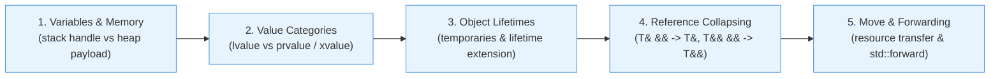
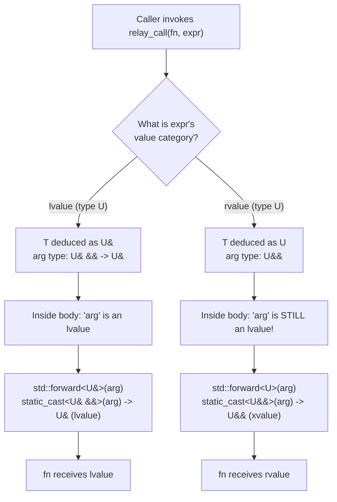

# Introduction to Move Semantics and Perfect Forwarding in C++

::: tip What you'll learn

- See how **variables, value categories, lifetimes, and reference collapsing** connect into a single coherent pipeline
- Implement a resource-managing class with a **move constructor** and **move assignment operator**
- Understand why `noexcept` is essential for standard library optimizations and what **"valid but unspecified state"** actually guarantees
- Master **perfect forwarding** (`T&&` + `std::forward<T>`) and why named parameters decay into lvalues
- Build and trace a logged dynamic buffer (`MiniBuffer`) alongside a forwarding wrapper (`relay_call`)
:::

## Motivation

Suppose you are writing two everyday pieces of modern C++ code:

1. **A resource-owning class** (such as a dynamic array or string buffer) that manages a heap allocation (`new[]` / `delete[]`).
2. **A generic wrapper function** (such as a factory `make_widget(...)` or a logging proxy `relay_call(fn, args...)`) that accepts arguments from a caller and passes them straight through to an underlying target function.

Before C++11, both tasks hit a painful wall:

- **The unnecessary copy problem:** When returning a large temporary buffer from a function or passing a temporary into a container (`vec.push_back(make_buffer())`), C++98 had no way to distinguish a short-lived temporary from a persistent variable. It had to allocate brand-new heap memory, copy every byte over, and immediately destroy the temporary—wasting CPU cycles and memory bandwidth on resources that were about to vanish anyway.
- **The forwarding combinatorics problem:** When writing a wrapper `relay_call(fn, arg)` that forwards `arg` to `fn`, you want lvalues to arrive at `fn` as lvalues (so `fn` can mutate them if it takes `T&`) and rvalues to arrive at `fn` as rvalues (so `fn` can move from them if it takes `T&&`). Without perfect forwarding, you would have to write $2^N$ overloads (`T&` and `const T&` combinations) for $N$ parameters—and you still could not forward rvalue-ness.

Modern C++ solves both problems with two interlocking mechanisms: **move semantics** (stealing resources from expiring objects) and **perfect forwarding** (preserving an argument's type and value category across function boundaries).

::: tip When this matters most
Writing RAII resource wrappers, designing library APIs, building factory functions (`std::make_unique`, `emplace_back`), optimizing container reallocations, and debugging _"why did my wrapper trigger a deep copy instead of a move?"_
:::

::: info When you can ignore it
Passing small, trivially copyable types (`int`, `double`, small POD structs) where copying a few registers is just as fast as moving—though knowing how forwarding wrappers behave remains vital whenever you write generic templates.
:::

::: danger First, unlearn a common myth
**`std::move` does not move anything, and `std::forward` does not forward anything at runtime.** Both are compile-time casts (`static_cast`) that adjust value categories so overload resolution picks the right function. All actual work happens inside constructors, assignment operators, or the target function.
:::

## Core Idea & Intuition

### The Big Picture: How Five Concepts Form One Pipeline

This capstone guide ties together the foundational building blocks of modern C++ into a single cause-and-effect chain:



Every piece in this chain exists because of the piece before it:

1. **Variables & Memory:** A resource-managing object typically lives on the stack as a lightweight **handle** (a pointer + size) owning a heavyweight **payload** on the heap. Copying duplicates the heap payload; moving transfers the pointer.
2. **Value Categories:** To transfer resources safely, the compiler must know whether an expression refers to a persistent object (**lvalue**) or an expiring/movable one (**prvalue** or **xvalue**, collectively **rvalues**).
3. **Object Lifetimes:** Temporaries normally die at the end of the full-expression (`;`), but binding an rvalue to `const T&` or `T&&` extends its lifetime, giving a move constructor or target function a safe window to inspect or loot its guts.
4. **Reference Collapsing:** When a template parameter `T&&` deduces against an lvalue or an rvalue, C++ collapses reference-to-reference types (`T& &&` $\rightarrow$ `T&`, `T&& &&` $\rightarrow$ `T&&`), encoding the caller's value category directly into `T`.
5. **Move Semantics & Perfect Forwarding:** Using those rules, move operations steal heap pointers from rvalues, while `std::forward<T>(arg)` restores an argument's original value category after it becomes a named local parameter.

### Intuition in Two Sentences

> **Move semantics** is a shallow pointer swap disguised as object construction: instead of cloning a heap allocation from a source object that is about to die, the destination steals the source's pointer and leaves the source in a clean, empty state.
> **Perfect forwarding** is a postal relay: a wrapper function receives an argument (which inevitably becomes an lvalue once given a parameter name) and uses `std::forward<T>` to re-attach its original "lvalue" or "rvalue" shipping label before handing it to the next function.

### Analogy — and Where It Breaks

::: tip Moving houses vs. cloning houses
Suppose Alice owns a furnished house (a stack object holding a pointer to a heap buffer).

* **Copy semantics** is building an identical house down the street and buying brand-new furniture to match every single piece in Alice's house. Alice keeps her house intact; you now have two full houses.
* **Move semantics** is handing Bob the deed and keys to Alice's existing house, then updating Alice's records to say "currently owns no house." No furniture is moved or duplicated—only the ownership pointer changes hands.
* **Perfect forwarding** is a courier service: if Alice hands over a "keep my original" box (lvalue), the courier delivers it as a keep-original box; if Alice hands over a "disposable/transferable" box (rvalue), the courier preserves that tag instead of accidentally relabeling it as permanent.
:::

::: warning Where the analogy breaks
In C++, handing over the keys does **not** destroy Alice's stack variable. Alice's object still exists in scope and **its destructor will still run** when its scope ends. Therefore, the move operation *must* leave Alice's handle in a safe, destructible state (for example, setting its internal pointer to `nullptr` so `delete[] nullptr` is a harmless no-op).
:::

## Formal Mechanism

### 1. Move Semantics: Special Member Functions

To equip a resource-managing class `Buffer` with move semantics, you define two special member functions alongside your copy operations (the **Rule of Five**):

```cpp
class Buffer {
public:
    // Move constructor: steals resources from an expiring 'other'
    Buffer(Buffer&& other) noexcept;

    // Move assignment operator: releases current resources, then steals from 'other'
    Buffer& operator=(Buffer&& other) noexcept;
};

```

#### How Move Construction Works

1. **Steal:** Copy `other`'s raw resource handles (e.g., `data_` pointer and `size_`) into `*this`.
2. **Reset:** Set `other`'s handles to an empty, neutral state (`other.data_ = nullptr; other.size_ = 0;`).
3. **Result:** `*this` now owns the original heap buffer in $O(1)$ time, and `other`'s destructor can safely run without freeing the memory `*this` now owns.

#### How Move Assignment Works

1. **Self-assignment guard:** Check `if (this == &other) return *this;` (essential if someone writes `buf = std::move(buf);`).
2. **Release existing resources:** Free `*this`'s current buffer (`delete[] data_`) so it does not leak.
3. **Steal & Reset:** Transfer `other.data_` and `other.size_` into `*this`, then zero out `other`.

#### Why `noexcept` Matters So Much

Marking move constructors and move assignment operators `noexcept` is not merely stylistic—it directly controls standard library performance:

* Containers like `std::vector` provide the **strong exception guarantee** during reallocation (e.g., `push_back` when capacity is exceeded).
* If moving elements could throw an exception midway through reallocating a vector, the original array would already be partially gutted and could not be rolled back.
* Therefore, `std::vector` checks `std::is_nothrow_move_constructible<T>` (via `std::move_if_noexcept`). **If your move constructor is not marked `noexcept`, `std::vector` will silently fall back to copying every element during reallocation.**

#### "Valid but Unspecified State"

The C++ standard specifies that a moved-from standard library object is left in a **valid but unspecified state**:

* **Valid:** All class invariants hold. You can safely destroy the object, assign a new value to it (`buf = Buffer(10);`), or call precondition-free observers (like `buf.size()` or `buf.empty()`).
* **Unspecified:** You must not assume what value it holds after the move. For example, a moved-from `std::string` might be empty, or it might still hold a short-string-optimization buffer. Never read its previous contents without reinitializing it first.

### 2. Perfect Forwarding: Named Parameters, Forwarding References, and `std::forward`

#### The Problem: Parameter Names Are Always Lvalues

Inside any function, a parameter has a name and an addressable memory location—which makes the expression naming that parameter an **lvalue**, even if its declared type is an rvalue reference (`T&&`):

```cpp
void target(int& x)  { /* mutates lvalue */ }
void target(int&& x) { /* moves from rvalue */ }

void broken_wrapper(int&& arg) {
    // 'arg' has declared type int&&, so it bound to an rvalue at the call site.
    // HOWEVER, inside this body, the expression 'arg' has a name -> it is an LVALUE!
    target(arg);  // Calls target(int&) instead of target(int&&)!
}

```

#### Forwarding References (`T&&` with Type Deduction) and Reference Collapsing

When `T` is a **deduced template type parameter** (or `auto&&`), `T&&` is a **forwarding reference** (often called a universal reference). Special template argument deduction rules apply:

* If the caller passes an **lvalue** of type `U`, `T` is deduced as `U&`.
* If the caller passes an **rvalue** (prvalue or xvalue) of type `U`, `T` is deduced as `U`.

Because C++ forbids forming a reference to a reference directly in source code, the compiler resolves `T&&` during template instantiation using **reference collapsing**:

| Deduced `T` | Parameter type `T&&` | Collapsed result | Meaning |
| --- | --- | --- | --- |
| `U&` (caller passed lvalue) | `U& &&` | `U&` | Lvalue reference wins (`&` is "infectious") |
| `U` (caller passed rvalue) | `U&&` | `U&&` | Remains an rvalue reference |

#### How `std::forward<T>(arg)` Restores Value Category

`std::forward<T>` is simply a conditional cast:

```cpp
template <class T>
constexpr T&& forward(std::remove_reference_t<T>& arg) noexcept {
    return static_cast<T&&>(arg);
}

```

Watch what `static_cast<T&&>(arg)` produces in both cases:

1. **Caller passed an lvalue `x` (`T = U&`):**
`static_cast<U& &&>(arg)` collapses to `static_cast<U&>(arg)` $\rightarrow$ returns an **lvalue**.
2. **Caller passed an rvalue `U{}` (`T = U`):**
`static_cast<U&&>(arg)` stays `static_cast<U&&>(arg)` $\rightarrow$ returns an **xvalue** (an rvalue).



## Hands-On Lab: Logged Dynamic Buffer & Forwarding Relay

Let's put everything into a self-contained program. We will build:

1. **`MiniBuffer`**: A minimal heap-allocated integer array that logs every construction, copy, move, and destruction.
2. **`relay_call`**: A variadic perfect-forwarding wrapper that logs when it intercepts a call and forwards all arguments untouched to a target function.

```cpp
#include <algorithm>
#include <cstddef>
#include <iostream>
#include <string>
#include <utility>
#include <vector>

class MiniBuffer {
public:
    // 1. Standard constructor: allocates heap memory
    explicit MiniBuffer(std::string label, std::size_t size = 4)
        : label_(std::move(label)),
          size_(size),
          data_(size > 0 ? new int[size]{} : nullptr) {
        std::cout << "[Construct]  " << label_ << " (size=" << size_
                  << ", ptr=" << data_ << ")\n";
    }

    // 2. Destructor: releases heap memory
    ~MiniBuffer() {
        std::cout << "[Destroy]    " << (label_.empty() ? "<moved-from>" : label_)
                  << " (ptr=" << data_ << ")\n";
        delete[] data_;
    }

    // 3. Copy constructor: deep-copies heap memory (expensive)
    MiniBuffer(const MiniBuffer& other)
        : label_(other.label_ + "_copy"),
          size_(other.size_),
          data_(other.size_ > 0 ? new int[other.size_] : nullptr) {
        if (data_) {
            std::copy(other.data_, other.data_ + size_, data_);
        }
        std::cout << "[Copy Ctor]  " << label_ << " from " << other.label_
                  << " (new ptr=" << data_ << ")\n";
    }

    // 4. Copy assignment operator
    MiniBuffer& operator=(const MiniBuffer& other) {
        if (this == &other) return *this;
        delete[] data_;
        label_ = other.label_ + "_copy_assigned";
        size_ = other.size_;
        data_ = size_ > 0 ? new int[size_] : nullptr;
        if (data_) {
            std::copy(other.data_, other.data_ + size_, data_);
        }
        std::cout << "[Copy Asgn]  " << label_ << " (new ptr=" << data_ << ")\n";
        return *this;
    }

    // 5. Move constructor: steals pointer in O(1), marked noexcept!
    MiniBuffer(MiniBuffer&& other) noexcept
        : label_(std::move(other.label_)),
          size_(other.size_),
          data_(other.data_) {
        // Leave 'other' in a valid, empty state so its destructor won't free our buffer
        other.size_ = 0;
        other.data_ = nullptr;
        std::cout << "[Move Ctor]  " << label_ << " (stole ptr=" << data_ << ")\n";
    }

    // 6. Move assignment operator: frees own buffer, steals other's pointer
    MiniBuffer& operator=(MiniBuffer&& other) noexcept {
        if (this == &other) return *this;
        delete[] data_;

        label_ = std::move(other.label_);
        size_ = other.size_;
        data_ = other.data_;

        other.size_ = 0;
        other.data_ = nullptr;
        std::cout << "[Move Asgn]  " << label_ << " (stole ptr=" << data_ << ")\n";
        return *this;
    }

    std::size_t size() const noexcept { return size_; }
    const std::string& label() const noexcept { return label_; }

private:
    std::string label_;
    std::size_t size_;
    int* data_;
};

// Overloaded sinks to observe whether lvalue or rvalue arrives
void sink(MiniBuffer& buf) {
    std::cout << "  -> sink(MiniBuffer&  [LVALUE]) received '" << buf.label() << "'\n";
}

void sink(MiniBuffer&& buf) {
    std::cout << "  -> sink(MiniBuffer&& [RVALUE]) received '" << buf.label() << "'\n";
    // Because 'buf' is an rvalue reference, sink is permitted to move from it:
    MiniBuffer local_owner(std::move(buf));
}

// Generic forwarding wrapper
template <typename Func, typename... Args>
decltype(auto) relay_call(Func&& fn, Args&&... args) {
    std::cout << "[relay_call] Forwarding arguments...\n";
    return std::forward<Func>(fn)(std::forward<Args>(args)...);
}

int main() {
    std::cout << "=== Case 1: Forwarding an lvalue ===\n";
    MiniBuffer persistent("alpha", 8);
    relay_call(sink, persistent);  // 'persistent' is an lvalue -> Args = MiniBuffer&

    std::cout << "\n=== Case 2: Forwarding a prvalue (temporary) ===\n";
    relay_call(sink, MiniBuffer("beta", 16));  // prvalue -> Args = MiniBuffer

    std::cout << "\n=== Case 3: Forwarding an xvalue (std::move) ===\n";
    relay_call(sink, std::move(persistent));   // xvalue -> Args = MiniBuffer

    std::cout << "\n=== Case 4: std::vector reallocation relies on noexcept ===\n";
    std::vector<MiniBuffer> vec;
    vec.reserve(1);
    vec.emplace_back("item1", 4);
    std::cout << "-- Triggering vector growth --\n";
    vec.emplace_back("item2", 4);  // Uses Move Ctor because it is noexcept!

    std::cout << "\n=== End of main (destructors run) ===\n";
}

```

### Tracing the Output

```text
=== Case 1: Forwarding an lvalue ===
[Construct]  alpha (size=8, ptr=0x1000)
[relay_call] Forwarding arguments...
  -> sink(MiniBuffer&  [LVALUE]) received 'alpha'

=== Case 2: Forwarding a prvalue (temporary) ===
[Construct]  beta (size=16, ptr=0x2000)
[relay_call] Forwarding arguments...
  -> sink(MiniBuffer&& [RVALUE]) received 'beta'
[Move Ctor]  beta (stole ptr=0x2000)
[Destroy]    beta (ptr=0x2000)
[Destroy]    <moved-from> (ptr=0x0)

=== Case 3: Forwarding an xvalue (std::move) ===
[relay_call] Forwarding arguments...
  -> sink(MiniBuffer&& [RVALUE]) received 'alpha'
[Move Ctor]  alpha (stole ptr=0x1000)
[Destroy]    alpha (ptr=0x1000)

=== Case 4: std::vector reallocation relies on noexcept ===
[Construct]  item1 (size=4, ptr=0x3000)
-- Triggering vector growth --
[Construct]  item2 (size=4, ptr=0x4000)
[Move Ctor]  item1 (stole ptr=0x3000)
[Destroy]    <moved-from> (ptr=0x0)

=== End of main (destructors run) ===
[Destroy]    item1 (ptr=0x3000)
[Destroy]    item2 (ptr=0x4000)
[Destroy]    <moved-from> (ptr=0x0)

```

**What to notice in the trace:**

* **Zero deep copies occurred** across the entire program (`[Copy Ctor]` never appeared).
* In **Case 2**, `beta` was constructed at `0x2000`, forwarded as an rvalue into `sink(MiniBuffer&&)`, stolen by `local_owner` (`stole ptr=0x2000`), and the moved-from temporary safely destroyed `ptr=0x0`.
* In **Case 3**, `persistent` (`alpha`) had its pointer `0x1000` stolen; at the end of `main`, `persistent`'s destructor safely ran on `ptr=0x0`.
* In **Case 4**, when `vec` grew beyond capacity `1`, it moved `item1` instead of copying it—solely because `MiniBuffer(MiniBuffer&&)` was marked `noexcept`.

## Common Misunderstandings & Pitfalls

### Pitfall 1 — Reading from a moved-from object as if it were untouched

::: danger Undefined or logic-breaking behavior

```cpp
std::vector<int> data = {1, 2, 3};
sink(std::move(data));
std::cout << data[0];  // BUG! 'data' is in a valid but unspecified state (likely empty).

```

After `std::move(x)`, treat `x` as an empty shell. Only destroy it, reassign it (`data = {4, 5};`), or call safe state-reset methods like `data.clear()`.
:::

### Pitfall 2 — Forgetting `std::forward` inside a forwarding wrapper

::: danger Silent performance degradation

```cpp
template <typename T>
void bad_relay(T&& arg) {
    sink(arg);  // BUG! 'arg' is a named variable (lvalue), so sink(MiniBuffer&) is ALWAYS called!
}

```

Even if the caller passes `MiniBuffer("temp")` or `std::move(x)`, `arg` inside `bad_relay` is an lvalue. Without `std::forward<T>(arg)`, rvalues silently degrade into lvalues, turning moves into expensive deep copies.
:::

### Pitfall 3 — Applying `std::move` to the return value of `std::move` (or a local return variable)

::: warning Redundant move & breaking Return Value Optimization (RVO)

```cpp
// Anti-pattern 1: double std::move
sink(std::move(std::move(x)));  // Pointless noise; std::move(x) is already an xvalue.

// Anti-pattern 2: std::move on a local variable in a return statement
MiniBuffer make_buffer() {
    MiniBuffer buf("local", 10);
    return std::move(buf);  // HURTS PERFORMANCE! Prevents NRVO (Named Return Value Optimization).
}

```

When returning a local variable by value (`return buf;`), the compiler already treats `buf` as move-eligible or eliminates the move altogether via **NRVO** (constructing `buf` directly in the caller's memory slot). Wrapping it in `std::move(buf)` disables NRVO and forces a move construction.
:::

### Pitfall 4 — Using `std::move` on a `const` object

::: danger Silent copy instead of move

```cpp
const MiniBuffer frozen("const_buf", 8);
MiniBuffer copy_in_disguise(std::move(frozen));  // Calls COPY constructor!

```

`std::move(frozen)` produces `const MiniBuffer&&`. A move constructor takes a non-const `MiniBuffer&&` because it needs to mutate the source (setting `other.data_ = nullptr`). Since `const MiniBuffer&&` cannot bind to `MiniBuffer&&`, overload resolution falls back to `MiniBuffer(const MiniBuffer&)`—silently performing a deep copy.
:::

## Practice Check

**Exercise 1.** In the snippet below, which overload of `process` is called on lines A, B, and C?

```cpp
#include <utility>

struct Widget {};
void process(Widget&)  {}  // #1
void process(Widget&&) {}  // #2

template <typename T>
void forwarder(T&& w) {
    process(w);                   // Line A
    process(std::forward<T>(w));  // Line B
    process(std::move(w));        // Line C
}

int main() {
    Widget obj;
    forwarder(obj);
}

```

**Exercise 2.** Why does removing `noexcept` from `MiniBuffer(MiniBuffer&&)` in the hands-on lab cause `[Copy Ctor]` to appear during `vec.emplace_back("item2", 4)`?

**Exercise 3.** Spot the two bugs in this wrapper function:

```cpp
template <typename T>
void wrapper(const T&& item) {
    consume(std::forward<T>(item));
}

```

### Solutions

::: details Exercise 1 — Overload resolution inside a template
When `forwarder(obj)` is called with lvalue `obj`, `T` is deduced as `Widget&`, so `w` has type `Widget&`.

* **Line A (`process(w)`):** Calls **`#1` (`Widget&`)**. `w` is a named variable (lvalue).
* **Line B (`process(std::forward<T>(w))`):** Calls **`#1` (`Widget&`)**. Because `T` is `Widget&`, `std::forward<Widget&>(w)` casts `w` to `Widget& &&` $\rightarrow$ `Widget&` (an lvalue), faithfully preserving the caller's lvalue.
* **Line C (`process(std::move(w))`):** Calls **`#2` (`Widget&&`)**. `std::move` unconditionally casts `w` to `Widget&&` (an xvalue), even though the caller passed an lvalue! (Never use `std::move` on a forwarding reference unless you intend to unconditionally steal from the caller's lvalue.)
:::

::: details Exercise 2 — Why `noexcept` unlocks `std::vector` moves
When `std::vector` reallocates its internal array to grow capacity, it must preserve the **strong exception guarantee**: if an exception is thrown while transferring elements to the new buffer, the vector must remain unchanged. If moving an element could throw after half the elements have already been gutted, rollback is impossible. Thus, `std::vector` uses `std::move_if_noexcept`, which only selects the move constructor when `noexcept` is present; otherwise, it falls back to the copy constructor so the original array remains intact if an exception occurs.
:::

::: details Exercise 3 — Two bugs in `wrapper`

1. **`const T&&` is NOT a forwarding reference:** A forwarding reference must have the exact form `T&&` (without `const` or `volatile` qualifiers) where `T` is a deduced template parameter. `const T&&` is a plain rvalue reference to a `const` object, so passing an lvalue fails to compile, and passing a non-const rvalue adds `const` (blocking moves). Fix: change parameter to `T&& item`.
2. **Even if `const` were intended, `std::forward<T>(item)` would strip or mismatch `const`:** Because `item` is `const`, passing `item` into `std::forward<T>` (where `T` is non-const) fails to compile since `const T&` cannot bind to `std::remove_reference_t<T>&`.
:::

## Summary

* **Move semantics** avoids expensive deep copies by transferring ownership of dynamic resources (`data_` pointers) from expiring rvalues (`T&&`) in $O(1)$ time, leaving the moved-from source in a **valid but unspecified state** (safe to destroy or reassign).
* Always mark move constructors and move assignment operators **`noexcept`** so standard library containers (`std::vector`, `std::deque`) can safely use them during reallocations.
* **Named variables are always lvalues**, even if their declared type is `T&&`.
* **Perfect forwarding** combines a **forwarding reference** (`T&&` with template type deduction) and **reference collapsing** (`T& &&` $\rightarrow$ `T&`, `T&& &&` $\rightarrow$ `T&&`) with **`std::forward<T>(arg)`** to preserve an argument's exact value category across wrapper layers.
* Never use `std::move` on a `const` object (silently copies), on a returned local variable (breaks NRVO), or on a forwarding reference (use `std::forward<T>` instead).

## Quick Reference & Next Steps

### Cheat Sheet: `std::move` vs. `std::forward`

| Tool | Typical Context | What It Does | Mental Model |
| --- | --- | --- | --- |
| **`std::move(x)`** | Concrete type (`Buffer&&`), transferring ownership | Unconditionally casts `x` to an **xvalue** (`remove_reference_t<T>&&`) | *"I am done with `x`; feel free to steal its resources."* |
| **`std::forward<T>(x)`** | Template forwarding reference (`T&&`) | Casts `x` to an **xvalue** *only* if `T` is non-reference; keeps it an **lvalue** if `T` is `U&` | *"Pass `x` onward with the exact lvalue/rvalue category the caller gave me."* |

### Where to Go Next

Now that you have connected memory models, value categories, lifetimes, and reference collapsing, you are ready to explore how the C++ standard library builds on top of them:

1. **RAII & Smart Pointers (`std::unique_ptr`, `std::shared_ptr`):** See move-only types in action—`std::unique_ptr` deletes its copy constructor and relies purely on move semantics to transfer exclusive heap ownership with zero overhead.
2. **Standard Library Containers & Emplacement (`emplace_back`, `try_emplace`):** Learn how containers combine variadic templates and perfect forwarding to construct objects *in-place* inside internal node or buffer memory, eliminating even the move itself.
3. **Rule of Zero & Rule of Five:** Practice designing application classes that delegate resource management to smart pointers and standard containers so you rarely have to write manual destructors, copy constructors, or move operations yourself.
4. **Template Metaprogramming & Concepts (C++20):** Constrain forwarding templates cleanly using `std::constructible_from`, `std::invocable`, and `requires` clauses to get crystal-clear compiler diagnostics.

```
