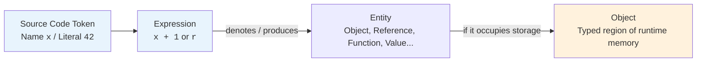
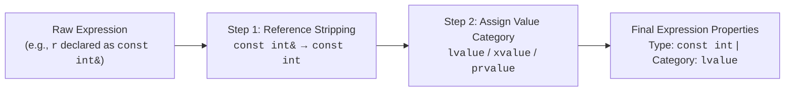

# C++ Object Model & Expression Basics: Object, Name, Expression, and Type

::: tip What you'll learn
* Cleanly separate **Object**, **Entity**, **Name**, and **Expression** without muddling source code with runtime memory
* Master **top-level vs. low-level cv-qualifiers** (`const` / `volatile`) and predict exactly when they strip or stick
* Understand why the C++ standard dictates that **expressions never have reference types**, and how a variable's declared type differs from an expression's type
* Avoid six common pitfalls caused by confusing names with expressions
:::

## Motivation

Many C++ learners hit a wall when reading compiler error messages, cppreference pages, or template deduction rules. The root cause is rarely complex syntax—it is an imprecise mental vocabulary that lumps **variables**, **regions of memory**, and **expressions** into a single fuzzy bucket.

Without separating those layers, basic questions quickly turn into paradoxes:

* In `int& r = a;`, is `r` an object? Does it occupy memory of its own?
* Why is the declared type of `r` `int&`, yet the expression `r` has type `int`?
* In `const int x = 1;`, `x` cannot be modified—so why can a pointer declared as `const int* p = &x;` be reassigned to point somewhere else?

This guide builds the foundational vocabulary and mental model you need before tackling object lifetimes, reference binding, and value categories (`lvalue`, `prvalue`, `xvalue`).

::: tip When this matters most
Understanding reference binding, `auto` and `decltype` type deduction, `const`-correctness in APIs, template argument deduction, and reading C++ standard / cppreference specifications.
:::

::: info When you can ignore it
Writing straightforward procedural code without references, pointers-to-const, or type deduction—though even there, confusing a reference with an object leads to dangling-reference bugs.
:::

::: danger First, stop calling everything a "variable"
In casual conversation, programmers say "variable" to mean a name in source code, the memory holding its value, and the expression that reads it. In C++, those are **distinct concepts with different rules**. Precision here pays off everywhere else.
:::

## Core Idea & Intuition

### The four-way distinction: Entity, Name, Object, and Expression

Every piece of C++ code operates across two worlds: the **compile-time language/syntax world** and the **runtime memory world**. Four terms bridge them:

1. **Entity** *(language-level concept)*: Anything in a C++ program that can be introduced by a declaration or referred to. The C++ standard explicitly lists what counts as an entity: **values, objects, references, functions, enumerators, types, class members, templates, template specializations, namespaces, and parameter packs**.
2. **Name (Identifier)** *(source-code symbol)*: A token in your source code (like `x`, `r`, or `foo`) used to denote an entity. Not every entity has a name (e.g., temporary objects), and multiple names can refer to the same entity (e.g., references).
3. **Object** *(runtime physical storage)*: A region of storage created at runtime that has a size, alignment, storage duration, lifetime, and type—and usually holds a value.
4. **Expression** *(compile-time evaluation unit)*: A sequence of operators and operands (including a single name or literal) that computes a value or designates an object or function.



Notice the critical asymmetries:

* **A reference is an entity and has a name, but it is NOT an object.** It is an alias bound to an existing object or function.
* **A temporary (like the result of `std::string("hi")`) IS an object, but it has NO name.**
* **A function is an entity and has a name, but it is NOT an object.** Code lives in instruction memory, not in typed data storage governed by object lifetimes.

### Analogy — and where it breaks

::: tip A house, a nameplate, and walking up to the door
Think of an **Object** as a physical house with a foundation and square footage.

A **Name** is a nameplate bolted next to the front door (`x`). Declaring a reference (`int& r = x;`) does **not** build a second house—it simply bolts a second nameplate (`r`) onto the exact same house.

An **Expression** is the act of looking up a nameplate or performing a calculation at the mailbox (`r + 5`). Meanwhile, a literal like `42` is a pure number written on a postcard: it has a value, but no house at all.
:::

::: warning Where the analogy breaks
In the physical world, a second nameplate still takes up a tiny bit of space on the wall. In C++'s abstract machine, a reference is **not required to occupy any storage whatsoever**. The compiler may substitute the underlying object directly, keep an address in a CPU register, or—when storing a reference inside a `struct`—use a hidden pointer under the hood. The language specification intentionally leaves physical representation up to the compiler.
:::

### Static properties of a Type and cv-qualifiers

Every object and every expression has a **type**. A type is a compile-time blueprint that answers four questions:

1. How many bytes of storage does this occupy (`sizeof`)?
2. What memory address boundaries must it sit on (`alignof`)?
3. How should the raw bits in memory be interpreted (e.g., two's complement integer vs. IEEE-754 floating-point)?
4. Which operations are valid on it?

Types can be modified by **cv-qualifiers**: `const` (read-only contract) and `volatile` (prevent compiler caching/reordering across memory accesses). When pointers or references are involved, cv-qualifiers appear at two distinct levels:

* **Top-level cv-qualifier**: Applies directly to the object or pointer *itself* ("this variable/pointer cannot be reassigned").
* **Low-level cv-qualifier**: Applies to the *pointed-to or referred-to* object ("you cannot modify the target through this pointer/reference").

| Declaration | Top-level `const`? | Low-level `const`? | Meaning |
| --- | --- | --- | --- |
| `const int x = 1;` | ✅ Yes | — (not a pointer/ref) | `x` itself is constant. |
| `const int* p = &x;` | ❌ No | ✅ Yes | `p` can point elsewhere; `*p` cannot be modified. |
| `int* const p = &y;` | ✅ Yes | ❌ No | `p` is fixed to `y`; `*p` can be modified. |
| `const int* const p = &x;` | ✅ Yes | ✅ Yes | Neither `p` nor `*p` can be modified. |
| `const int& r = x;` | ❌ No *(refs are never reassignable)* | ✅ Yes | `r` is an alias through which `x` cannot be modified. |

**Why this split matters:** Whenever C++ copies a value—such as passing an argument by value to a function or deducing a type with `auto`—**top-level cv-qualifiers are stripped, while low-level cv-qualifiers are preserved**. Copying an `int* const` into a brand-new pointer variable `q` cannot mutate the original pointer, so `q` has no reason to be `const`. However, `q` still points to the *same* underlying `const int`, so stripping the low-level `const` would break type safety.

### The cornerstone rule: Expressions never have reference types

If you internalize one rule from the C++ standard, make it this one:

> **Reference Stripping Rule (C++ Standard `[expr.type]`):** If an expression initially has the type "reference to `T`", its type is adjusted to `T` prior to any further analysis.

Even when a variable is declared as `int& r = a;` or `const std::string& s = "hi";`, the **expression** `r` has type `int`, and the **expression** `s` has type `const std::string`.

Why did C++ design the type system this way?

1. **Uniformity of operations:** Adding two integers (`a + b`) should invoke the exact same integer-addition rules whether `a` is an `int` variable or an `int&` reference. You should not need separate `+` operators for `int` and `int&`.
2. **Separation of concerns:** C++ cleanly separates **what kind of data** an expression represents (its **type**, e.g., `int`) from **how that data is situated in memory** (its **value category**, e.g., `lvalue` vs. `prvalue`). Stripping the reference from the type leaves the value category to record that the expression refers to an identifiable object.

## Formal Definition / Mechanism

### What strictly defines an Object?

According to the C++ standard (`[intro.object]`), an object is created by a definition, a `new`-expression, a throw-expression, changing the active member of a union, or creating a temporary object. Every object has five fundamental properties:

1. **Size** (`sizeof(T)` bytes; always $\ge 1$ for complete object types, though base-class subobjects or members marked `[[no_unique_address]]` can have zero size via Empty Base Optimization).
2. **Alignment requirement** (`alignof(T)`).
3. **Storage duration** (automatic, static, thread, or dynamic).
4. **Lifetime** (the runtime window between initialization/construction and destruction/storage release).
5. **Type** (fixed at creation; determines layout and valid operations).

**Immediate consequences of this definition:**

* **Functions are not objects:** You cannot call `sizeof(func)` or `new` a function; functions have no storage duration or object lifetime.
* **References are not objects:** `sizeof(int&)` does not return the size of a pointer—by language rule, `sizeof` applied to a reference type returns the size of the **referenced type** (`sizeof(int)`). You also cannot have an array of references (`int& arr[3]` is ill-formed) or a pointer to a reference (`int&* p` is ill-formed), because arrays and pointers require objects (or functions) as targets.

### How the compiler analyzes an Expression

Whenever the compiler encounters an expression, it evaluates its static properties in a strict two-step pipeline:



1. **Reference stripping:** Any `T&` or `T&&` is adjusted to `T`.
2. **Value category classification:** The expression is classified as either a **glvalue** (has identity: `lvalue` or `xvalue`) or a **prvalue** (pure value, no identity).
3. **Non-class prvalue cv-stripping:** If the resulting expression is a **prvalue** of a non-class, non-array type (such as `int` or `int*`), any top-level cv-qualifiers are stripped as well. For example, `(const int)42` produces a prvalue of type `int`, not `const int`—a pure scalar number with no memory address cannot be meaningfully "const". (Class prvalues *do* retain `const`, because `const` member functions can be called on them.)

### Implicit Expression Conversions (Decay & Value Reading)

Because expressions denote either memory locations (`glvalue`) or pure values (`prvalue`), C++ frequently performs automatic **standard conversions** when an expression appears in a context expecting a value:

* **Lvalue-to-rvalue conversion:** When you write `int y = x;`, `x` starts as an `lvalue` denoting an object in memory. To initialize `y`, the compiler reads the value stored inside `x`, converting the `lvalue` into a `prvalue` of non-cv-qualified type `int`. *(Note: Reading an uninitialized object triggers undefined behavior precisely at this lvalue-to-rvalue conversion step.)*
* **Array-to-pointer decay:** An lvalue expression of array type `T[N]` implicitly converts to a `prvalue` pointer of type `T*` pointing to its first element—**except** when used as the operand of `sizeof`, `alignof`, `typeid`, address-of `&`, `decltype`, or when initializing a reference to an array (`int (&ref)[N]`).
* **Function-to-pointer decay:** An lvalue expression designating a function of type `R(Args...)` implicitly converts to a `prvalue` function pointer of type `R(*)(Args...)` in almost all contexts (except `sizeof`, `&`, `decltype`, and function reference initialization).

## Step-by-Step Example

Let's trace how the compiler distinguishes entities, names, objects, types, and expressions across four concrete steps.

### Step 1 — Variable name vs. runtime object vs. expression

```cpp
int x = 10;

```

Here, a single line introduces three distinct things:

1. **The Object:** At runtime, 4 bytes (on typical platforms) of automatic storage are allocated on the stack, aligned to a 4-byte boundary, initialized with the bit pattern for `10`.
2. **The Name & Entity:** `x` is an identifier naming that object entity. Its declared type is `int`.
3. **The Expression `x`:** When you later write `x + 5`, the subexpression `x` has type `int` and is an `lvalue` designating the object. To compute `+`, the compiler applies **lvalue-to-rvalue conversion** to read `10` out of the object.

### Step 2 — Proving a reference is not an independent object

```cpp
#include <iostream>

int main() {
    int x = 10;
    int& ref = x;

    std::cout << (&ref == &x) << '\n';              // prints 1 (true)
    std::cout << (sizeof(ref) == sizeof(x)) << '\n'; // prints 1 (true)
}

```

* `ref` is an **entity** (specifically, a reference entity) with the **name** `ref` and declared type `int&`.
* `&ref` does **not** take the address of a "reference object"—because no such object exists. It takes the address of the target object `x`, so `&ref == &x` is guaranteed to be true.
* `sizeof(ref)` evaluates the size of the expression `ref` (whose type has already been stripped from `int&` to `int`), yielding `sizeof(int)`.

### Step 3 — Querying the Name vs. querying the Expression with `decltype`

C++ provides a direct lens into the difference between a **named entity** and an **expression**: `decltype`.

```cpp
#include <type_traits>

int main() {
    int x = 10;
    int& ref = x;

    // 1. Unparenthesized id-expression: queries the ENTITY's declared type
    static_assert(std::is_same_v<decltype(ref), int&>);

    // 2. Parenthesized expression: queries the EXPRESSION's type + value category
    static_assert(std::is_same_v<decltype((ref)), int&>);

    // 3. Arithmetic expression: reference stripped, yields prvalue int
    static_assert(std::is_same_v<decltype(ref + 0), int>);
}

```

**Why `decltype(ref)` and `decltype((ref))` both give `int&` for *different* reasons:**

* `decltype(ref)` (no extra parentheses) looks up the declaration of the **name** `ref` and reports its declared type verbatim: `int&`.
* `decltype((ref))` (extra parentheses turn it into a general expression) first strips `int&` down to `int`, sees that `(ref)` is an **lvalue**, and encodes "lvalue of type `int`" as `int&`.

Watch what happens when we change `ref` to an rvalue reference `int&& rref = 20;`:

```cpp
int&& rref = 20;
static_assert(std::is_same_v<decltype(rref),   int&&>); // declared type of name
static_assert(std::is_same_v<decltype((rref)), int&>);  // expression type (int) + lvalue (&)

```

Because the expression `rref` has its reference stripped to `int` and has a name (making it an lvalue), `decltype((rref))` evaluates to `int&`—proving beyond doubt that the expression itself does not carry `int&&`.

### Step 4 — Top-level vs. low-level `const` in `auto` and function parameters

```cpp
#include <type_traits>

void by_value(int* ptr) {
    // Even if passed an `int* const`, `ptr` is a fresh copy and can be reassigned:
    ptr = nullptr;
}

int main() {
    int a = 1;
    const int ca = 2;

    int* const top_const_ptr = &a;       // top-level const
    const int* low_const_ptr = &ca;      // low-level const

    by_value(top_const_ptr);             // OK: top-level const is stripped on copy
    // by_value(low_const_ptr);          // ERROR: cannot strip low-level const!

    auto p1 = top_const_ptr;             // top-level const stripped -> type is `int*`
    auto p2 = low_const_ptr;             // low-level const kept     -> type is `const int*`

    static_assert(std::is_same_v<decltype(p1), int*>);
    static_assert(std::is_same_v<decltype(p2), const int*>);
}

```

Passing `low_const_ptr` to `by_value(int*)` is rejected by the compiler because doing so would allow `by_value` to write `*ptr = 99;` and silently mutate the `const` object `ca`. Stripping top-level `const` on `top_const_ptr`, by contrast, only lets `by_value` modify its own local copy of the pointer.

## Common Misunderstandings & Pitfalls

### Pitfall 1 — "A reference is just an 8-byte pointer under the hood"

::: danger False — confuse implementation with language semantics at your peril
In the C++ language model, a reference is **not an object**: it has no address, no `sizeof` of its own, and cannot be reseated or null. While a compiler *may* implement a reference using a pointer register or an 8-byte hidden pointer field inside a class, it can also optimize a local reference away completely into zero bytes of memory. Reasoning about references as pointers breaks down as soon as you deal with `sizeof`, `decltype`, lifetime extension, or arrays of references.
:::

### Pitfall 2 — "Anything marked `const` can never change"

::: warning Careful — distinguish a `const` object from a pointer/reference to `const`

```cpp
int x = 10;
const int& cref = x; // cref is a read-only view, NOT a const object!
x = 20;              // Perfectly legal: cref now reads 20.

```

Modifying an actual **`const` object** (like `const int y = 10; const_cast<int&>(y) = 20;`) is **undefined behavior**. Modifying a non-`const` object through a separate non-`const` access path while holding a `const int*` or `const int&` to it is completely valid. Low-level `const` restricts the *access path*, not the underlying object.
:::

### Pitfall 3 — "The expression `r` has type `int&`"

::: danger False
Even if `r` is declared `int& r = x;`, the **expression** `r` has type `int` (non-reference). Reference types only exist on declarations (variables, parameters, function return types, type aliases)—never on expressions.
:::

### Pitfall 4 — "An array name is just a pointer"

::: danger False

```cpp
int arr[5] = {1, 2, 3, 4, 5};
static_assert(sizeof(arr) == 5 * sizeof(int)); // arr has array type int[5]
static_assert(sizeof(arr + 0) == sizeof(int*));  // arr + 0 triggers decay to int*

```

`arr` is an lvalue expression of type `int[5]`, **not** `int*`. It merely *decays* into a `prvalue` pointer `int*` in expressions that expect a pointer (like `arr + 0` or passing `arr` to `void f(int*)`).
:::

### Pitfall 5 — "`auto` preserves `const` and `&`"

::: danger False
Plain `auto x = expr;` uses template argument deduction rules for pass-by-value parameters: it **strips references first**, and then **strips top-level cv-qualifiers**.

```cpp
const int& r = 42;
auto a = r;        // `a` is `int`, NOT `const int&`!
const auto& b = r; // `b` is `const int&` (explicitly requested)

```

If you want to preserve references and top-level cv-qualifiers automatically, you need `decltype(auto)`.
:::

### Pitfall 6 — "A function name and a function pointer are the same thing"

::: warning Subtle distinction

```cpp
void greet() {}

// `greet` is a function entity; as an expression, it is an lvalue of type `void()`
// `greet` implicitly decays to a prvalue function pointer of type `void(*)()`
void (*fp1)() = greet;   // implicit function-to-pointer decay
void (*fp2)() = &greet;  // explicit address-of produces the same prvalue `void(*)()`
void (&fr)()  = greet;   // binds directly to the function lvalue without decay!

```

A function is a non-object entity. Its name produces a function lvalue, which decays to a function pointer `prvalue` when needed—but it is not a pointer object itself (`sizeof(greet)` is ill-formed).
:::

## Practice Check

**Exercise 1 (Concept Classification).** Examine the snippet below and classify each numbered item as an **Object**, a **Non-Object Entity**, or an **Expression**:

```cpp
int global_val = 5;        // (1) the memory allocated for global_val
                           // (2) the identifier `global_val` in its declaration
void helper(int& param);   // (3) the function `helper`
                           // (4) the parameter `param`
int main() {
    int& alias = global_val;
    int res = alias + 10;  // (5) `alias + 10`
                           // (6) the literal `10`
}

```

**Exercise 2 (Top-level vs. Low-level `const`).** Given `int x = 1; const int cx = 2;`, determine whether each line compiles and explain why in terms of top-level vs. low-level `const`:

```cpp
int* p1 = &x;
const int* p2 = p1;       // (a)
int* p3 = p2;             // (b)
int* const p4 = p1;       // (c)
int* p5 = p4;             // (d)
const int* const p6 = p4; // (e)
p4 = &x;                  // (f)

```

**Exercise 3 (`auto` and `decltype` Deduction).** Predict the exact deduced type of `v1` through `v5`:

```cpp
int x = 10;
const int cx = 20;
const int& cr = cx;
int* const cp = &x;

auto v1 = cr;
auto v2 = cp;
auto& v3 = cr;
decltype(cr) v4 = cx;
decltype((cr)) v5 = cx;

```

### Solutions

::: details Exercise 1 — Concept Classification

1. **Object:** `global_val` occupies static storage at runtime with size `sizeof(int)`, alignment `alignof(int)`, and lifetime spanning program execution.
2. **Name (denoting an Object Entity):** In the declaration, `global_val` is the source-code name introduced for that object entity.
3. **Non-Object Entity:** Functions are entities in C++, not objects; `helper` has no object storage duration or `sizeof`.
4. **Non-Object Entity:** `param` is a reference entity (an alias to an `int` object), not an object itself.
5. **Expression:** `alias + 10` is a compound expression of type `int` (prvalue) that reads `global_val` via `alias` and adds `10`.
6. **Expression:** `10` is an integer literal expression of type `int` (prvalue). It denotes a pure value, not an object in memory.
:::

::: details Exercise 2 — Top-level vs. Low-level `const`

* **(a) Compiles ✅:** Adding low-level `const` (`int*` $\rightarrow$ `const int*`) is always allowed; restricting write access through a new pointer is safe.
* **(b) Fails to compile ❌:** Stripping low-level `const` (`const int*` $\rightarrow$ `int*`) is forbidden without `const_cast`, because `p2` might point to a genuinely `const` object like `cx`.
* **(c) Compiles ✅:** Copying `p1` into a top-level `const` pointer `p4` simply means `p4` itself cannot be reseated later.
* **(d) Compiles ✅:** Copying `p4` into `p5` strips `p4`'s **top-level** `const`. Because `p5` is a separate pointer object, reassigning `p5` does not mutate `p4`, and neither pointer has low-level `const`.
* **(e) Compiles ✅:** Top-level `const` is copied/ignored as needed, and adding low-level `const` (`int*` $\rightarrow$ `const int*`) is valid.
* **(f) Fails to compile ❌:** `p4` has **top-level** `const` (`int* const`), so `p4` itself is a `const` object and cannot be assigned a new address.
:::

::: details Exercise 3 — `auto` and `decltype` Deduction

* **`v1` $\rightarrow$ `int`:** Plain `auto` strips the reference (`const int&` $\rightarrow$ `const int`) and then strips top-level `const` (`const int` $\rightarrow$ `int`).
* **`v2` $\rightarrow$ `int*`:** `cp` has top-level `const` (`int* const`), which `auto` strips when making a copy.
* **`v3` $\rightarrow$ `const int&`:** Because `&` is explicitly placed on `auto&`, reference-stripping does not drop `const`; `v3` binds as a reference to `cr`'s target, preserving low-level `const`.
* **`v4` $\rightarrow$ `const int&`:** Unparenthesized `decltype(cr)` yields the **declared type** of the entity `cr`.
* **`v5` $\rightarrow$ `const int&`:** Parenthesized `decltype((cr))` evaluates the **expression** `(cr)`—its reference is stripped to `const int`, and because it is an lvalue, `decltype` appends `&`, yielding `const int&`.
:::

## Summary

* **Separate the four layers:** **Entities** are anything declarable in C++; **Names** are source-code identifiers; **Objects** are typed regions of runtime memory; **Expressions** are compile-time evaluation units.
* **References and functions are entities, never objects:** A reference has no storage of its own in the abstract machine (`sizeof(T&) == sizeof(T)`), and a temporary object has storage without a name.
* **Top-level vs. low-level `const` governs copying:** Copying a value strips **top-level** cv-qualifiers (protecting the source object itself) but must preserve **low-level** cv-qualifiers (protecting the indirectly accessed target).
* **Expressions never have reference types:** Any `T&` or `T&&` is stripped to `T` before expression analysis, leaving **value categories** (`lvalue`, `xvalue`, `prvalue`) to track object identity and movability.
* **Use `decltype` intentionally:** `decltype(name)` inspects the **declaration** of an entity, whereas `decltype((expr))` inspects the **expression** (type + value category).

## Quick Reference

### Core Concepts Comparison

| Concept | World | Occupies Runtime Memory? | Has a Name? | Examples |
| --- | --- | --- | --- | --- |
| **Object** | Runtime memory | ✅ Yes (`sizeof >= 1` for complete objects) | Optional (variables do; temporaries don't) | `int x = 1;`, `std::string("hi")`, `*ptr` |
| **Entity** | Language model | Only if it is an object | Optional | Objects, references (`int& r`), functions (`void f()`), types, namespaces |
| **Name** | Source code | ❌ No (it is a token) | Is itself the name | `x`, `r`, `f`, `std` |
| **Expression** | Compile-time AST | ❌ No (evaluates to an entity or value) | N/A | `x`, `r`, `42`, `x + 1`, `std::move(x)` |

### Top-Level vs. Low-Level cv-Qualifiers

| Qualifier Kind | Example | What is `const`? | Preserved on Pass-by-Value / `auto`? |
| --- | --- | --- | --- |
| **Top-level `const`** | `const int x`, `int* const p` | The variable or pointer itself | ❌ Stripped (copying does not mutate original) |
| **Low-level `const`** | `const int* p`, `const int& r` | The pointed-to or referenced object | ✅ Preserved (stripping would allow illegal mutation) |
| **Both** | `const int* const p` | Both the pointer and the target | Top-level stripped, low-level preserved $\rightarrow$ `const int*` |
